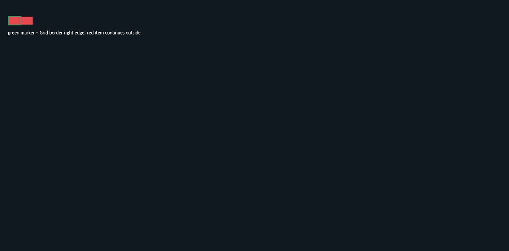

# C11.1 `fit-content(%)` root-border overflow control

## 독립 기대값

고정 fixture는 content width 30px인 Grid에 `fit-content(200%)` column과 width 60px인 child를 둔다. CSS Grid §7.2.1의 `max(auto minimum, min(limit, max-content))`에서 percentage limit은 `30 × 2 = 60px`이고, 고정 child의 60px contribution과 함께 used track은 60px이다. Grid border box는 `[20, 40, 34, 24]`, child는 `[22, 42, 60, 20]`이므로 Grid border의 오른쪽 edge `x=54`를 넘어 `x=82`까지 28px이 보인다. 이 계산을 Chrome 관찰 전에 `expected.json`에 기록했다.

## Agent Browser 관찰

Headless Chrome 156.0.0.0, Agent Browser CLI 0.31.1, viewport 1280×633 CSS px, DPR 1에서 computed columns `60px`, rows `20px`를 관찰했다. Root/child frame과 28px overflow는 독립 기대값과 일치한다. `chrome-observation.json`을 보존했다. PNG의 `(30,50)`은 item red, `(53,50)`은 표시한 root border marker green, `(60,50)`은 root 바깥 item red, `(85,50)`은 배경색이다.

## 범위와 한계

이는 Chrome 기준 관찰과 고정 크기 geometry 대조다. Spinon layout/runtime이나 Android/iOS surface 동작을 검증하지 않는다. 일반 CSS 지원, indefinite axis, implicit tracks, named areas, WPT 적합성은 다루지 않는다.
