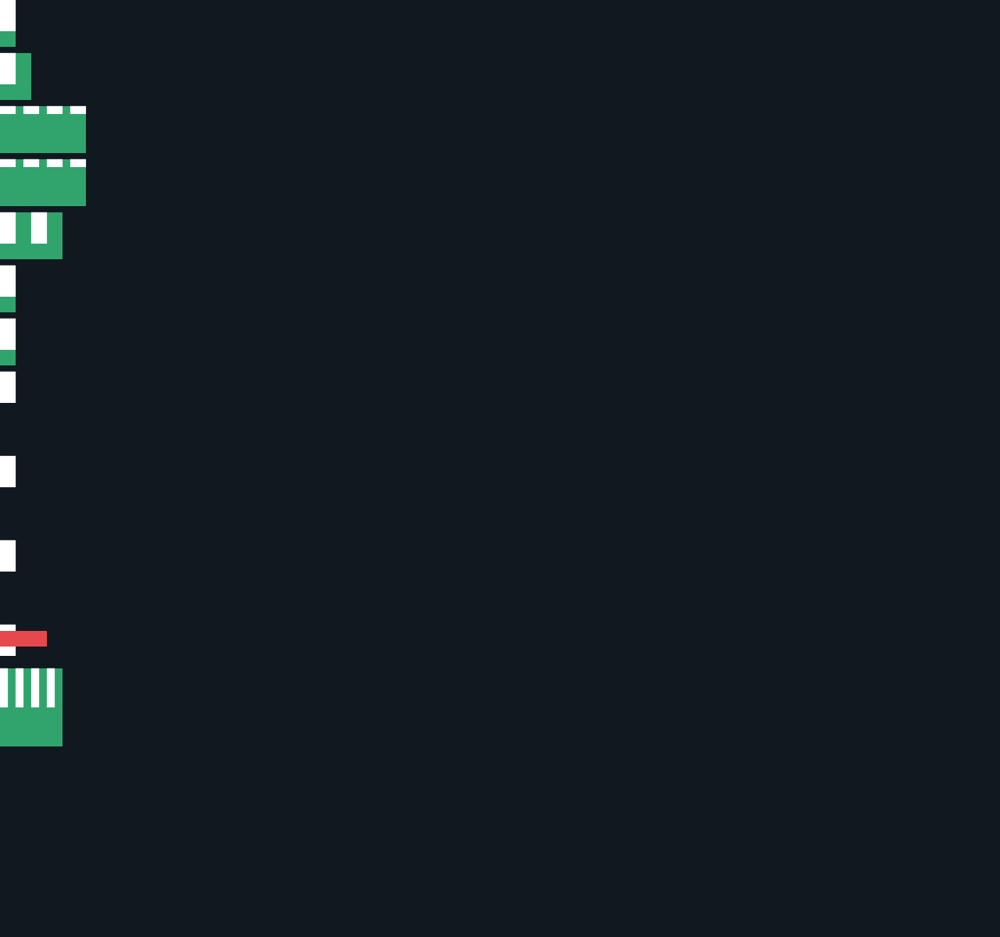

# C11.1 parsed Root HTML `fit-content(percentage)` 사전 비교

## 고정 입력과 독립 기대값

- 고정 HTML fixture: `root-html-grid-fit-content-percentage-precomparison.html`
- 규범식에서 먼저 계산한 기대값: `expected.json`
- Chrome 관찰값: `chrome-observation.json`

CSS Grid Layout Module Level 1, 2025-03-26 CRD §7.2.1의 `fit-content()` 계산은 `max(auto minimum, min(limit, max-content contribution))`이다. Ahem의 `AA AA AA AA`를 고정해 min-content/max-content 너비 20px/110px, 20px 컨테이너에서의 min-content 높이 40px을 독립 probe로 측정한다. Chrome 값은 이 계산의 대조 관찰값이며 기대값을 생성하는 출처로 쓰지 않았다.

고정 너비 200px Grid에서 `0%`, `5%`, `20%`, `60%`, `120%` cap은 각각 0px, 10px, 40px, 120px, 240px이다. 그 결과 track은 각각 20px minimum floor, 20px minimum floor, 40px cap, 110px max-content, 110px max-content가 된다. `repeat(2, fit-content(20%))`는 `[40px, 40px]`을 낸다. definite zero-width axis의 `100%` cap과 definite-width `0%` cap은 모두 0px로 계산되지만 text min-content floor 20px을 유지한다. definite 100px block axis의 row `0%`/`20%`/`120%` cap은 각각 0px/20px/120px이며, 모두 40px row minimum을 유지한다. definite zero-height row axis의 `100%` cap은 0px로 계산되며, 40px row minimum을 유지한다. 이 row 장면에서 computed used track은 floor에 의해 동일하므로 cap 비교는 규범식의 independent resolved-cap 계산과 분리해 기록한다. 별도 160px fixed-item scene은 40px cap 아래에서도 item의 60px specified-size minimum 때문에 track 60px을 유지한다. root width 320px과 20개의 Ahem word를 쓰는 text scene은 80px cap, 10px minimum contribution, 390px max-content contribution으로 track 80px을 확인한다.

독립 기대값은 Chrome 관찰 전에 작성했다. Chrome 156 Agent Browser의 13개 장면 측정은 독립 track·item 기대값과 CSS 0.02px 이내로 일치했다. Ahem font load는 완료됐고 viewport는 1280×1200, DPR 1이다. fixture SHA-256은 `8c6c49321271deec1a0d9cd8246a1f7f0c0b9bcd07a0563ef1dbbd289a384aed`, Ahem font SHA-256은 `b719ecb31c5b21fc573c03f6421c74ac63c271a5a3ff841e34f9705fb94b8448`, screenshot SHA-256은 `3309293bb176a550590f36293d0e7f5262f58dc1f20ec0bd4f84a550736a835c`이다.

## 범위와 한계

이 자료는 browser reference와 명세 기반 입력 계산만 고정한다. Spinon implementation, Android/iOS runtime, WPT conformance 또는 일반 CSS admission을 검증하지 않는다. 계획과 구현은 parsed Root HTML 기본 route의 definite axis, direct `<percentage>` 인자인 explicit `fit-content()` track만 다루고, Chrome 결과만으로 구현 지원을 주장하지 않는다.
