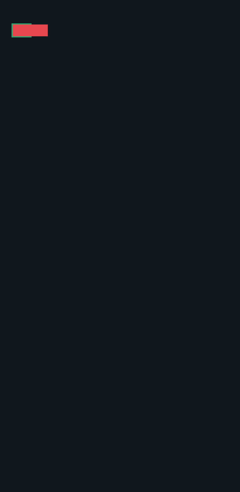
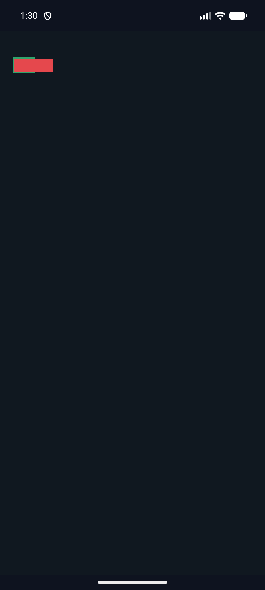
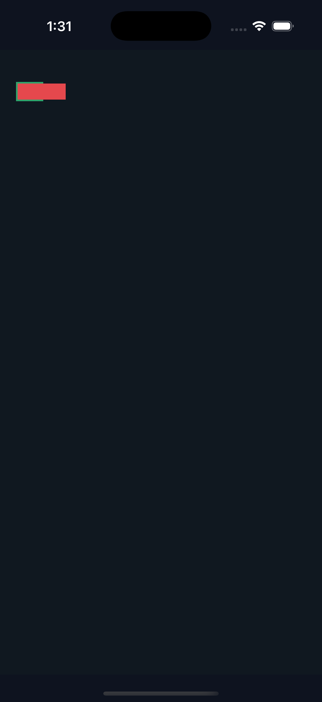
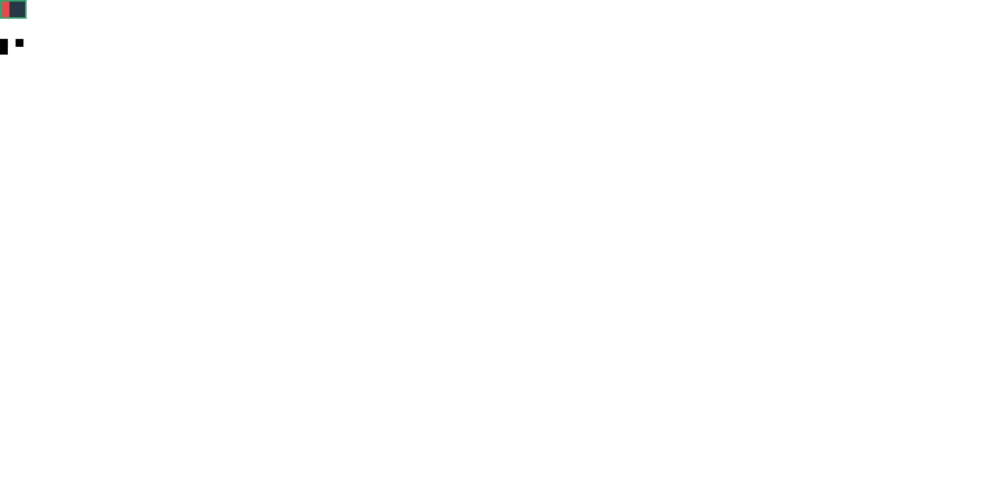

# C11.1 parsed Root HTML `fit-content(percentage)` 시뮬레이터 근거

## 결과

같은 parsed Root HTML overflow fixture에서 Android와 iOS 표면 픽셀 표본 4개가 모두 기대 색상과 일치했다.

- Android API 37.0 ARM64 AVD `spinon_c114_cyclic_image_span_20261023`: PixelCopy 4/4.
- iPhone 17 Pro, iOS 26.2 Simulator: Metal drawable 4/4. 표본은 compositor 제출 전이다.

장면은 content box 30×20 CSS px, `fit-content(200%)`, 2px 녹색 테두리, 60×20 CSS px 자식으로 구성했다. Runtime geometry는 root border box `(20, 40, 34, 24)`, 자식 `(22, 42, 60, 20)`이다. 표본은 root 내부, 자식이 덮지 않는 테두리, root 바깥의 자식, 자식 바깥 배경을 포함한다. 좌표와 색상은 [expected.json](expected.json)에 고정했다.

이 제한 구현은 기존 `RootHtmlFitContentV1` layout gate를 따르므로 column/row 중 한 축만 percentage여도 두 Grid content dimension이 모두 definite해야 한다. percentage가 없는 반대 축의 `auto` size는 아직 지원하지 않는다.

Android 앱은 `SPINON_ROOT_HTML_DEFAULT_APP_ROUTE`와 `index.html`로 parsed Root HTML 기본 경로를 실행했다. 캡처에 사용한 임시 DOM probe는 [root-app-probe.js](root-app-probe.js), fixture는 [root-html-grid-fit-content-percentage-overflow-runtime.html](../../../../tests/fixtures/css/c11/root-html-grid-fit-content-percentage-overflow-runtime.html)이다.

## Chrome 156 비교 기준

### 120% cap과 definite available space

[Ahem 비교 장면](chrome-over-100-cap.html)은 definite 50px content width, `fit-content(120%)`, min-content 20px, max-content 110px을 사용한다. CSS Grid 식으로 cap은 60px이지만 Chrome 156은 used track 50px을 반환했다. definite Grid의 available space가 50px이므로 track이 이를 넘지 않는 결과다. 이 layout 검사는 공유 `TrackSizing` 알고리즘을 비교하고, parsed Root HTML cascade·projection 검사는 `120%` typed 값을 별도로 보존하는지 확인한다. [관찰 JSON](chrome-over-100-cap-observation.json) · [화면](chrome-over-100-cap.png).

### 테두리가 있는 Grid의 content-box basis

[추가 Ahem 비교 장면](chrome-content-box-percentage-basis.html)은 `content-box` width 30px, 양쪽 2px 테두리, `fit-content(50%)`, min-content 10px, max-content 30px을 사용한다. content box 기준 cap은 15px이고 border box를 잘못 기준 삼으면 17px이다. Agent Browser의 Chrome 156 관찰값은 used track 15px, item 15px로 content-box basis를 구별한다. [관찰 JSON](chrome-content-box-percentage-basis-observation.json) · [화면](chrome-content-box-percentage-basis.png).

같은 30px content box, 2px border, Ahem min/max 10px/30px 조건을 공유 `TrackSizing` layout test에도 적용했다. Spinon used track은 15px이다. Ahem sizing 검사는 공유 track algorithm을 비교하고, parsed Root HTML cascade/projection/runtime 검사는 별도로 제한 profile admission과 typed percentage를 확인한다.

두 비교 장면의 규범 기준은 [CSS Grid Layout Module Level 1, §§7.2.1, 11.2, 11.6](https://www.w3.org/TR/2025/CRD-css-grid-1-20250326/)이다.

## 캡처

Android PixelCopy:

Android 전체 시뮬레이터 화면:

iOS 전체 시뮬레이터 화면:

Chrome 156, 120% cap 비교:

Chrome 156, 테두리와 content-box basis 비교:

## 빌드와 소스 식별

두 플랫폼 빌드는 C04 runtime GPU, C04 runtime fixture route, C11 Grid Metal surface pixel capture 옵션을 켜서 성공했다. [source-revision.json](source-revision.json)에 기준 HEAD, 대상, run ID, APK와 executable hash를 기록했다. 빌드 및 표본 로그를 보존했으며, 원본 iOS xcodebuild 로그는 trailing whitespace를 그대로 유지하도록 [gzip 압축](ios-build.log.gz)했다.

최종 focused Rust gate의 원본 로그:

- [percentage layout 12/12](layout-focused-tests.log) 및 [Grid fit-content 회귀 20/20](layout-fit-content-regressions.log)
- [cascade 4/4](cascade-focused-tests.log), [style-to-layout fit-content 7/7](projection-focused-tests.log), [Root HTML runtime 3/3](runtime-focused-tests.log)
- [style-render 기본 71 passed·1 ignored](style-render-focused-tests.log), [C11.4 fixture mode 74 passed·1 ignored](style-render-c114-fixture-tests.log)
- [rustfmt](rustfmt.log), [변경 crate Clippy](clippy-scoped.log), [C11.4 fixture mode Clippy](clippy-style-render-c114.log)

## 검토

- [구현/runtime 실패 관점 검토 20개](implementation-runtime-review-20.md)
- [사용자 요청 PR diff 검토 20개](pr-diff-review-user-20.md) 및 [프로젝트 필수 PR diff 검토 30개](pr-diff-review-required-30.md). 실제 diff에서 수정이 필요한 결함은 발견하지 않았다.
- PR #1106 GitHub check rollup은 비어 있고 `main` required status checks는 설정되지 않았다. CI 통과로 간주하지 않는다.

첫 진단 시도의 route 및 표본 좌표 오류는 [진단 evidence](../c11-root-html-grid-fit-content-percentage-runtime-2026-11-03/README.md)에 남겼다. 이 실행에서는 parsed Root HTML 앱 경로를 사용하고 노출된 테두리를 표본화했다.

## 한계

Android는 hardware GPU나 실기기가 아닌 software-rendered AVD다. iOS 표본은 compositor 제출 전 Metal drawable에서 읽었다. 이 근거는 한 고정 overflow 장면만 다루며 전체 C11 완료, 일반 Grid 지원, WPT 적합성 또는 public CSS admission을 증명하지 않는다.
