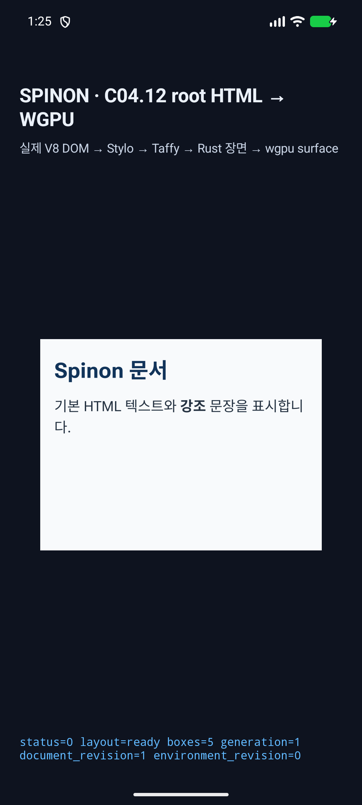
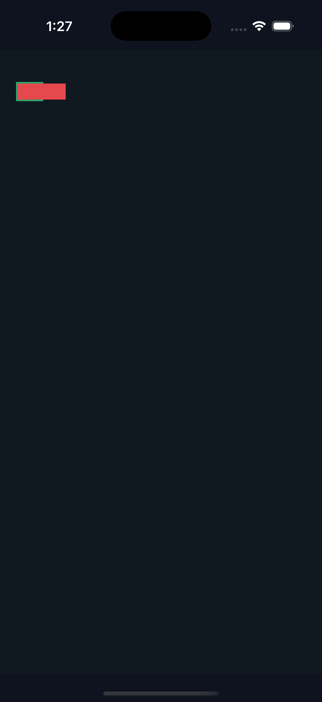

# C11.1 Root HTML percentage `fit-content()` 첫 캡처 진단

이 디렉터리의 첫 Android/iOS 결과는 최종 검증으로 사용하지 않는다. 원본 화면과 로그를 남겨 실패 원인을 추적할 수 있게 했다.

## Android

실행 인자에 `spinon_c0412_root_html_default_render=true`가 들어가 C04.12 demo route가 선택됐다. 이 때문에 parsed Root HTML 기본 앱 route가 실행되지 않았고 PixelCopy 요청도 전달되지 않았다. [실행 명령과 PixelCopy 로그](android-pixelcopy.log) · [앱 빌드 로그](android-build.log) · [원본 iOS 빌드 로그](ios-build.log.gz).

## iOS

Metal readback은 4개 중 3개 표본이 맞았고 `percentage-root-border` 표본 하나가 실패했다. 좌표 `(160,151)`은 3x scale에서 CSS `(53.3,50.3)`이며 overflowing child 아래에 있다. 해당 픽셀은 child의 빨간색으로 덮이는 것이 맞으므로 녹색 border 표본으로 사용할 수 없었다. 후속 실행은 child가 덮지 않는 border x=21 CSS px을 표본화했다. [표본 로그](ios-metal-pixel.log) · [원본 빌드 로그](ios-build.log.gz).

이 실패 산출물은 진단 근거다. 수정 실행의 4/4 표면 표본과 화면은 [pass02 evidence](../c11-root-html-grid-fit-content-percentage-runtime-2026-11-03-pass02/README.md)에 있다.

## 첫 시도 화면

