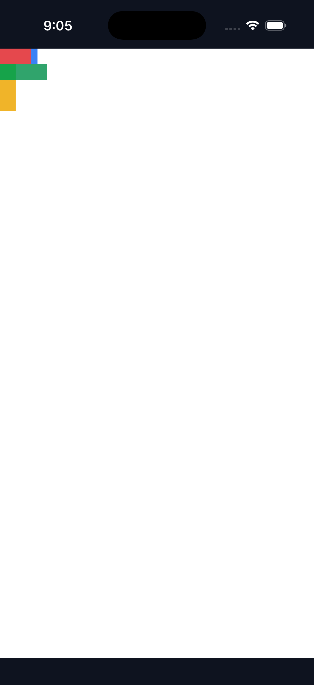

# C11.1 Root HTML `fit-content(px)` runtime candidate

2026-11-03 기준 구현 후보 근거다. parsed Root HTML 기본 runtime에서 explicit columns/rows의 finite non-negative px `fit-content()`와 이에 맞는 named-area track 조합을 제한적으로 허용한다. CSS Grid 전체, implicit `fit-content()`, percentage/calc limit, WPT 적합성 또는 C11 완료 근거가 아니다. 공식 `spec/STATUS.md`의 72/213과 C11 체크 상태를 승격하지 않는다.

## 검증 결과

- `cargo fmt --all -- --check`, `git diff --check`: 통과.
- Focused Rust tests: **223 passed, 0 failed**. Layout Ahem sizing 3, layout percentage rejection 1, style cascade fit-content 3, existing style Grid 95, style-to-layout Root HTML 52, runtime Root HTML 69. Runtime fit-content 4개 테스트는 마지막 69개 집계 안에 포함된다.
- `cargo clippy --locked -p spinon-runtime -p spinon-layout -p spinon-style-to-layout -p spinon-style --all-targets -- -D warnings`: 통과.
- 구현/runtime 실패 관점 검토 20개: [implementation-review-20.md](./implementation-review-20.md). PR 실제 diff의 별도 30개 검토는 아직 하지 않았다.

로그는 [layout Ahem](./layout-ahem-final.log), [layout 거부](./layout-fit-content-rejection-final.log), [cascade](./style-cascade-fit-content-final.log), [style Grid 회귀](./style-grid-final.log), [projection](./style-to-layout-root-html-tests.log), [runtime 후보](./runtime-fit-content-final.log), [Root HTML runtime 회귀](./runtime-root-html-tests.log), [Clippy](./scoped-clippy.log)에 있다.

## Android API 37 AVD

`emulator-5556`, Android 17 / API 37, ARM64 AVD. 기본 Root HTML route에서 `layout=ready`, `boxes=10`, draw/present boxes 10을 확인했다. renderer는 ANGLE/Vulkan/SwiftShader software 경로다. surface는 1080×2209, density 2.625, CSS viewport 411×842다. APK SHA-256은 `b22e9115c4809e35062441d8e394b95b3d69a1a643ec843c2bb2879903ee63d1`이다.

PixelCopy는 7/7 exact였다. CSS 표본과 surface pixel 위치는 다음과 같다.

| Scene sample | CSS point | PixelCopy point | RGBA |
|---|---:|---:|---|
| direct track 안쪽 | (25, 10) | (67, 27) | 229, 72, 77, 255 |
| direct track overflow | (35, 10) | (93, 27) | 229, 72, 77, 255 |
| direct marker | (42, 10) | (111, 27) | 59, 130, 246, 255 |
| named area 안쪽 | (25, 30) | (67, 80) | 48, 164, 108, 255 |
| named area overflow | (35, 30) | (93, 80) | 48, 164, 108, 255 |
| row 안쪽 | (10, 50) | (27, 132) | 240, 180, 41, 255 |
| row overflow | (10, 65) | (27, 171) | 240, 180, 41, 255 |

[PixelCopy scene](./android-api37-avd-fit-content-pixelcopy-final-pass01.png) · [전체 기기 화면](./android-api37-avd-fit-content-pixelcopy-screen-final-pass01.png) · [7/7 log](./android-api37-avd-fit-content-pixelcopy-final-pass01.log)

PixelCopy PNG SHA-256: `aa21098bb4a746428ec70b3390a258999379dac3b99ee0b1895b451e49464474`. 화면 캡처 SHA-256: `6fe5fb2cbf4e83b53b1e3bae0c07e559e12e14f5574605e9fee049655a54a853`.

## iOS Simulator

iPhone 17 Pro / iOS 26.2 Simulator, UDID `9DCCE836-7659-4914-B6C1-13F54BFFA9DB`, Metal renderer. CSS viewport 402×778, drawable 1206×2334, scale 3.0. 기본 Root HTML route `layout=ready`, `boxes=10`; Metal drawable 표본은 compositor 제출 전 **7/7 RGBA exact**다. 앱은 캡처 뒤 종료했다. 앱 실행 파일 SHA-256은 `f62a510525ee15c05715738fdf78a5cf030053dbdcd71eff3570b8c703e520cd`다.

[Metal 7/7 log](./ios-26_2-simulator-fit-content-metal-pixel-final-pass01.log) · [전체 기기 화면](./ios-26_2-simulator-fit-content-screen-final-pass01.png) · [Simulator build log](./ios-simulator-build-final-pass01.log)

화면 캡처 SHA-256: `ab833def8d8fc7c7e862da141bc23ca0159a03d2d8e675e578daf7f5d80dfe51`.

## 재현 입력과 한계

- HTML fixture SHA-256: `55fcb7760ced29a4ac749a822db57e61430854f7cab3cc9254b8eeb9bddbb040`.
- Root app runtime probe SHA-256: `c2178682381cda7527057fa45f1afd70ffe11134db12045c2b1c37cd2c732de7`.
- 임시 bootstrap 입력은 캡처 후 원본 hash `index.html=e7ecee32a5c5f645cc90ea7bd0c524caaf9da93fd4c780ff9dbb29d0894dd3b9`, `root-app.js=b87b53883ce838df86412657e1353f8dc90435049eb8ead6ba8fa478ca8a1c32`로 복원했다.
- 사용한 Android/iOS 빌드에는 C04 runtime과 C11 표면 capture test flag를 opt-in 했다. AVD는 실기기 GPU 증거가 아니며 SwiftShader software renderer다. iOS Metal 표본은 compositor 제출 이전이다. Android/iOS 실기기 근거는 이 후보에서 수집하지 않았다.
- Checkout HEAD와 입력 hash 목록은 [source-files.sha256](./source-files.sha256), 빌드 및 캡처 artifact hash는 [artifact-hashes.sha256](./artifact-hashes.sha256)에 고정한다.
