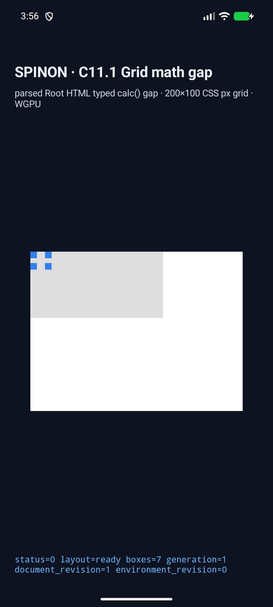
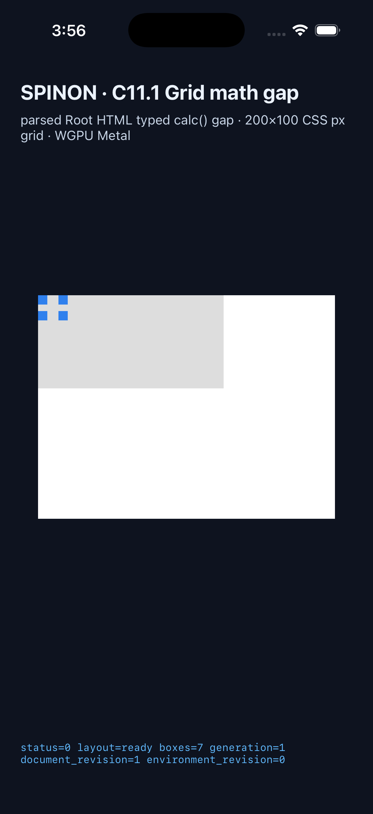

# C11 parsed Root HTML Grid typed math gap 사전 비교

## 기준과 입력

- 규범 기준은 [CSS Gaps Level 1](https://www.w3.org/TR/css-gaps-1/) §2.1–2.4다. `row-gap`/`column-gap`은 `[0,∞]` 범위의 `<length-percentage>`를 받으며, percentage는 대응하는 content-box 축을 기준으로 한다. `gap`은 두 longhand의 shorthand이고 `grid-gap`은 legacy alias다.
- 계산 범위 기준은 [CSS Values and Units Level 4](https://www.w3.org/TR/css-values-4/) §10.9–10.12다. 계산 결과는 해당 속성의 허용 범위로 computed/used value에서 clamp한다. 음수 gap 계산값은 0으로 제한하고 NaN도 0으로 censor한다. 양의 무한대는 UA의 유한 숫자 상한으로 제한된다.
- 브라우저 oracle은 Agent Browser 0.31.1, `HeadlessChrome/156.0.0.0`이다. 세션은 비교 뒤 닫았고 종료 확인에서 browser session은 0개였다.
- HTML 입력 [`grid-math-gap-v1.html`](../../../../tests/fixtures/css/c11/grid-math-gap-v1.html)의 SHA-256은 `14fa0bf2cad3a9d3c0ed07b4079f5e436a8db62ba49b6ed11086d6882970140c`이다.
- Chrome 관측 JSON SHA-256은 `5f7233ddc80f0106068f3ab919a3c2fc608057bb80b39a4df386a65dafa8b7c4`이고 화면 SHA-256은 `4722cd993b21871e500e67b726f0b7e497e8e6c3eb51a544d3510161d7a88f88`이다. 원본은 [관측 JSON](./chrome156-observation.json)과 [화면](./chrome156-precomparison.png)이다.

## 제품 runtime 단일 Grid 입력

위 19 scene HTML은 여러 Grid와 named-area scene을 묶은 브라우저 oracle이다. 제품 named-area route는 한 화면의 visible Grid 하나만 받으므로 이 묶음 fixture 전체를 앱 입력으로 쓰지 않는다. Android/iOS에서 같은 제품 입력을 실행할 수 있도록 별도 [단일 Grid runtime fixture](../../../../tests/fixtures/css/c11/grid-math-gap-runtime-v1.html)를 둔다.

- runtime fixture SHA-256: `e355b0a9bedf04de1e97538e939e0bad48e46395849d0ff39b2fb0f5ff7033c0`
- 같은 fixture의 Chrome 156 observation SHA-256: `80ec1a2c65fe93b624245bfaec8ef72c9bf9d24af46d46c0937bb6e617626393`
- Chrome 화면 SHA-256: `ce5c5e05cdca0ec8529af462716c090b638b4ed172449040f40d176b85fa581e`
- 독립 기대값: root 200×100px, row/column gap 7/12px, item frames `[0,0,10,10]`, `[22,0,10,10]`, `[0,17,10,10]`, `[22,17,10,10]`.
- 원본은 [runtime Chrome observation](./chrome156-runtime-observation.json)과 [화면](./chrome156-runtime-fixture.png)이다. Simulator run은 이 단일 fixture hash를 Android와 iOS 양쪽에 그대로 공급한다.
- 관측은 CSS 계산 결과와 Chrome의 사용값/프레임을 담는다. 아래 독립 기대값은 규범식에 입력한 definite content-box 치수와 Grid track geometry로 따로 계산했다.

## 독립 기대값과 Chrome 관측

각 item은 10×10px이고 padding, border, alignment-added spacing이 없다. 기본 열 배치는 두 10px 열이며 `column-gap` 사용값이 item 간 x 차이에서 직접 분리된다.

| 장면 | 독립 계산 | Chrome 156 관측 |
|---|---|---|
| `calc-mixed-column` | `5% × 200 + 2 = 12px`; 둘째 item x=22 | `calc(5% + 2px)`, x=22 |
| `calc-mixed-row` | `10% × 100 + 2 = 12px`; 둘째 row y=22 | `calc(10% + 2px)`, y=22 |
| `calc-absolute` | `5 + 7 = 12px`; 둘째 item x=22 | computed `12px`, x=22 |
| `calc-min` | `min(30, 20) = 20px`; 둘째 item x=30 | `min(15%, 20px)`, x=30 |
| `calc-max` | `max(30, 20) = 30px`; 둘째 item x=40 | `max(15%, 20px)`, x=40 |
| `calc-clamp` | `clamp(5, 12, 20) = 12px`; 둘째 item x=22 | `clamp(5px, 5% + 2px, 20px)`, x=22 |
| `calc-clamp-min-wins` | `clamp(30, 7, 10)`은 min > max일 때 min 우선; gap 30px, 둘째 item x=40 | `clamp(30px, 5% + 2px, 10px)`, x=40 |
| `calc-product` | `5% × 2 × 200 = 20px`; 둘째 item x=30 | computed `10%`, x=30 |
| `calc-divide` | `24 / 2 = 12px`; 둘째 item x=22 | computed `12px`, x=22 |
| `calc-zero-basis` | `75% × 0 + 2 = 2px`; 두 zero-width item x=0/2 | `calc(75% + 2px)`, item x=0/2 |
| `calc-negative` | `2 − 5% × 100 = −3px`, range-check 후 0px; 둘째 item x=10 | computed `calc(-5% + 2px)`, 둘째 item x=10 |
| `calc-over-100` | `120% × 100 + 1 = 121px`; 둘째 item x=131, scroll width 141 | `calc(120% + 1px)`, x=131, scroll width 141 |
| `calc-infinity` | `1px / 0`은 양의 무한대이며 UA 숫자 상한으로 제한된다. 이 extreme case는 정상 크기 geometry 기대에 합치지 않고 finite-output/range stress로만 사용한다. | computed `3.35544e+07px`; track `[3.98438, 0]`, 둘째 item x=33,554,432. Chrome layout 좌표 상한의 영향을 기록한다. |
| `calc-nan` | `0px / 0`은 NaN이며 top-level gap 결과가 0px로 censor된다. 둘째 item x=10 | computed `0px`, x=10 |
| `calc-implicit-row` | row gap `5% × 100 + 2 = 7px`; tracks `[20,25]`, implicit row y=27 | computed math gap, tracks `20px 25px`, y=27 |
| `calc-column-flow` | column gap 12px; 50% implicit column 100px; next column x=52 | computed math gap, tracks `40px 100px`, x=52 |
| `calc-named-area` | column/row gaps 8/5.5px; spanning header width 128px; lower items y=25.5, second column x=48 | computed math gaps, header width 128, lower items y=25.5, x=48 |
| `calc-shorthand` | row/column gaps 7/12px; item origins `(0,0)`, `(22,0)`, `(0,17)`, `(22,17)` | both computed longhands retain `calc(5% + 2px)`; frames match |
| `calc-legacy-alias` | `grid-gap` must match the shorthand geometry above | computed longhands and frames match `calc-shorthand` |

Chrome와 독립값은 정상 범위 17개 geometry case에서 일치한다. `calc-infinity`/`calc-nan`은 수치 경계 관측이며, 무한대 case의 clipped track geometry는 normal-range equality 주장에 포함하지 않는다. 이 비교는 parsed Root HTML Grid의 해당 definite-size geometry만 다루며 cyclic/indefinite percentage resolution, arbitrary CSS admission, WPT 전체 적합성, 앱 표면 픽셀 동등성은 증명하지 않는다.

## 구현 전 현황

이 비교를 고정한 source revision은 `085ec179a884ffe93404c432c2892d2ddb1a2b41`이다. 기존 parsed Root HTML Grid는 px/percentage/normal gap을 지원하지만 `layout_math_values`에 math-backed `row-gap`/`column-gap`이 있으면 projection에서 거부한다. 일반 `LayoutCssMath` evaluator와 Flex math gap 경로는 별도로 존재하므로, Root HTML 범위에서만 기존 node/property-bound typed math를 사용할 계획이다. 이 문서는 oracle과 계획 입력이며 구현 완료 근거가 아니다.

## 구현 candidate 실행

- 후보는 같은 저장소 checkout의 branch `feat/c11-root-html-grid-math-gap`, base `88b4001949fca480ff70dc75000f52d0c13063e6`에서 검증했다. 소스 변경 diff SHA-256은 `d7b13cc51b577f917765114798d5f80e45d2ca41f7cd40f14638dcfa95738a54`다. worktree는 만들지 않았다.
- Runtime fixture는 위의 tracked `grid-math-gap-runtime-v1.html`이며 SHA-256 `e355b0a9bedf04de1e97538e939e0bad48e46395849d0ff39b2fb0f5ff7033c0`이다. 앱 실행에는 기존 opt-in `c11-1-root-html-percent-columns-fixture-test` host를 재사용했다. capture build 동안만 host의 `include_str!` 입력을 이 fixture로 연결하고 screenshot caption을 `Grid math gap · 200×100 CSS px`로 바꿨다. build 뒤 `host.rs`, Android Java, iOS Swift 세 파일 모두 base와 diff가 없는지 확인했다. 앱 캡션 변경은 candidate source에 포함되지 않는다.
- Android는 `emulator-5558`, API 37, `sdk_gphone16k_arm64` AVD에서 실행했다. 사용한 APK SHA-256은 `0a9bbe46cad6eb641d469dd5ec376b3911063a9dcd8b164871c28a91282b5d9a`이다. Renderer는 기존 ANGLE/Vulkan/SwiftShader software path이고 Android 실기기는 사용하지 않았다. [`Android 화면`](./android-avd-screen-labeled.png), [install](./android-avd-labeled-install.log), [launch](./android-avd-labeled-launch.log), [process-filtered runtime log](./android-avd-labeled-runtime.log), [app build](./android-avd-labeled-apk-build.log), [native build](./android-avd-labeled-build.log).
- iOS는 booted iPhone 17 Pro / iOS 26.2 Simulator `ACA7BF91-E2D5-4CF7-909A-08D1AD95FF3D`에서 실행했다. executable SHA-256은 `b85a51c09b8a5b72aa836ea71245685d1ae6d3d964b14ca09dc0c7c848c2afe4`이다. [`iOS 화면`](./ios-simulator-screen-labeled.png), [install](./ios-simulator-labeled-install.log), [launch](./ios-simulator-labeled-launch.log), [runtime log](./ios-simulator-labeled-runtime.log), [build log](./ios-simulator-labeled-build.log). iOS screenshot은 Metal draw/present 화면 관찰이며 compositor 이후 pixel readback은 아니다.
- 양쪽에서 `layout=ready boxes=7`, grid `200×100`, item origins `(0,0)`, `(22,0)`, `(0,17)`, `(22,17)`을 기록했다. Android root width는 121.90476 CSS px, iOS root width는 106.666664 CSS px로 grid가 부모 root보다 넓다. 화면은 gray grid와 4개 item을 보여주며 parent/grid frame의 차이는 runtime log로 확인한다. 이는 시각 smoke이며 PixelCopy/Metal RGBA 표본의 정확성 주장이 아니다.
- 최종 `cargo test --locked -p spinon-style-to-layout c11_1_root_html_percentage_gap_tests`는 8/8, `cargo test --locked -p spinon-layout grid::root_html_gap::tests`는 3/3 통과했다. 전체 변경 패키지 재실행은 [회귀 기록](./package-test-note.md)에 연결했다. Scoped Clippy와 workspace format check도 통과했다.
- 최종 candidate code/runtime 독립 실패 관점 20개는 [구현·runtime 검토](./implementation-runtime-review-20-2026-11-03.md)에 기록했다. plan PR의 30개 diff review와는 별도 검토다. 구현 PR 자체의 diff review 30개는 해당 PR diff 생성 후 별도로 수행한다.
- `ps` 검사에서는 Agent Browser와 terminal-browser 프로세스를 찾지 못했다. 이번 최종 화면 캡처는 native simulator screenshot이며 browser process를 시작하지 않았다.

### Simulator screenshot

| Android API 37 AVD | iPhone 17 Pro / iOS 26.2 Simulator |
|---|---|
|  |  |

현재 링크된 screenshot에는 fixture와 일치하는 caption이 있다. 앞선 pass의 `android-avd-screen.png`/`ios-simulator-screen.png`는 runner의 기존 정적 `300×63 column-flow` caption이 표시되어, 수정된 labeled capture가 최종 visual evidence다.
