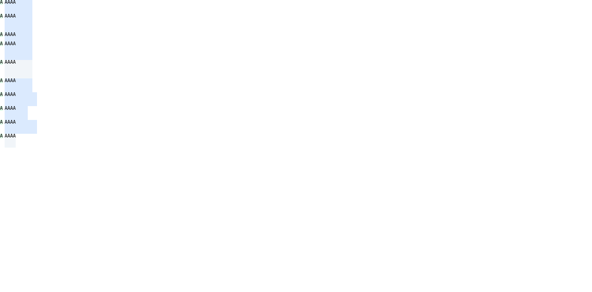

# 기본 Root HTML Grid direct-text `aspect-ratio` min/max 사전 비교

## 입력과 환경

- Chrome: Agent Browser의 HeadlessChrome `156.0.0.0`, macOS, viewport `1280×633 CSS px`.
- Fixture: [`fixture.html`](./fixture.html)이며 저장소 입력은 [`root-html-grid-direct-text-aspect-ratio-min-max-precomparison.html`](../../../../tests/fixtures/css/c11/root-html-grid-direct-text-aspect-ratio-min-max-precomparison.html)이다. 두 파일은 같은 SHA-256이다.
- `document.fonts.check('10px monospace')`는 `true`였다. `AAAA`의 intrinsic width control은 `24.09375px`다.
- Root는 `70px` 폭, `[10px,60px]` 두 explicit column, 단일 `auto` row, zero gap, row sparse flow다. 각 Grid에는 direct text item `A`와 `AAAA`가 하나씩 있다.

## 독립 기대값과 Chrome 관측

기대값은 고정 ratio 전이 뒤 해당 축의 직접 px `min`/`max` clamp를 적용하고, `min > max`이면 `min`이 우선한다는 계산으로 만들었다. 기준은 [CSS Grid Layout 2025 CRD §6.2](https://www.w3.org/TR/2025/CRD-css-grid-1-20250326/#grid-item-sizing)와 [CSS Sizing Level 4 2026 WD §4.2](https://www.w3.org/TR/2026/WD-css-sizing-4-20260904/#automatic-sizes)다. 두 문서는 각각 Candidate Recommendation Draft와 Working Draft이며, 이 행렬은 이 고정 입력의 관측·기대 비교이지 일반 CSS 적합성 판정이 아니다.

| 장면 | 직접 기대 item frame (CSS px) | Chrome frame | 판정 |
|---|---|---|---|
| `width-ratio-baseline` | `60×30` | `60×30` | 일치 |
| `width-ratio-min-height` | `60×40` | `60×40` | min-height가 row와 item height 증가 |
| `width-ratio-max-height` | `60×20` | `60×20` | max-height가 ratio 전이 높이를 제한 |
| `width-ratio-minmax-height` | `60×40` | `60×40` | min-height가 더 작은 max-height보다 우선 |
| `width-control-min-height` | `60×40` | `60×40` | ratio 없는 축약 대조 |
| `height-ratio-baseline` | `60×30` | `60×30` | 일치 |
| `height-ratio-min-width` | `70×30` | `70×30` | min-width가 fixed track 바깥으로 10px 넘침 |
| `height-ratio-max-width` | `50×30` | `50×30` | max-width가 ratio 전이 폭을 제한 |
| `height-ratio-minmax-width` | `70×30` | `70×30` | min-width가 더 작은 max-width보다 우선 |
| `height-control-max-width` | `24.09375×30` | `24.09375×30` | ratio 없는 intrinsic-size 대조 |

DOMRect, computed track list, aspect ratio와 min/max computed values는 [`chrome-observation.json`](./chrome-observation.json)에 있고 독립값은 [`expected-values.json`](./expected-values.json)에 있다. [`comparison.json`](./comparison.json)은 10개 장면의 geometry와 track list가 정확히 일치함을 기록한다.

화면은 browser layout을 확인하는 시각 자료다. 앱 runtime, GPU surface readback, glyph pixel 및 WPT 결과를 증명하지 않는다. 이 Agent Browser 세션은 닫았고 종료 확인 시 session은 inactive였으며 `agent-browser`/전용 `HeadlessChrome` 프로세스는 남지 않았다.

입력·관측·독립 기대값·비교 결과·화면 SHA-256은 [`SHA256SUMS`](./SHA256SUMS)에 고정한다.
