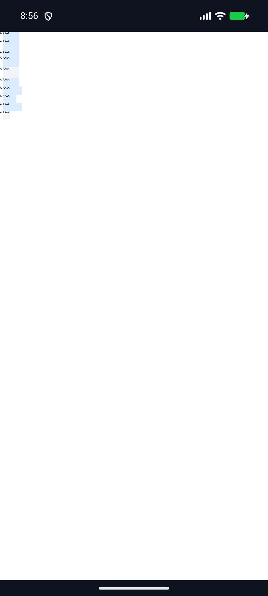
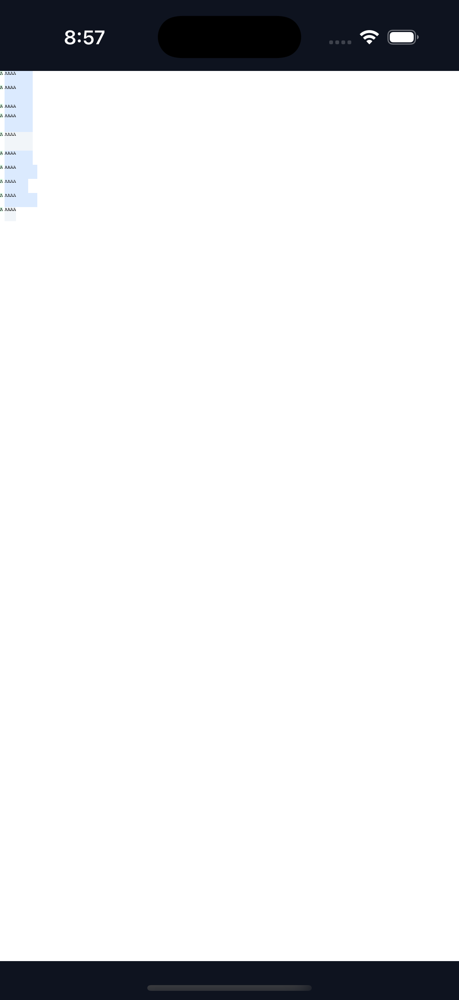

# C11.1 Root HTML `aspect-ratio` min/max 실행 근거

**상태:** C11.1의 좁은 기본 Root HTML 구현 slice다. C11.1/C11 완료나 일반 CSS Grid 지원으로 승격하지 않는다. 공식 완료 집계는 `78/214`로 유지한다.

## 기준과 구현 범위

[Chrome 156 Agent Browser 사전 비교](../c11-root-html-grid-text-aspect-ratio-min-max-precomparison-2026-11-05/README.md)의 10개 장면과 독립 기대값을 기준으로 한다. 비교 결과는 10/10 scene에서 target/root frame, computed min/max와 track list가 exact 일치했다. Android/iOS 앱에 포함된 fixture SHA-256은 두 플랫폼의 [artifact-hashes.txt](android/aspect-ratio-min-max/artifact-hashes.txt), [artifact-hashes.txt](ios/aspect-ratio-min-max/artifact-hashes.txt)에 기록된 `4ddb06ca0d0915215c7aa3ca9e6a49a39d558771325fed3603f3e7461ceaf08c`로 동일하다.

지원 범위는 기존의 정확한 두 direct text item, 고정 70px Grid, `[10px,60px]` columns, auto row와 numeric `2/1` target에 더해 target item의 finite direct px `0..=70px` min/max만 허용한다. owner와 첫 sibling은 기존 min/max 경계를 유지한다. CSS 문법 전체나 일반 Grid item constraint admission은 포함하지 않는다.

## Rust 및 빌드 검증

- Style projection bounded min/max: [1/1](style-minmax-focused.log)
- C11.1 ratio/minmax matrix와 fail-closed controls: [7/7](style-matrix.log)
- Layout ratio transfer regression: [1/1](layout-focused.log)
- 기본 Root HTML runtime 10-scene geometry: [1/1](runtime-focused.log)
- 변경 crate 범위 Clippy: [통과](clippy.log)
- `cargo fmt --all -- --check`: [통과](rustfmt.log)
- Android feature-enabled APK: [BUILD SUCCESSFUL](android/aspect-ratio-min-max/build.log)
- iOS Simulator feature-enabled app: [BUILD SUCCEEDED](ios/aspect-ratio-min-max/build.log)
- Android 기본 feature 경계 빌드: [BUILD SUCCESSFUL](android/default-feature-build.log); C04 runtime은 켜고 C04 fixture-test/C11 surface pixels는 끈 조합
- iOS 기본 feature 경계 빌드: [BUILD SUCCEEDED](ios/default-feature-build.log); C04 runtime은 켜고 C04 fixture-test/C11 Metal surface pixels는 끈 조합. 재현 명령은 [build command 기록](default-feature-build-commands.txt)에 있다.
- 변경분 `git diff --check`: 통과

두 feature-off 결과는 compile boundary 빌드이며 simulator 실행 결과는 아니다. 전체 workspace/package test suite를 모두 통과했다고 주장하지 않는다. 이 실행은 위 focused gate와 네 앱 빌드만 다룬다.

## Android API 37 ARM64 AVD

[기기 정보](android/aspect-ratio-min-max/device.json)는 API 37, `arm64-v8a`, emulator를 기록한다. 로그의 renderer는 ANGLE/Vulkan/SwiftShader software 경로다. 실기기 또는 hardware GPU 결과가 아니다. HTML에 viewport meta가 없으므로 Root HTML layout viewport `980×2004.4629`와 시각 viewport `411×842`가 다르다. PixelCopy 좌표는 layout viewport와 surface `1080×2209` 비율로 변환한다.

기본 Root HTML route에서 `layout=ready`, draw/present를 확인했다. PixelCopy는 CSS `(65,215)`, `(75,215)`, `(85,215)`를 읽었고 RGBA는 각각 `(219,234,254,255)`, `(219,234,254,255)`, `(255,255,255,255)`로 **3/3 exact**다. 두 번째 표본은 60px track 및 70px Grid 오른쪽 경계를 넘어선 70px item 내부다.

- [SurfaceView PixelCopy PNG](android/aspect-ratio-min-max/pixelcopy.png)
- [실행 로그](android/aspect-ratio-min-max/run.log)
- [APK·fixture·root-app hash](android/aspect-ratio-min-max/artifact-hashes.txt)

## iPhone 17 Pro / iOS 26.2 Simulator

[Simulator 정보](ios/aspect-ratio-min-max/device.json)와 실행 로그를 고정했다. Root HTML layout viewport는 `980×1896.617`, UIKit visible viewport는 `402×778`, Metal drawable은 `1206×2334`다. Metal sampling은 layout viewport를 drawable 비율에 맞춰 `1.2306123 px/CSS px`로 변환한다.

기본 Root HTML route에서 `layout=ready`, draw/present를 확인했다. Metal drawable 표본 `(80,265)`, `(92,265)`, `(105,265)`는 기대 RGBA와 **3/3 exact**로 일치했다. Readback은 OS compositor 제출 전이며 이후 화면 표시는 검증하지 않았다.

- [실행 및 Metal readback 로그](ios/aspect-ratio-min-max/run.log)
- [실행 파일·fixture·root-app hash](ios/aspect-ratio-min-max/artifact-hashes.txt)

## 실패한 시도와 보정

초기 Android 좌표 변환은 viewport meta가 없는 문서의 980px layout viewport 대신 411px visible viewport를 사용해 흰 영역을 읽었다. 그 과정에서 Java의 `Math.round(double)` 반환형을 `int`로 암시 대입한 빌드 오류도 발견했다. iOS 첫 readback 역시 402×778 visible viewport를 sampling 기준으로 사용했다. 모든 실패와 수정은 [시도 기록](failed-attempts.md)에 남겼고, 마지막 run `c11rmx-20261105-r3`에서 양 플랫폼 3/3 exact를 확인했다.

시뮬레이터 실행 후 Android/iOS 앱을 종료했고, `examples/bootstrap/index.html`과 `root-app.js`를 실행 전 SHA-256 값으로 복원했다. 스크립트는 해시를 실행 전후 확인한다.

## 실패 관점 검토

- [구현/runtime 실패 관점 20개](implementation-runtime-review-20.md)
- [PR diff 실패 관점 30개](pr-diff-review-30.md)
- [계획 실패 관점 20개](../../../../plan/c11-root-html-grid-text-aspect-ratio-min-max-plan-review-20.md)
- [계획 PR diff 검토 30개](../c11-root-html-grid-text-aspect-ratio-min-max-precomparison-2026-11-05/plan-pr-diff-review-30.md)

## 남은 제한

일반 CSS author admission, percentage/math/intrinsic min/max, 다른 Grid topology, Spinon WPT, Android 실기기 및 hardware GPU, iOS 실기기와 compositor 이후 pixel parity는 미검증이다. 이 slice는 C11.1/C11 완료나 CSS Grid 전체 지원을 선언하지 않는다.

Evidence 파일 hash는 [SHA256SUMS](SHA256SUMS)에 기록한다.
로그는 판독 결과를 바꾸지 않도록 줄 끝 공백과 파일 끝의 빈 줄만 정규화했다.
