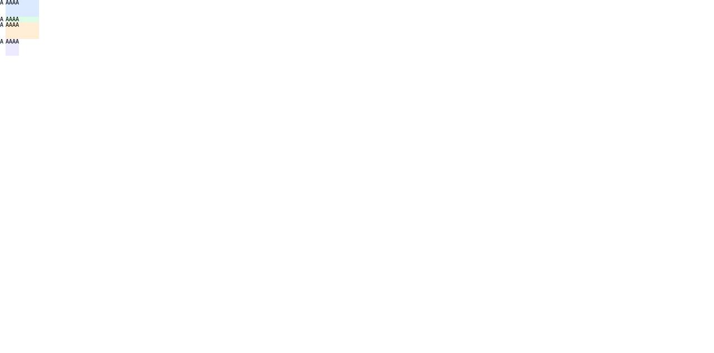

# 기본 parsed Root HTML Grid direct-text aspect-ratio 사전 비교

**계획:** [기본 parsed Root HTML Grid direct-text aspect-ratio](../../../../plan/c11-root-html-grid-text-aspect-ratio.md)

## 입력과 환경

- HTML 입력: [`fixture.html`](./fixture.html)와 저장소의 [원본 fixture](../../../../tests/fixtures/css/c11/root-html-grid-direct-text-aspect-ratio-precomparison.html)
- Browser: Agent Browser의 HeadlessChrome `156.0.0.0`, macOS, viewport `1280×633 CSS px`
- 입력은 기본 경로가 지원하는 CSS `monospace`를 사용한다. 현재 Root HTML runtime은 `@font-face` source를 불러오지 않으므로 Ahem webfont는 이 기본 경로에서 쓸 수 없다.
- Browser 관찰에서 `document.fonts.status=loaded`, `document.fonts.check('10px monospace')=true`; 10px `A` advance는 `6.03125px`, `AAAA` 폭은 `24.09375px`, line-height는 `10px`이다.
- 네 Grid root는 body의 direct child이며 각각 direct HTML block item `A`와 `AAAA`를 가진다. Ratio scene마다 owner 한 개에 ratio item 한 개만 둔다.
- 입력 fixture SHA-256: `d44069e298552707307ddcb2116dd7758c630af28a8c943e527984c8a5f80005`
- evidence 폴더의 `fixture.html`과 저장소 원본의 SHA-256이 위 값과 같다. `SHA256SUMS`는 두 fixture copy, DOM/CSSOM observation, 독립 기대값과 screenshot의 해시를 기록한다.

## 기대 geometry와 관찰

Grid width는 `70px`, columns는 `[10px,60px]`, gap은 `0`, row는 단일 `auto`이고 ratio는 `2/1`이다. Width-ratio 및 height-ratio 장면의 `AAAA`는 각각 definite width `60px` 또는 height `30px`에서 `60×30px`이 된다. Width-control row는 `10px`; height-control은 CSS 시스템 `monospace`의 intrinsic width를 쓴다.

Chrome 관찰은 [chrome-observation.json](./chrome-observation.json), 고정 기대값은 [expected.json](./expected.json), 화면은 [Agent Browser screenshot](./chrome-156-agent-browser.png)이다. 네 장면의 Grid frame, tracks, ratio target frame, width-control frame은 기대값과 `0 CSS px` 차이로 일치했다.

시스템 `monospace` 폭은 OS font registry에 따라 달라질 수 있다. Android/iOS 결과에서는 ratio 대상 frame과 Grid/track geometry를 독립 판정하고, `height-control`의 intrinsic width를 CSS ratio의 통과 기준으로 사용하지 않는다. Screenshot은 화면 구성을 확인하는 자료이며 pixel-diff/WPT 결과가 아니다.

`SHA256SUMS`는 입력, 관찰, 기대값, screenshot을 고정한다. Browser capture 뒤 Agent Browser session을 닫았고, 종료 확인에서 agent-browser/전용 HeadlessChrome process는 남아 있지 않았다. Screenshot은 CSS layout geometry가 그려졌음을 보여주지만 pixel-diff나 WPT 결과는 아니다.
