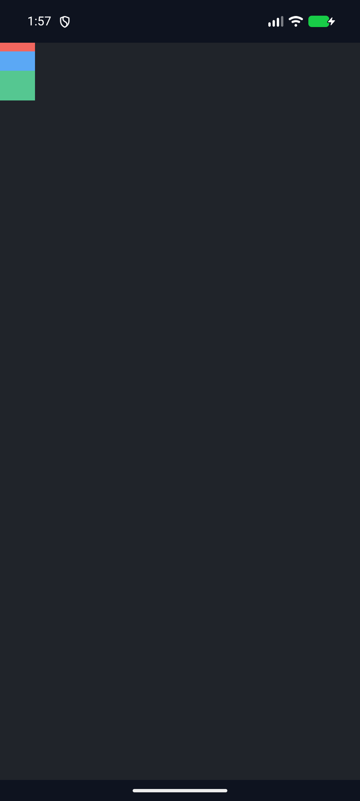
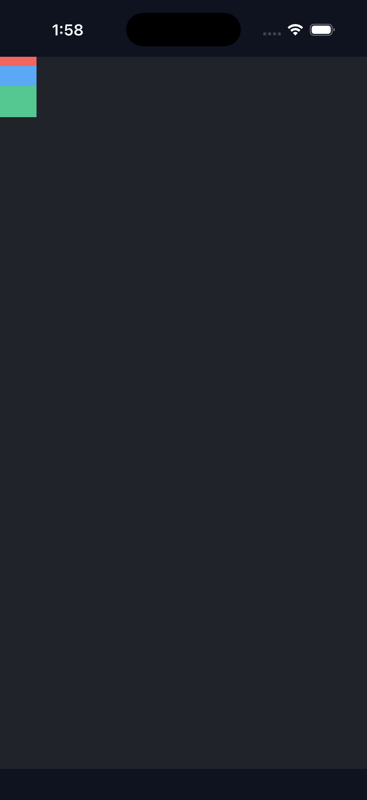

# C11.4 Root HTML intrinsic implicit row precomparison

The fixed Chrome 156 input is [the precomparison fixture](../../../../tests/fixtures/css/c11/root-html-grid-intrinsic-auto-rows-precomparison.html). Its SHA-256 is `7a6e0c32527b91a89d10c5ddcfdb00efe62f781bc814b3abf604a9bd08ebf15c`. The color declarations use `background-color`; the equivalent `background` shorthand expanded into unsupported `background-position-x` in the default Root HTML CSS profile during integration testing. Borders use the initial zero-width style because `border: 0` expands into unsupported `border-top-color`. These equivalent declarations keep the fixture within the product route's admitted CSS while preserving its colors and geometry.

Agent Browser reported `HeadlessChrome/156.0.0.0`. The computed row list was `10px 22px 34px` for one explicit 10px row followed by two `grid-auto-rows:min-content` rows. The direct children had fixed block sizes of 10px, 22px, and 34px, so their independent min-content contributions set the three used row sizes. The expected row origins are therefore y=0, 10, and 32px. The 40px-tall Grid has visible overflow; the final item ends at y=66px, 26px beyond the Grid.

The independent expected values are in [expected.json](expected.json); raw browser observations and screenshot hash are in [chrome156-observation.json](chrome156-observation.json). The screenshot SHA-256 is `6716fa1cf24ddf9124f4ee0b62fdb382e6d9949e19be2d57e7c82d6e51c249b5`. [Chrome screenshot](chrome156.png) is browser evidence only. It is not Spinon runtime or WPT evidence.

The Agent Browser session was closed with `agent-browser close --all`; no `agent-browser` process remained. The temporary loopback HTTP server on port 18876 was stopped after capture.

## Android and iOS simulator app route

The same HTML fixture SHA-256 (`7a6e0c32527b91a89d10c5ddcfdb00efe62f781bc814b3abf604a9bd08ebf15c`) was copied into the normal bootstrap asset path for the final candidate rebuild. A temporary `root-app.js` checked the fixture's parsed IDs, parentage, and DOM source order, then round-tripped a `data-c11-runtime=ready` marker. The final Android and iOS build logs show C04 runtime GPU enabled and every fixture-test flag disabled. The original source and pre-existing generated bootstrap assets were restored byte-for-byte after building; final restored hashes are in [simulator-final-bundle-restoration.txt](simulator-final-bundle-restoration.txt).

The final Android API 37 ARM64 AVD `emulator-5554` (`sdk_gphone64_arm64`, Android 17) run reported `SPINON_ROOT_HTML_DEFAULT_APP_BOOT status=pass root_app_marker=ready layout=ready boxes=7` and `SPINON_C0410_DRAW status=0 presented boxes=7`. The renderer is ANGLE over SwiftShader software. The APK's packaged `assets/index.html` hash matches the source fixture. Its 1080×2400 OS screenshot uses 2.625 physical pixels per CSS pixel. At x=10, the exact RGB runs have heights 26, 58, and 89 physical pixels, corresponding to expected CSS rows 10, 22, and 34 after raster rounding. The green run remains visible through its expected y=66 CSS endpoint. Final pixel samples are recorded in [simulator-pixel-samples-final.json](simulator-pixel-samples-final.json); [Android screenshot](android-simulator-final.png), [build log](android-simulator-final-build.log), [runtime log](android-simulator-final.log), and [artifact hashes](simulator-final-artifact-hashes.txt) are preserved.

The final iPhone 17 Pro / iOS 26.2 Simulator run likewise reported the root-app marker, `layout=ready boxes=7`, and `SPINON_C0410_DRAW ... presented boxes=7`; its renderer is Metal on the Apple simulator GPU. The `.app` packaged `index.html` hash matches the same fixture. Its 1206×2622 OS screenshot uses 3 physical pixels per CSS pixel; the exact RGB runs at x=10 are 30, 66, and 102 pixels tall, matching CSS row heights 10, 22, and 34. The green row ends at the expected visible y=66 CSS position. See the [iOS screenshot](ios-simulator-final.png), [build log](ios-simulator-final-build.log), [runtime log](ios-simulator-final.log), [launch log](ios-simulator-final-launch.log), and [artifact hashes](simulator-final-artifact-hashes.txt).

The Rust RuntimeSession test checks exact CSS frames and the 26px overflow; its unsupported-value matrix covers 13 unsupported combinations and confirms no completed layout or render snapshot is published. Focused cascade 1/1, projection 1/1, capacity 2/2, layout 11/11, RuntimeSession 2/2, scoped Clippy, and rustfmt results are preserved beside this README. The separate candidate implementation/runtime review covers 20 failure perspectives, and the [PR change review](pr-diff-review-30.md) covers 30 additional contract and failure boundaries. These device captures independently verify visible paint after `draw/present`; they are `adb screencap`/`simctl screenshot` samples, not Android PixelCopy or direct Metal drawable readback. They do not establish physical Android GPU behavior or general CSS/WPT support. A broader `cargo test -p spinon-style-to-layout root_html` filter had the same nine C11.5 alignment/placement failures with the candidate and with the three changed style-to-layout source files temporarily replaced by `HEAD`; candidate was 133 passed/9 failed, baseline 131 passed/9 failed. The candidate adds two passing projection tests; none of the nine failures changed. Full output is in [root-html-candidate.log](root-html-candidate.log) and [root-html-baseline.log](root-html-baseline.log); neither run is reported as green.
