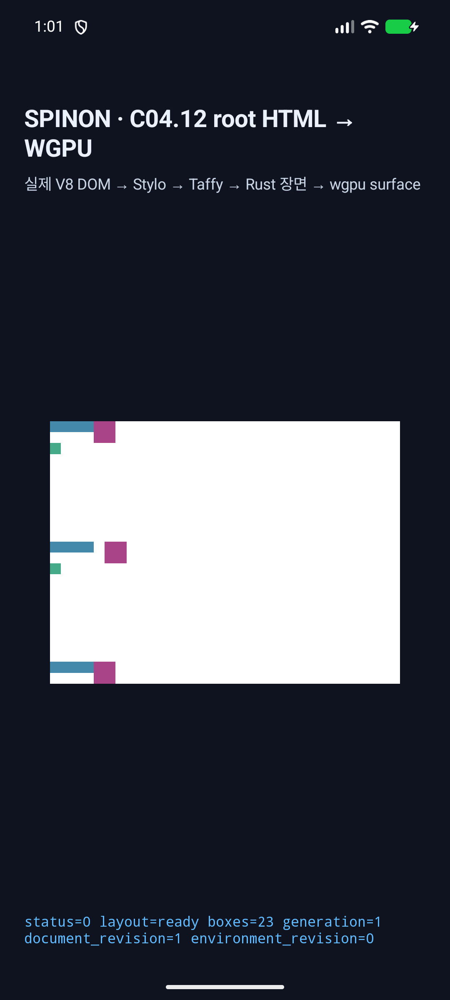
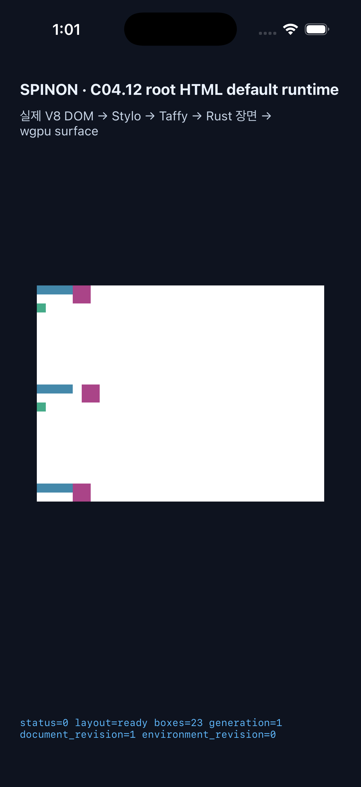

# C11.1 parsed Root HTML intrinsic Grid fixed-px gap runtime

## 범위와 판정

이 문서는 `RootHtmlIntrinsicTrackSizingV1`의 bounded fixed-px gap 후보를 기록한다. `gap` shorthand, `row-gap`, `column-gap`의 finite non-negative px 값만 허용하고, CSS-valid `%`·math-backed `calc()`와 finite `f32` 범위를 넘는 gutter aggregate는 node/property diagnostic으로 전체 layout을 거부한다. CSS-invalid negative declaration은 Stylo cascade fallback을 따른다. 이 결과는 일반 CSS Grid admission, 공개 CSS 지원, WPT 적합성 또는 C11.1/C11/C11.4 완료를 뜻하지 않는다.

Chrome 156 Agent Browser 관찰과 독립 기대값은 [사전 비교](../c11-root-html-intrinsic-gap-precomparison-2026-11-05/README.md)에 있다. 10px column gap에서는 columns `[40,50]`, row gap에서는 rows `[20,70]`, 양축 shorthand에서는 두 결과가 함께 적용된다. 네 장면 모두 세 item의 root-relative frame을 비교했다.

## Rust 검증

| 검증 | 결과 | 원본 |
|---|---:|---|
| `cargo test --locked -p spinon-layout --lib root_html_intrinsic` | 6/6 통과 | [로그](layout-focused-tests.log) |
| `cargo test --locked -p spinon-runtime --features c11-1-grid-intrinsic-tracks-fixture-test root_html_grid_intrinsic_tracks` | 10/10 통과 | [로그](runtime-focused-tests.log) |
| `cargo clippy --locked -p spinon-layout --all-targets -- -D warnings` | 통과 | [로그](layout-clippy.log) |
| `cargo clippy --locked -p spinon-runtime --features c11-1-grid-intrinsic-tracks-fixture-test --all-targets -- -D warnings` | 통과 | [로그](runtime-clippy.log) |
| `cargo fmt --all -- --check`, `git diff --check` | 통과 | 실행 결과 0 |

전체 `spinon-layout` library suite는 448개 중 447개 통과, 1개 실패다. 실패는 변경하지 않은 C15 `host_document_collects_direct_text_and_inherited_spans_in_source_order` assertion이다. 이 기록은 전체 crate가 green이라고 주장하지 않는다. [전체 suite 로그](layout-full-suite.log).

적대적 재현에서 세 explicit column track에 `f32::MAX` gap을 주면 기존 코드가 `NaNpx` track trace를 포함한 layout을 성공 반환했다. 축별 gutter aggregate를 Taffy 실행 전에 검사해 이 입력을 거부한다. 추가로 두 column track의 각 min-content base와 하나의 finite `0.75 × f32::MAX` gutter를 결합하면 gutter aggregate 단독은 finite여도 Taffy가 두 번째 track을 `NaNpx`로 반환했다. `CalcLayoutTree`는 gap이 있는 intrinsic profile에서 Taffy의 resolved track line positions가 finite인지 frame 수집 전에 검사하고, 아니면 해당 `column-gap`/`row-gap` diagnostic으로 거부한다. layout 2개와 parsed Root HTML runtime atomic-rejection 2개가 두 overflow 경계를 고정한다.

## Android API 37 ARM64 AVD

- 대상: `emulator-5554`, `sdk_gphone64_arm64`, API 37, ABI `arm64-v8a`.
- GLES renderer: ANGLE / Vulkan / SwiftShader. Android 실기기 또는 hardware GPU 결과가 아니다.
- 빌드: `SPINON_ENABLE_C04_RUNTIME_GPU=1 SPINON_V8_DIR=/Users/yoonhb/Documents/workspace/spinon/build/c11-v8-rebuild/v8-source/v8 mise exec -- bun run build:android` · [build log](android/build.log).
- fixture SHA-256: `db9e7919e84c052abef185f100fe25a1279819b9758eefce5092f8d828114a7a`. APK에서 추출한 root HTML asset도 같은 hash다. 원래 app asset은 `38813ca802618bd20bdf3bbb9ed9bc7525c289f48c0928813c855567f9e7df85`로 복구됐다.
- APK SHA-256: `437cf1748df6cfa6f56688f4ea1d538909a40d2d78664a498cc7d5609e46f782` ([hash](android/apk.sha256)).
- 실행: `adb -s emulator-5554 shell am start -W -n dev.spinon.bootstrap/.MainActivity --ez spinon_c0412_root_html_default_render true`.
- 최종 PID-filtered process log는 같은 fixture hash, `layout=ready boxes=23`, root `320×440 CSS px`, viewport `320×240 CSS px`, `SPINON_C0410_DRAW status=0 presented boxes=23`을 기록한다. [최종 PID-filtered log](android/logcat-final.txt) · [install](android/install.log) · [launch](android/launch.log).
- [화면 캡처](android/simulator-screen.png) (`1080×2400`, SHA-256 `e75647d5e8b5526f3409809a1bcbd3fa90712013bd3ee47ae3ab8f57181443df`). 앱을 캡처 후 force-stop했다.

## iOS Simulator

- 대상: iPhone 17 Pro, iOS 26.2 Simulator, UDID `9DCCE836-7659-4914-B6C1-13F54BFFA9DB`.
- 빌드: `SPINON_ENABLE_C04_RUNTIME_GPU=1 SPINON_V8_DIR=/Users/yoonhb/Documents/workspace/spinon/build/c11-v8-rebuild/v8-source/v8 mise exec -- bun run build:ios-sim` · [build log](ios/build.log). V8 archive의 기존 duplicate debug-map warnings가 있었으며 Xcode 빌드는 성공했다.
- 앱 bundle의 root HTML asset hash는 fixture와 같은 `db9e7919e84c052abef185f100fe25a1279819b9758eefce5092f8d828114a7a`; 원래 iOS resource는 `38813ca802618bd20bdf3bbb9ed9bc7525c289f48c0928813c855567f9e7df85`로 복구됐다.
- iOS Simulator executable SHA-256: `e7cb67b649df40b1a84e0aeef5761cdf259eb7acb6ba84fe5ad3bc1362743cbe` ([hash](ios/app-executable.sha256)).
- 실행: `xcrun simctl launch --terminate-running-process 9DCCE836-7659-4914-B6C1-13F54BFFA9DB dev.spinon.bootstrap --spinon-c0412-root-html-default-render`.
- 최종 앱 PID `54342`로 필터링한 unified log는 같은 fixture hash, `layout=ready boxes=23`, root `320×440 CSS px`, viewport `320×240 CSS px`, Metal draw/present를 기록한다. [최종 PID-filtered unified log](ios/unified-log.txt) · [install](ios/install.log) · [launch](ios/launch.log).
- [화면 캡처](ios/simulator-screen.png) (`1206×2622`, SHA-256 `d0571b013c769d6616716757321e7fc791d824ee7142f67dc0c6180816af89a9`). 앱을 캡처 후 terminate했다.

## 문서 빌드 범위

`mise exec -- bun run docs:build`를 실행했지만 RSPress가 이 checkout의 다른 `spec/internal/evidence/` Markdown 경로에서 dead link를 보고해 전체 문서 빌드가 실패했다. 해당 경로들은 이번 PR diff에 포함되지 않으며, 이 결과를 문서 빌드 통과로 세지 않는다. 전체 로그는 PR evidence에 포함하지 않았다.

## 한계와 artifact 경계

두 simulator screenshot은 화면 표시 확인용이다. Android PixelCopy나 iOS Metal drawable surface readback을 수행하지 않았고, OS compositor 이후 pixel parity를 주장하지 않는다. 네 장면 중 아래 viewport에 놓인 장면들의 geometry는 Chrome oracle 및 Rust runtime frame 비교로 확인했다. fixture test module은 `c11-1-grid-intrinsic-tracks-fixture-test` feature로만 컴파일되며 새 fixture FFI·runtime profile·public API를 추가하지 않았다.

`android/logcat.txt`는 최초 잘못된 default route 실행의 사전 진단 로그다. 최종 성공 실행 근거로 세지 않지만 보존하고 checksum manifest에는 포함한다. 최종 로그는 새 앱 PID만 필터링했다. 재빌드는 [simulator build script](./build-simulators.sh)로 HTML asset을 임시 교체한 뒤 원본을 복구한다. 로그 본문은 유지하고 행 끝 공백과 EOF 빈 줄만 정규화했다. `SHA256SUMS.txt`는 이 디렉터리의 모든 파일(자기 자신 제외)을 확인한다.
