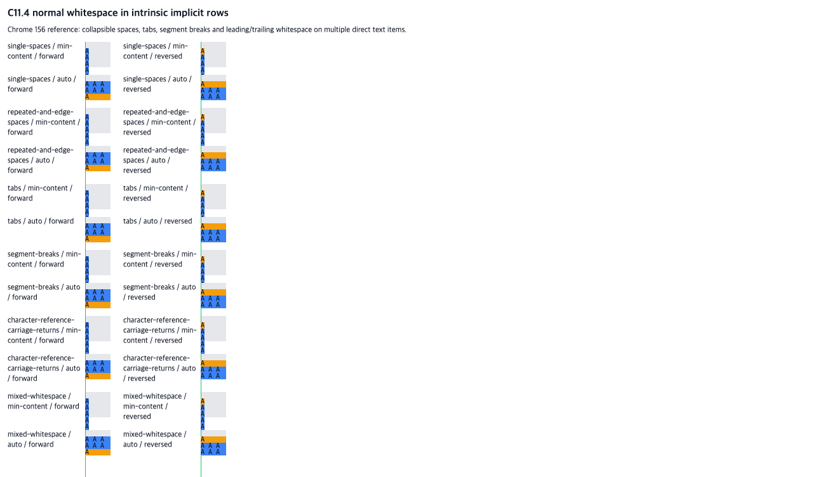

# Parsed Root HTML intrinsic row text whitespace precomparison

**기준 커밋:** `990ce5c41f211070152e5f92fc0960b64b6a7933` · **비교 브라우저:** Agent Browser HeadlessChrome `156.0.0.0` · **상태:** Chrome 기준 관측만 완료, 제품 구현 전

## 질문과 구현 경계

현재 C11.4 기본 Root HTML intrinsic-row 경로는 direct text가 `A` token을 단일 ASCII 공백 하나로 구분한 경우만 허용한다. 입력의 computed style은 `white-space: normal`에 해당하는 collapse/wrap 조합이므로, 반복 공백·탭·HTML segment break·문자 참조 carriage return과 가장자리 공백도 같은 텍스트로 처리할 수 있는지 Chrome에서 확인한다.

제안 범위는 기존 text-source 문법의 구분자만 CSS collapsible document whitespace로 넓히는 것이다. 허용 token은 계속 `A` 하나뿐이며 비어 있지 않은 token이 하나 이상 있어야 한다. DOM text 원문을 미리 정규화하지 않고 기존 text-layout 경로에 전달한다. U+0020 SPACE, U+0009 TAB, U+000A LINE FEED, U+000D CARRIAGE RETURN만 구분자로 인정한다. NBSP, form feed, vertical tab, 다른 글자와 공백만 있는 source는 범위 밖이다.

## 기준과 재현

기준은 [CSS Text Module Level 4 §4.1, §4.3.1, §4.3.3](https://drafts.csswg.org/css-text-4/#white-space-processing)이다. `white-space-collapse: collapse`는 collapsible spaces와 tabs를 줄이며, segment break는 처리 규칙에 따라 변환한다. carriage return은 space와 같이 취급한다. fixture는 `lang="en"`, `white-space: normal`, LTR `horizontal-tb`, 10px monospace와 10px line-height를 고정한다.

[24개 scene fixture](../../../../tests/fixtures/css/c11/root-html-grid-intrinsic-normal-whitespace-multiple-text-precomparison.html)는 여섯 입력형(단일 공백 기준, 반복·가장자리 공백, 탭, line feed, carriage-return character reference, 혼합 whitespace), 두 열 조건(`min-content`, `auto`), 두 DOM source order의 조합이다. 각 Grid에는 10px explicit row, 여러 direct-text item, `grid-auto-rows: min-content`와 34px overflow control이 있다.

## Chrome 관측

| 열 조건 | 사용 열 | 정방향 행 | 역순 행 | 긴 text 줄 수 |
| --- | ---: | --- | --- | ---: |
| `min-content` | `6.03125px` | `[10, 60, 10, 34]px` | `[10, 10, 60, 34]px` | 6 |
| `auto` | `40px` | `[10, 20, 10, 34]px` | `[10, 10, 20, 34]px` | 2 |

다섯 whitespace 입력형은 같은 열 조건·DOM 순서의 single-space 기준과 사용 열·사용 행·item frame·text line 위치가 모두 같았다. 최종 행렬은 **24/24 scene**, 비교 차이는 **0건**이다. 전체 DOM 관측은 [chrome156-observation.json](https://raw.githubusercontent.com/ohah/spinon/6af70e0e54d52705f7be908f7e2257795ad361e5/spec/internal/evidence/c11-root-html-intrinsic-normal-whitespace-precomparison-2026-11-06/chrome/chrome156-observation.json), 장면 화면은 [Agent Browser screenshot](https://raw.githubusercontent.com/ohah/spinon/6af70e0e54d52705f7be908f7e2257795ad361e5/spec/internal/evidence/c11-root-html-intrinsic-normal-whitespace-precomparison-2026-11-06/chrome/chrome156-agent-browser.png)에 보존했다.

Chrome의 min-content column negative controls는 single-space `A A`의 `6.03125px`와 달리 form-feed와 vertical-tab 사이를 연속 intrinsic word로 보아 `14.671875px`, NBSP는 `18.0625px`, NEL은 `16.03125px`로 계산했다. 이는 허용 구분자와 거부 문자의 차이를 보인다. [negative-control-observation.json](https://raw.githubusercontent.com/ohah/spinon/6af70e0e54d52705f7be908f7e2257795ad361e5/spec/internal/evidence/c11-root-html-intrinsic-normal-whitespace-precomparison-2026-11-06/chrome/negative-control-observation.json)에 raw 결과를 보존했다.

이 관측은 Chromium 156 한 버전의 CSS/Text/Grid 기준값이다. 제품 구현, Android/iOS, WPT 적합성, 임의 문자·Unicode/font, form-feed 및 whitespace-only item을 증명하지 않는다.

비교가 끝난 뒤 Agent Browser의 `spinon-c11-max-content` session을 `close --all`로 종료했다. 후속 process filter에서는 Agent Browser·HeadlessChrome process가 0개였다. session metadata와 close/process 결과를 별도 JSON으로 남겼다.
