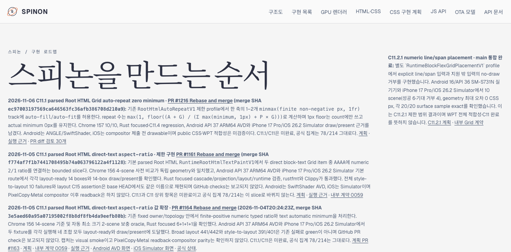
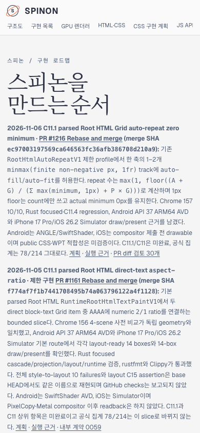

# C11.1 zero-minimum auto-repeat · 공식 대장·로드맵 동기화

이 문서는 구현 PR [#1216](https://github.com/ohah/spinon/pull/1216) 병합 뒤 공식 상태 대장, 내부 계약 0059, C11 구현 계획 및 공개 roadmap HTML을 같은 범위로 맞추는 후속 기록이다. 구현 merge SHA는 `ec97003197569ca646563fc36afb386708d210a9`다.

## 동기화 범위

- `spec/STATUS.md` C11 상세에 PR #1216 결과와 검증 한계를 추가했다. C11 상위 checkbox와 C11.1/C11.4 범위는 미완료로 유지한다. 완료 수는 `78/214` 그대로다.
- Internal contract 0059의 기존 “auto-repeat 전체 거부” 문구를 제한 `RootHtmlAutoRepeatV1` subset으로 정정했다. 숫자 버전은 `0.1.0`이다. 새 public API, parser, runtime profile 또는 FFI를 선언하지 않는다.
- `plan/c11-css-grid.md`에 PR #1216 병합·검증 정보를 반영하고, 일반 auto-repeat/CSS Grid/WPT 지원으로 넓혀 해석될 수 있는 제외 문구를 바로잡았다.
- `spec/public/roadmap.html` 상단 progress note에 이번 제한 slice, merge SHA, 검증 범위와 미완료 상태를 추가했다. 공식 counter는 `spec/STATUS.md`의 checkbox를 계속 읽는다.

## Agent Browser 후보 화면

변경된 `spec/public/roadmap.html`을 임시 localhost HTTP server에서 Agent Browser로 열었다. 첫 progress note에 PR #1216과 merge SHA가 표시되고, GitHub `main`의 공식 상태 대장은 `214개 표시 · 공식 완료 78/214`로 읽혔다. Desktop viewport는 1280×633이었다. Mobile viewport는 390×844였고 `documentElement.scrollWidth`와 `body.scrollWidth` 모두 390px였다.

| 캡처 | 크기 | SHA-256 |
|---|---:|---|
| Desktop | 1280×633 | `1b0a1e1718d04d4307edd05f075d8a29b34654faeb199ddbd80fe97655b67bea` |
| Mobile | 390×844 | `83e31d2a95fdd247c82a26cfe35c6631a0ff8890fd015846dadddf0a069d9473` |

Agent Browser 세션을 닫고 Agent Browser 프로세스가 남지 않았음을 확인했다. 임시 localhost server도 중지했다. Terminal Browser를 사용하지 않았다.

## Tailnet preview

Tailnet preview는 GitHub Pages가 아니라 사용자 지정 개발 미리보기 경로다. 이 변경을 main에 병합한 뒤 기존 파일을 삭제하지 않는 backup·hash 검증 절차로 동기화하고, Agent Browser desktop/mobile에서 최종 served 화면과 `78/214`를 확인한다. 그 실행 결과는 후속 동기화 근거에 추가한다.
