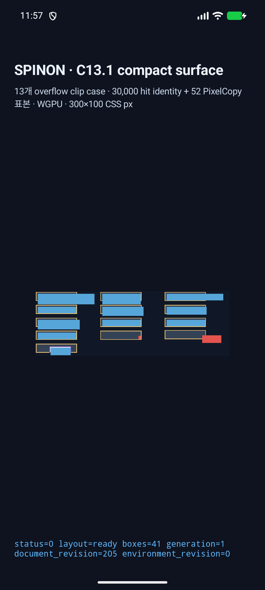
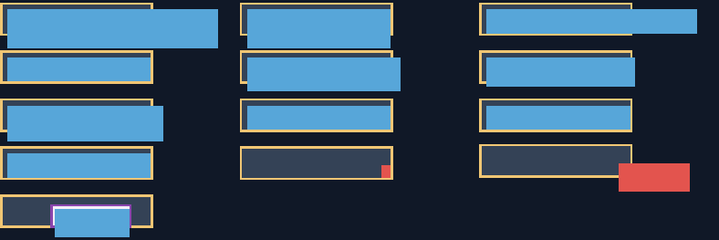

# C13.1 Android 앱 전체 hit identity grid 실행 근거 · 2026-10-14

이 실행은 compact C13.1 fixture를 실제 Android 앱의 `RuntimeRenderSnapshot`에서 평가해 Chrome 155의 고정 정수 CSS 좌표 grid와 비교한다. 제품 CSS 지원, 전체 C13.1 적합성 또는 DOM event dispatch를 판정하지 않는다. 계획 PR [#163](https://github.com/ohah/spinon/pull/163)은 이 실행 전에 rebase 방식으로 병합됐다(merge SHA `9529b108476bb22e090d9ec3e6f1db5b70371f77`).

## 고정 oracle와 판정 기준

- Chrome for Testing `155.0.8059.40`, revision `cfaadc5a132d78e1828635aa8405a499f3e14864-refs/branch-heads/8059`; oracle는 [Chrome 30,000-point grid](../c13-1-android-app-hit-identity-grid-2026-10-14/chrome155-hit-identity-grid.json)와 기존 [compact surface Chrome observation](../c13-1-compact-surface-matrix-2026-10-14/chrome155-observation.json)에 고정했다.
- viewport는 `300×100` CSS px, DPR 1, scroll `(0,0)`이며 `elementFromPoint(x,y)`를 모든 정수 좌표 `(0..299, 0..99)`에서 한 번씩 질의한다.
- grid는 41개 순서 고정 Node ID, 100행, 870개 RLE run으로 30,000점 전체를 gap/overlap 없이 덮는다. 기존 52개 hit sample은 전체 grid의 부분 집합으로 다시 확인한다.
- 고정 expanded identity SHA-256: `93cccd042e82d8cd30cb7a8ab34a5154073d4a9eccbc4038294d3ca5b9dfce87`. grid 파일 SHA-256: `35e88e57edc16e526e389317b0d18ef227e35d1356a2353b92476c75ef6414f6`.
- [사전 validator](../c13-1-android-app-hit-identity-grid-2026-10-14/validate-hit-identity-grid.mjs)는 source·browser provenance, viewport, row coverage, node identity 및 52점 subset을 확인했다. [validator tests](../c13-1-android-app-hit-identity-grid-2026-10-14/validate-hit-identity-grid.test.mjs)는 5/5 통과했다.

## Android AVD 실행

- 연결 device 목록은 `emulator-5554` 하나이며 API 37 / Android 17, ARM64 `sdk_gphone16k_arm64`, `ro.kernel.qemu=1`이다. 실기기는 연결하거나 사용하지 않았다. [ADB 장치 목록](adb-devices.txt), [AVD 속성](avd-getprop.txt), [ABI](android-abi.txt).
- 빌드: `SPINON_V8_DIR=.../build/v8-source/v8 SPINON_ENABLE_C04_RUNTIME_GPU=1 SPINON_ENABLE_C131_OVERFLOW_CLIP_FIXTURE_TEST=1 mise exec -- bash tools/build-android-app.sh` — [로그](android-build.log), 성공.
- 설치한 debug APK SHA-256: `3ba6b91753e687c0a81ca62a49b349897d5809ac09685a02add08553af41ce4f` ([hash file](apk-sha256.txt)). 앱 화면의 runtime status는 `status=0 layout=ready boxes=41 generation=1`이다.
- 같은 route `run_id=2355eebbe6e3`에서 41/41 frame, 기존 고정 hit query 52/52, 전체 integer hit identity 30,000/30,000, mismatch 0을 확인했다. actual identity SHA는 oracle SHA와 일치한다.
- SurfaceView `PixelCopy` begin log의 generation `2`에서 788×263 표면을 얻고 기존 고정 52 sample을 52/52 exact 비교했다. RGBA sample SHA-256은 `09ab4348074597011fa6f62cd3419ad641a95211a42d94edee441fee678ab3ab`. runtime generation `1`과 SurfaceView generation `2`는 서로 다른 counter이며, 동일 run ID로 이 route의 로그를 연결한다.
- 실행 시 renderer log는 `backend=Gl`, Android Emulator OpenGL ES Translator / ANGLE / Vulkan 1.3 / SwiftShader라고 보고했다. 이는 API 37 AVD software backend 결과다.
- 원본 [logcat](avd-logcat.txt), [앱 전체 화면](android-api37-avd-app-screen.png), [PixelCopy PNG](android-api37-avd-pixelcopy.png)을 보존했다. 화면 PNG는 1080×2400, SHA-256 `3535b0fc9d1db547dda6e6ee349446b7e00a028b470d4093ef27a5e81aa53131`; PixelCopy PNG는 788×263, SHA-256 `09ab4348074597011fa6f62cd3419ad641a95211a42d94edee441fee678ab3ab`이다.

## 빌드·회귀 근거

- Rust focused feature tests: 10 passed, 0 failed. Workspace tests: 779 passed, 0 failed, 4 ignored ([로그](workspace-tests.log)).
- Workspace Clippy `cargo clippy --locked --workspace --all-targets -- -D warnings` 통과 ([로그](workspace-clippy.log)); feature FFI Clippy 및 `cargo fmt --all -- --check`, `git diff --check` 통과.
- Android debug app build와 위 AVD 실행은 Java report parser 보강 뒤 다시 수행했다.
- iOS Simulator feature-on build는 성공했지만 iOS 앱 runtime은 실행하지 않았다. 기존 linker duplicate-symbol 및 V8 dSYM 경고는 [로그](ios-simulator-build.log)에 남아 있다.
- 기본 host debug FFI archive에는 신규 fixture 심볼·grid payload·`sha2`가 없고, `c13-1-overflow-clip-fixture-test` positive control에는 모두 존재한다. 판정 범위와 명령은 [feature isolation](feature-isolation.txt)에 기록했다. 이 archive 검사는 release artifact나 final APK size 판정이 아니다.
- committed build logs의 local absolute checkout/home 경로는 `$CHECKOUT` 및 `$USER_HOME`으로 치환했다.

## 남은 범위

이 결과는 Android API 37 ARM64 AVD에 한정된다. 물리 기기와 hardware GPU, iOS 앱 실행 및 Metal drawable readback, 788×263 표면 전체 RGBA 대조, compact fixture 밖 clip draw/hit controls, DOM event/CSSOM scroll, WPT 및 C13.1 완료 gate는 남아 있다.
