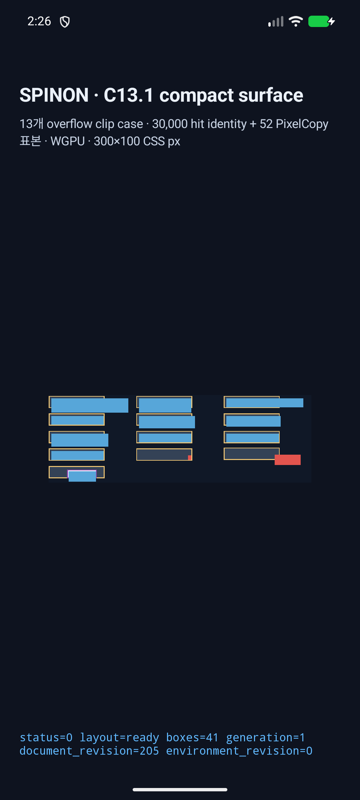

# C13.1 Android API 37 AVD full surface regression

- 실행 ID: `2b7c7c8490c9`
- 대상: emulator-5554 · sdk_gphone16k_arm64 · API 37 · arm64-v8a
- C13.1 compact fixture 앱에서 41/41 frame, 52/52 fixed PixelCopy sample, 30,000/30,000 hit identity를 확인했다.
- 788×263 PixelCopy에서 CSS pixel center 30,000개와 RGBA channel 120,000개를 Chrome 155와 exact 비교했다. 불일치 0개다.
- Chrome target이 overflow container border 바깥까지 paint하는 `(270,72)`를 전체 좌표 scan에 포함했다.
- API 37 ARM64 AVD의 ANGLE/Vulkan/SwiftShader만 검증한다. 실기기·hardware GPU·전체 physical pixel byte, DOM event dispatch, WPT 및 C13.1 완료를 뜻하지 않는다.
- [실행 요약](./summary.json) · build/install/launch/runtime 로그, PixelCopy와 앱 화면을 함께 보존했다.

## ADB runner 진단

ADB transport와 앱 실행은 정상이었다. 첫 runner는 비동기 `am start` 직후 `pidof`를 호출해 PID가 아직 없는 순간을 실패로 처리했으므로 이전 앱을 force-stop하고 새 PID를 기다리도록 했다. 이후 앱 logcat에서 JNI·Java가 중복 기록한 41개 frame은 node index별 payload 동일성까지 확인해 집계한다. eval report의 필드 순서와 PixelCopy SHA/path capture group, 비교 결과의 크기 필드 경로도 runner 가정과 맞지 않아 각각 수정했다. 최종 실행은 새 process에서 report·PNG hash·30,000점 비교를 모두 마쳤고 ADB 연결 오류나 앱 렌더링 불일치는 재현되지 않았다.

## API 37 ARM64 AVD 화면과 PixelCopy

