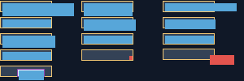

# C13.1 compact surface matrix Chrome precomparison · 2026-10-14

## 판정 범위

Chrome oracle이 compact fixture의 13개 case frame, computed overflow, 52개 고정 좌표의 `elementFromPoint` identity와 screenshot RGBA를 관찰한다. 이 자료는 reference browser의 fixture 화면이며 Spinon 앱 화면, renderer parity, DOM event dispatch 또는 C13.1 완료 근거가 아니다.

## 실행 환경

- agent-browser CLI `0.31.1`과 Google Chrome `155.0.8059.40` arm64, revision `cfaadc5a132d78e1828635aa8405a499f3e14864-refs/branch-heads/8059@{#936}`, V8 `15.5.35.20`을 사용했다.
- 실제 capture의 UA는 `HeadlessChrome/155.0.0.0`이며 viewport `300×100`, DPR `1`, scroll `(0,0)`이다. Root frame은 `(0,0,300,100)`이다.
- Oracle fixture는 [HTML wrapper](../../../../tests/fixtures/css/c13/c13-1-compact-surface-matrix.html)와 [공유 CSS/DOM source](../../../../tests/fixtures/css/c13/c13-1-compact-surface-matrix.js)다. Source SHA-256은 각각 `431f4b4452969adcae80c4e5f89e5e45b1e8756fc3c4d8995b7a5eccfbc6f355`, `d36bc1f7d3c791cdc91f6d878c3961e067efc2f88ca1486db8a065c5fd69c760`다. 마지막 capture에서는 body 없는 runtime document를 처리하도록 source에 document-root fallback을 두었다.
- 재현 명령: `node tools/css-reference/capture-c13-1-compact-surface-matrix.mjs`; 저장된 결과 검사: `node --test tools/css-reference/c13-1-compact-surface-matrix.test.mjs`. Capture tool은 agent-browser로 fixture를 열고 Chrome의 version page에서 revision/V8을 읽으며, viewport screenshot에서 RGBA를 추출한다.

## 결과

- 13/13 case ID와 41 fixture node가 관찰됐다. Section/tile frame은 고정된 3열×5행 좌표와 일치했다. Positioned-escape의 static box는 `top:1px`가 적용되지 않아 tile top에 놓인다.
- 52/52 좌표가 viewport 안에 있고 서로 겹치지 않는다. Hit identity와 실제 PNG RGBA가 oracle validator의 기대 표와 모두 일치했다. Clip-margin의 x 표본은 padding/border reference에서 painted target, content reference와 hidden/mixed clip에서는 clipped parent를 반환한다. Y 표본도 clip, margin, hidden, positioned, nested visible-y 경로를 나눠 관찰한다.
- `node --test tools/css-reference/c13-1-compact-surface-matrix.test.mjs`: 2개 validator test 통과. 변조 hit ID, RGBA, 중복 좌표, frame geometry를 거부하는 네 mutation control이 포함된다.

## 고정 산출물

- [정규화된 관찰](chrome155-observation.json): 13 frame·overflow style·sample identity/RGBA와 모든 source hash. SHA-256 `515fc95f811399fda9e336a13e7583f2d22555fce4727f1fe7f734981abd0299`.
- [agent-browser 원본 JSON](chrome155-agent-browser-raw.json): agent-browser eval 원본. SHA-256 `83fdeba30f6307aca408f12e52eb4c6ebc2e19b2a8b2566e0bb92369ecf9f2a0`.
- [300×100 Chrome surface screenshot](chrome155-surface.png): SHA-256 `b682308e3604ad599becff2c8d8c801c80a2a5b8547f3ac3316f133d47232601`.

이 screenshot은 Chrome oracle의 DOM paint를 보여 준다. Android PixelCopy·iOS Simulator 화면이나 실기기/하드웨어 GPU 동작을 나타내지 않는다.

Android AVD PixelCopy와 iOS Simulator fixture route 실행은 [runtime evidence](runtime-execution.md)에 기록했다. 해당 실행과 별도로 구현 실패 관점 20개 및 PR delta 관점 30개를 각각 검토한다. 전체 surface byte equality, WPT와 C13.1 완료는 이 precomparison으로 닫히지 않는다.
