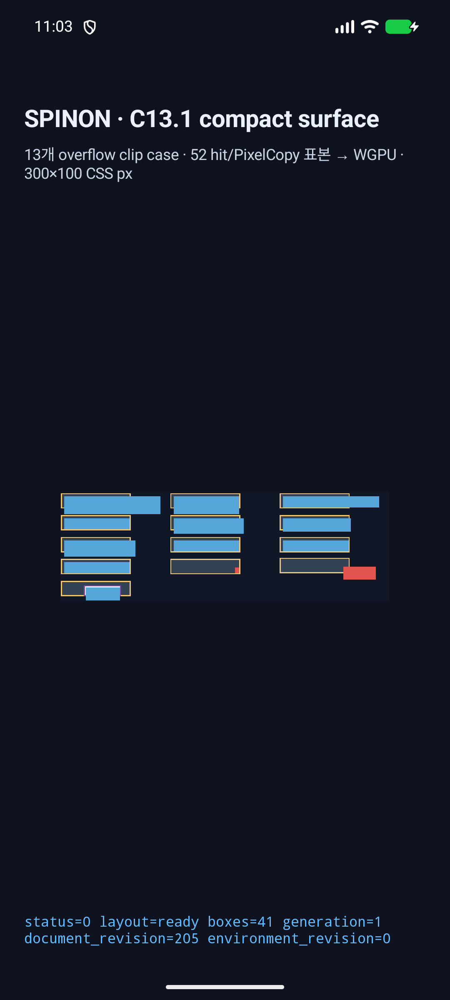
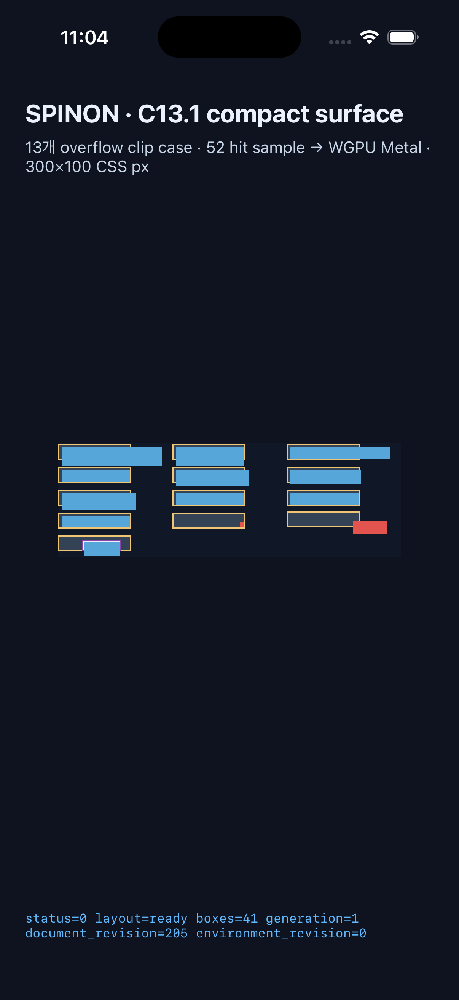

# C13.1 전체 CSS pixel-center 대조 · 2026-10-14

## 판정 범위

Chrome 155에 고정한 compact 13-case fixture를 Android API 37 ARM64 AVD의 실제 WGPU `SurfaceView`로 실행하고, `PixelCopy` 이미지의 CSS pixel-center 표본을 전수 비교했다. Chrome의 300×100 DPR 1 surface에서 30,000개 논리 픽셀 중심을 검사했고, 각 표본의 RGBA 네 채널이 모두 exact 일치한다. 이 결과는 788×263 물리 surface의 선택하지 않은 subpixel, 실기기/hardware GPU, C13.1 전체 지원을 증명하지 않는다.

## 고정 oracle과 좌표 계산

- 기준: [Chrome 155 screenshot](../c13-1-compact-surface-matrix-2026-10-14/chrome155-surface.png), [observation](../c13-1-compact-surface-matrix-2026-10-14/chrome155-observation.json). Chrome `155.0.8059.40`, revision `cfaadc5a132d78e1828635aa8405a499f3e14864-refs/branch-heads/8059`, fixture source SHA와 viewport `300×100`, DPR 1, scroll `(0,0)`를 validator로 재검사한다.
- AVD: `spinon_api37_1_compat16k`, serial `emulator-5554`, API 37, ARM64, `ro.kernel.qemu=1`, 표시 영역 1080×2400 / 420 dpi. SurfaceFlinger는 ANGLE 2.1.1, Vulkan 1.3, SwiftShader를 보고한다.
- PixelCopy: 788×263 px, x scale `2.6266666666666665`, y scale `2.63`. 각 CSS 정수 `(x,y)` 표본은 `floor((x+0.5)×scaleX)`, `floor((y+0.5)×scaleY)`로 대응한다. x/y 축은 각각 캡처 크기로 산출하고 density를 대신 쓰지 않는다.
- 비교기: `node tools/css-reference/compare-c13-1-surface-pixel-centers.mjs <pixelcopy.png> <result.json>`. Chrome observation과 fixture hash를 다시 검증한 뒤 30,000개 위치의 RGBA 네 채널 exact equality를 검사한다. 전체 mismatch record에는 CSS와 PixelCopy 좌표 및 양쪽 RGBA를 저장한다. 단위 테스트 mutation은 R/G/B/A 각 채널의 1-byte 차이와 표면 크기 경계를 거부한다.

## 실패 재현과 수정

수정 전 PR #161의 Android AVD PixelCopy를 다시 비교해 30,000점 중 860개 불일치를 재현했다. 불일치는 CSS `(200,60)`–`(263,73)`에만 있었고, Chrome의 상자 배경 719점과 gold border 141점이 Android에서 root 배경으로 덮였다. 기존 52개 고정 sample은 positioned-escape box frame/border를 표본으로 삼지 않아 이 차이를 놓쳤다. [수정 전 comparison JSON](pre-fix-comparison.json)과 [원본 PixelCopy](android-api37-avd-pixelcopy-before-fix.png)를 보존했다.

원인은 auto `z-index` positioned parent의 모든 descendant가 static-only일 때만 in-flow subtree를 부모 뒤로 이동하던 paint order였다. static box와 positioned escape sibling이 공존하면 parent 전체를 건너뛰어 상자 배경과 border가 뒤의 root/section paint에 덮였다. [CSS 2.2 Appendix E](https://www.w3.org/TR/CSS22/zindex.html#painting-order)는 in-flow non-positioned descendant 단계 뒤에 positioned `z-index:auto` descendant 단계를 둔다. 기존 52개 고정 sample은 positioned-escape box frame/border를 표본으로 삼지 않아 이 차이를 놓쳤다. 적대 점검은 같은 문제의 `relative; z-index:auto` 변형도 추가로 재현했다. renderer는 static in-flow descendant만 모으고 positioned 또는 별도 `z-index` subtree는 자기 paint phase에 둔다. hit-test 순서와 clip ancestry는 별도 값으로 유지한다. Rust 회귀는 positioned escape sibling, relative auto parent, static tree order, nested positioned child, non-auto stacking context, sibling clip 비상속을 검사한다.

## 수정 후 결과

| 확인 | 결과 |
| --- | --- |
| Android geometry | 41/41 frame, viewport 300×100 |
| Android hit identity | 52/52 |
| Android 고정 PixelCopy sample | 52/52 |
| 전체 CSS pixel-center 비교 | 30,000/30,000 exact, RGBA 120,000/120,000 channel exact |
| 불일치 | 0, maximum channel error 0 |
| iOS Simulator geometry/hit | 41/41 frame, 52/52 hit identity |

현재 [전체 비교 JSON](full-surface-comparison.json)은 788×263 PixelCopy PNG와 Chrome PNG의 SHA-256, 크기, scale, sample 수를 기록한다. [Android runtime log](android-api37-avd-runtime.log)와 [화면](android-api37-avd-screen.png), [iOS Simulator runtime log](ios-26-2-simulator-runtime.log)와 [화면](ios-26-2-simulator-screen.png)을 함께 보존한다. iOS Simulator는 geometry·hit query·화면만 확인했다. Metal drawable readback은 수행하지 않았다.

### 보존 artifact와 검토 기록

SHA-256 manifest는 [Chrome 기준, 수정 전·후 캡처와 비교 JSON](artifacts.sha256)을 고정한다. 화면 크기는 Android 앱 `1080×2400`, Android PixelCopy `788×263`, iOS Simulator `1206×2622`다. 설치 Android APK SHA-256은 `1b5212efb26d3c486943ed44f42aeb4fac0bbb55d668a51e9e10c046aa63406a`이며 설치본과 빌드 산출물이 일치했다. 빌드 로그의 사용자 홈과 작업 경로는 제거했다.

- [구현 후 별도 실패 관점 20개](implementation-review-20.md)
- [PR delta 실패 관점 30개](pr-delta-review-30.md)

### Android API 37 AVD 화면

### PixelCopy surface

### iOS 26.2 Simulator 화면

## 테스트와 빌드

- `node --test tools/css-reference/*.test.mjs`: 426 passed, 0 failed. Node 의존성은 기존 checkout의 설치본을 읽기 전용으로 잠시 연결해 사용했고, 테스트 뒤 isolated worktree symlink를 제거했다. 로그: [css-reference-tests.log](css-reference-tests.log).
- C13.1 비교기 mutation tests: 5 passed, 0 failed. 고정 Chrome observation 검증 및 Android flag 테스트를 포함한 전체 Node 결과 426건은 바로 위 reference suite에 포함된다.
- `cargo test --locked --workspace`: 779 passed, 0 failed, 4 ignored. 로그: [workspace-test.log](workspace-test.log).
- `cargo test --locked -p spinon-ffi --features c13-1-overflow-clip-fixture-test runtime_gpu::fixtures::c13_1_compact_surface_matrix::tests -- --nocapture`: 2 passed. 로그: [ffi-fixture-tests.log](ffi-fixture-tests.log).
- `cargo clippy --locked --workspace --all-targets -- -D warnings`, `cargo fmt --all -- --check`, `git diff --check`: 통과. [Clippy log](workspace-clippy.log).
- Android APK는 C04 runtime GPU와 C13.1 fixture-test를 켜고 Android Studio JBR 및 고정 V8 build input으로 빌드했다. [Android build log](android-build.log).
- iPhone 17 Pro / iOS 26.2 Simulator app을 같은 renderer 수정으로 빌드·실행했다. Xcode link는 성공했으며 기존 `raw_window_metal` duplicate symbol 경고가 있었다. [iOS build log](ios-simulator-build.log).

## 남은 범위

검증은 AVD software backend인 ANGLE/Vulkan/SwiftShader에 한정된다. 788×263 surface의 모든 물리 pixel byte, 다른 해상도/density/orientation, 실기기·hardware GPU, iOS Metal drawable readback, CSSOM scroll/event dispatch, WPT 및 C13.1 완료 gate는 다루지 않는다. 기존 52점은 별도 고정 hit/paint query이며 30,000개 CSS pixel-center 비교와 관찰 범위를 섞지 않는다.
