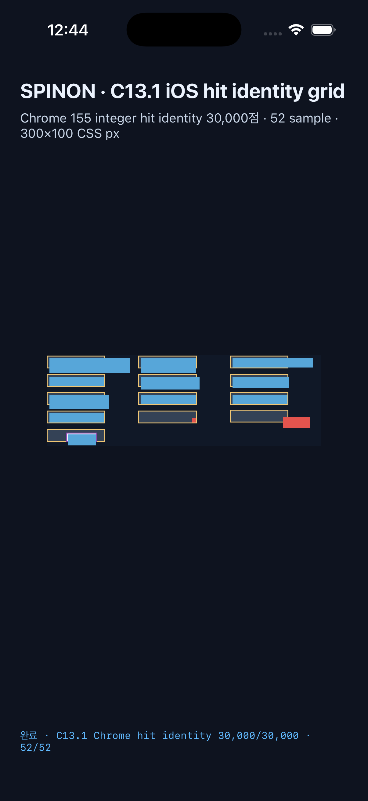

# C13.1 iOS Simulator app full hit identity grid

- 실행 묶음: `c13-1-ios-hit-grid-20261014T154338634Z-f1835c60`
- 대상: iPhone 17 Pro · com.apple.CoreSimulator.SimRuntime.iOS-26-2 · ACA7BF91-E2D5-4CF7-909A-08D1AD95FF3D
- 새 앱 프로세스 3개에서 각각 41개 frame, 52개 고정 hit sample, 30,000개 정수 좌표 hit identity를 검증했다.
- 세 실행 모두 Chrome 155 oracle identity, grid JSON, observation digest가 고정값과 일치했다.
- 41개 frame log와 52개 개별 hit sample log 모두 각 프로세스의 같은 `run_id`와 `runtime_generation=1`을 포함한다.
- 중복 C13.1 route negative control은 runtime host 초기화 전에 거부됐다.
- 파서 mutation harness는 positive assertion 5개와 negative control 23개를 통과했다. FFI full-grid 단위 테스트 8/8, workspace tests, workspace Clippy, rustfmt, iOS Simulator build도 통과했다.
- [실행 요약](./summary.json) · [parser mutation 결과](./parser-mutation-controls.log) · [parser Node test](./parser-tests.log) · [FFI hit-grid 테스트](./c13-1-ffi-hit-identity-grid-tests.log) · [workspace tests](./workspace-tests.log) · [workspace Clippy](./workspace-clippy.log) · [rustfmt](./rustfmt.log) · [구현 검토 20개](./implementation-review-20.md) · [PR 변경 검토 30개](./pr-delta-review-30.md) · build/install 로그(끝 공백 정리), process별 runtime 로그와 화면을 보존했다.
- iOS Simulator 증거만 포함한다. 실기기, Metal drawable pixel readback, DOM event dispatch, WPT 및 전체 C13.1 지원을 뜻하지 않는다.

## PR 병합 결과 · 2026-10-15

- 구현 PR [#166](https://github.com/ohah/spinon/pull/166)은 Rebase and merge로 병합됐다. GitHub mergeCommit OID와 원격 main HEAD는 894d01089b2f1c0f8a880855d1ce69b7f74912bf다.
- merge 후 agent-browser에서 PR 본문 screenshot을 다시 열어 complete=true와 1206×2622 natural dimensions를 확인했다.
- [병합 상태 동기화 PR의 30개 검토](./merge-status-review-30.md)는 상태 대장, 내부 인덱스, 원래 PR review 시점, image 지속성 및 완료 범위를 대조한다.
