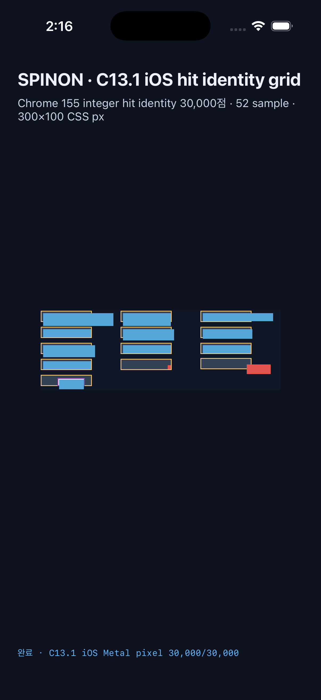

# C13.1 iOS Simulator Metal surface pixel centers

- Capture 묶음: `c13-1-ios-metal-20261014T171601787Z-572c6b6a`
- 대상: iPhone 17 Pro · com.apple.CoreSimulator.SimRuntime.iOS-26-2 · ACA7BF91-E2D5-4CF7-909A-08D1AD95FF3D
- 새 앱 process 3개에서 각각 469 batch로 30,000 CSS pixel center / 120,000 RGBA channel을 Chrome 155와 exact 비교했다.
- 각 실행에서 41/41 node frame, 52/52 고정 hit query와 30,000/30,000 hit identity가 같은 app run ID에 연결됐다.
- 각 JSONL은 surface generation, drawable 좌표·크기, RGBA, run ID를 기록하고 SHA-256을 manifest에 고정한다.
- `positioned-escape`의 `(270,72)` 표본은 overflow container의 오른쪽 border 밖에서 target paint가 유지되는 좌표다. 전체 표면 대조와 각 RGBA byte mutation control을 함께 검사했다.
- 잘못된 Metal route 단독 실행과 중복 C13.1 route가 host 생성 전에 거부됐다.
- [실행 요약](./summary.json) · build/install, 세 process log, screenshots, 직접 readback JSONL/manifest와 Chrome 비교 결과를 보존했다.
- 이 결과는 iOS Simulator의 Metal drawable 표본만 검증한다. compositor scanout, 실기기·hardware GPU, DOM events, WPT 및 C13.1 전체 완료를 뜻하지 않는다.

## iPhone 17 Pro Simulator 화면

