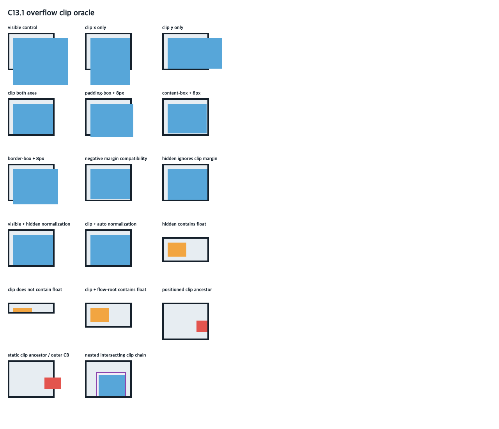

# C13.1 전체 viewport hit identity · 2026-10-14

## 범위

고정 C13.1 fixture의 유효한 13개 행을 한 Chrome page에서 두고 viewport의 모든 정수 CSS 좌표를 `elementFromPoint`로 관찰했다. Rust `RuntimeRenderSnapshot::hit_test_css_point` 결과를 `case`, clip `box`, `target`, nested `inner`, viewport `root`의 exact `NodeId`와 비교한다. 이 자료는 host Rust hit-test 비교이며 앱 runtime, surface paint, DOM event dispatch, WPT 또는 C13.1 전체 완료를 증명하지 않는다.

- agent-browser 0.31.1, Chrome for Testing `155.0.8059.40`, revision `cfaadc5a132d78e1828635aa8405a499f3e14864-refs/branch-heads/8059@{#936}`.
- viewport `1280×1100` CSS px, DPR 1, scroll `(0,0)`, fixture SHA-256 `b7acd7e63f79355b28cd480511b9be82e0f2bef478f1aadf685eb3b0bf4ef16a`.
- 13개 frame 및 1,408,000개 내부 정수 좌표를 비교했다. RLE는 1,100행·7,513 run이고 41개 hit identity가 모두 관찰됐다.
- viewport 바깥 좌/상/우/하 네 점 `(-1,20)`, `(100,-1)`, `(1280,20)`, `(100,1100)`은 Chrome `null` 및 Rust `None`으로 각각 일치했다.
- combined Rust scene의 13 section, 13 clip box, 13 target, nested inner frame은 Chrome frame에서 축별 최대 0.5 CSS px 이내여야 한다. 기존 target-frame observation은 fixture와 target frame hash로 연결한다.

## Chrome fixture 화면

이 화면은 Chrome 기준 HTML fixture의 oracle screenshot이다. Spinon Android/iOS 앱 화면이나 GPU surface 캡처로 해석하지 않는다. 화면에 보이는 invalid margin/float 행은 현재 성공 runtime scene에 포함하지 않고 Chrome hit identity를 viewport root fallback으로 접었다.

## 재현과 검증

- `capture-full-viewport-hit-identity.js`: 고정 browser viewport에서 frame·identity·RLE 및 viewport 바깥 null controls를 채집한다.
- `capture-initial-batch-error.json`: 처음 시도한 13 scene 동시 scan의 agent-browser daemon 자원 오류를 보존한다. 성공한 단일 page scan은 표본 범위를 유지한다.
- `capture-full-viewport-agent-browser-batch.json`: agent-browser batch 원본 결과.
- `chrome155-full-viewport-hit-identity.json`: 정규화된 oracle observation.
- `validate-full-viewport-capture.mjs`와 `capture-integrity-validation.log`: fixture/browser hash, case/frame 연결, run 연속성, 총 좌표와 null controls 검증.
- `focused-test.log`: `cargo test --locked -p spinon-style-to-render c131_combined_page_full_viewport_hit_identity_matches_chrome -- --nocapture` 결과.
- `workspace-test.log`: `cargo test --locked --workspace` 전체 로그(774 passed, 0 failed, 4 ignored).
- `clippy-workspace.log`: `cargo clippy --locked --workspace --all-targets -- -D warnings` 전체 로그.
- `rustfmt-check.log`와 `diff-check.log`: Rust format 및 whitespace 검사 결과.

`spec/STATUS.md`와 `plan/c13-overflow-scroll-clipping.md`에서 남은 paint surface, Android/iOS 전체 matrix, event dispatch, WPT와 scroll state 범위를 유지한다.
