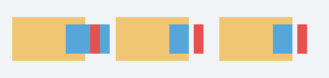

# C13.1 nested stacking descendant 사전 비교 · 2026-10-18

이 자료는 C13.1 내부 계약의 미해결 복합 stacking descendant 경계를 위한 구현 전 Chrome 기준이다. Agent Browser로 고정 HTML을 열고 viewport, computed overflow, frame, `elementFromPoint()` identity를 수집했다. 화면을 PNG로 저장한 뒤 각 표본 색은 그 PNG 바이트에서 직접 읽었다.

## 환경과 hash

- Agent Browser `0.31.1`, Google Chrome `155.0.8059.85`, macOS `26.5.1` arm64.
- User-Agent: `Mozilla/5.0 (Macintosh; Intel Mac OS X 10_15_7) AppleWebKit/537.36 (KHTML, like Gecko) HeadlessChrome/155.0.0.0 Safari/537.36`.
- Viewport `540×128` CSS px, DPR `1`, scroll `(0,0)`.
- Chrome launcher SHA-256: `6e156f2271cef44afce9db36a5b920e94518857b94a4160f082696f8c3bd1c9d`.
- Chrome Framework `155.0.8059.85` SHA-256: `b1d0216b347be90a898e9961302916aa1dbf4659f96597ea836dd3eb149574b7`.
- Fixture SHA-256: `6b691ddf5afd44543b438b47200f9a6f85981fa3d3c30e1619185a65d320791e`.
- Screenshot: [`chrome155-nested-stacking-descendants.png`](chrome155-nested-stacking-descendants.png), `540×128`, SHA-256 `a9727d516837df6c8a5d77e624aee3463b08ebfb991d8eb622d52d026c64585c`.

## 결과

세 case는 parent/layer/target/overlay의 geometry와 z-index가 같다. `visible`에서는 parent 오른쪽 clip 경계 뒤로 target의 blue paint/hit가 이어지며, `clip`·`hidden`에서는 경계 바깥 target hit가 `root`로 바뀌고 배경색이 보인다. 세 case 모두 child의 내부 `z-index`가 sibling overlay보다 커도 overlay의 red paint와 overlay hit가 우선한다.

- [geometry·computed overflow·18개 hit identity](chrome-observation.json)
- [PNG에서 읽은 18개 RGBA 및 hit 표본](chrome-paint-hit-samples.json)
- [Chrome full-version/platform metadata](chrome-browser-metadata.json)
- [원본 HTML fixture](../../../../tests/fixtures/css/c13/overflow-clip-stacking-descendants-c13-1.html)

이 자료는 Chrome oracle만 관찰한다. Spinon runtime, Android/iOS 앱, DOM event, WPT 또는 전체 C13.1 적합성을 증명하지 않는다.
