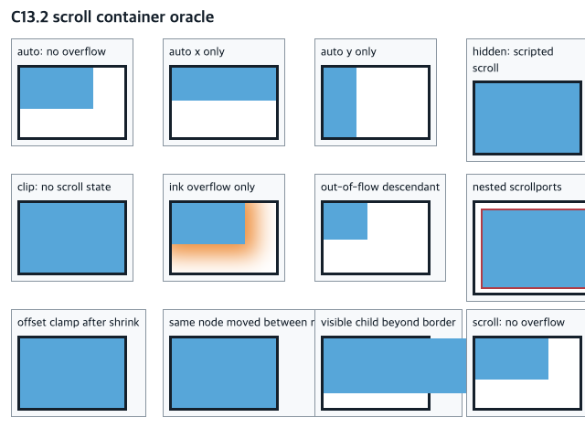
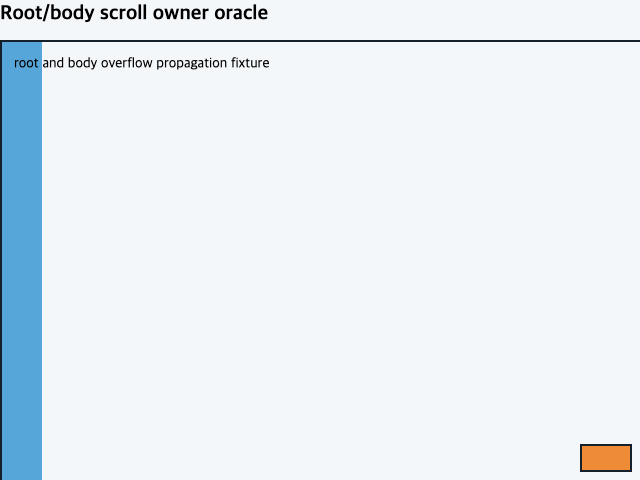

# C13.2 scroll container 사전 비교

- **상태:** 고정 Chrome oracle 캡처 완료 · C13.2 제품 구현 전
- **관찰 일시:** 2026-10-15 KST
- **기준:** Chrome for Testing `155.0.8059.40`, revision `cfaadc5a132d78e1828635aa8405a499f3e14864`, agent-browser `0.31.1`, macOS arm64, `640×480` CSS px, DPR 1.
- **입력:** [scroll container fixture](../../../../tests/fixtures/css/c13/c13-2-scroll-containers.html), [root/body fixture](../../../../tests/fixtures/css/c13/c13-2-root-scroll-owner.html), [전체 고정 observation JSON](../../../../tests/fixtures/css/references/c13-2-scroll-container-precomparison-v1.json).
- **재캡처:** 저장소 루트에서 `bun run css:reference:c13-2-scroll-precomparison`.

## 화면

## 경계 표본

첫 fixture는 같은 `120×82` CSS px border box와 `114×76` client box에서 바깥으로 그려지는 content, 실제 scrollable overflow, ink overflow를 따로 만든다.

| 사례 | Chrome 관찰 | 의미 |
| --- | --- | --- |
| `overflow:visible` 자식 | 자식이 부모 오른쪽·아래 border 밖까지 보임; `scrollWidth=160`, `clientWidth=114`; scripted write 뒤 offset `(0,0)` | 보이는 paint의 연장은 scroll state의 존재를 뜻하지 않는다. |
| out-of-flow 자식 | 자식 border box가 scrollport 오른쪽 border 밖으로 나감; `scrollWidth=178`, `clientWidth=114`, 최대 x offset `64` | 양의 방향 absolute overflow는 ink와 별도로 scrollable area에 기여한다. |
| shadow만 있는 자식 | 그림자는 scrollport 안에서 보이지만 `scrollWidth/clientWidth=114/114`, `scrollHeight/clientHeight=76/76` | ink overflow만으로 scroll range를 만들지 않는다. |
| no-overflow `auto`와 `scroll` | 양쪽 모두 `scrollWidth/clientWidth=114/114`, `scrollHeight/clientHeight=76/76`; `auto` scripted offset은 0 | range 없는 `scroll`과 no-overflow `auto`를 분리한다. |
| 한 축만 넘침 | x 전용 최대 offset `(86,0)`, y 전용 `(0,74)`; LTR negative write는 양쪽 축 모두 0으로 clamp | 축별 scrollable range와 nonnegative origin을 독립 확인한다. |
| `hidden` / `clip` | `hidden`은 scripted offset `(55,44)`를 보존; `clip`은 `(0,0)` | C13.1 clip semantics를 C13.2 scroll state와 혼합하지 않는다. |
| nested scrollers | outer `(22,17)`, inner `(42,29)` | 각 scroll owner가 독립 offset을 가진다. |
| content/descendant 변경 | 기존 `(30,20)`은 overflow 확장과 같은 owner 내 descendant 이동 뒤 유지; 과대 지정은 max `(146,124)`로 clamp; 축소 뒤 `(0,0)` | 같은 owner의 유효 offset은 유지하고 새 range 밖은 clamp한다. |
| scroll container reparent | remove/reinsert 뒤 offset `(0,0)` | 연결 트리에서 제거됐다 다시 붙는 scroll owner는 새 초기 위치로 시작하는 Chrome control이다. |

Chrome Headless의 `Element.scrollLeft/scrollTop` 정수 setter는 별도 diagnostic에서 `55.25`/`55.49`를 `55`, `55.5`/`55.51`/`55.75`를 `56`으로 반환했다. 이 반올림은 C29/S05 공개 CSSOM 입력 의미에 귀속하고, C13.2 내부 range/state 기준은 정수 CSS px offset case를 사용한다. internal subpixel state와 gesture fraction은 구현 계약/ C13.3에서 별도로 정한다.

## root/body 전파

표준 mode에서 Chrome의 `document.scrollingElement`는 네 경우 모두 `HTML`이었다. root의 overflow가 `visible`이면 body의 `auto`도 viewport로 전파되어 `window.scrollTo`/`html.scrollTop`이 움직이고 `body.scrollTop`은 0이었다. root가 `hidden`이고 body가 `auto`이면 viewport와 html offset은 0을 유지하면서 body 자체 scrollport가 `(64,83)`까지 움직였다. fixture에는 root가 움직일 때 위치를 유지하는 fixed control도 포함하며 Chrome rect는 `[580,444,52,28]`로 유지됐다.

이는 DOM `scrollTop` 공개 API 전체를 구현했다는 뜻이 아니다. C13 내부 owner mapping은 C13.2 범위에서 고정하되 `document.scrollingElement`, `Window`/`Element` CSSOM 메서드와 이벤트 공개 계약은 C29/S05 owner를 따른다.

## 고정 산출물과 제한

`tests/fixtures/css/references/c13-2-scroll-container-precomparison-v1.json`은 fixture·screenshot SHA-256, Chrome/agent-browser provenance, 모든 case의 computed overflow, rect, client/scroll dimensions, offsets와 root/body owner 결과를 보존한다. `node --test tools/css-reference/c13-2-scroll-precomparison.test.mjs`는 oracle 경계와 artifact hash를 확인한다.

이 observation은 Chrome reference일 뿐 Spinon 동작 결과가 아니다. Headless Chrome에서는 native scrollbar gutter를 보이지 않아 scrollbar allocation은 비교하지 않았다. 구현 시 Android API 37 ARM64 AVD와 iOS Simulator의 같은 내부 fixture를 각각 검증해야 하며, C13.2 전체 동작, 물리 기기, 제품 CSSOM, gesture input, scrollbar, snap, negative RTL origin 또는 WPT pass를 뜻하지 않는다.
