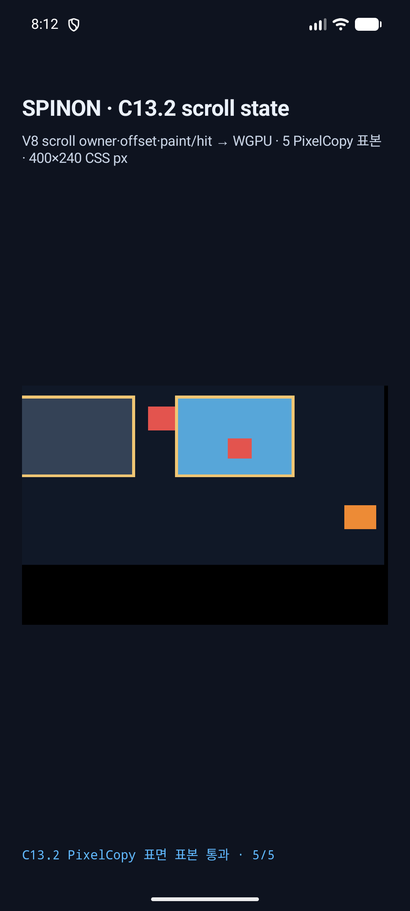
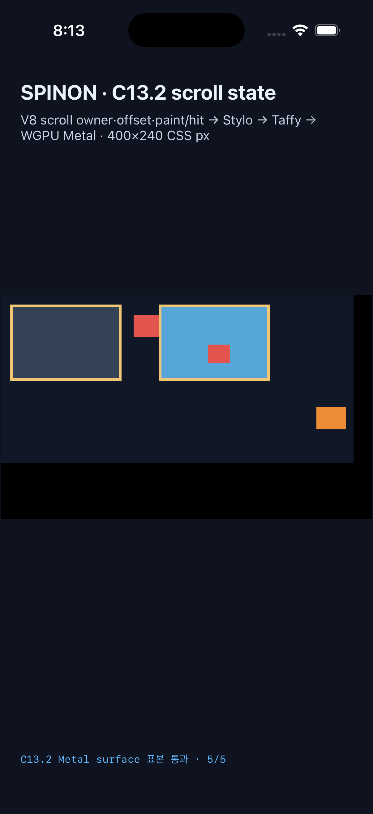

# C13.2 visible overflow surface pixel 실행 증거 · 2026-10-15

## 판정

고정 Chrome 155 oracle의 다섯 색상 표본이 Android API 37 ARM64 AVD의 SurfaceView PixelCopy와 iPhone 17 Pro / iOS 26.2 Simulator의 Metal drawable에서 각각 5/5 정확히 일치했다. stale draw에서 미제출 pixel 요청이 다음 draw로 넘어가지 않도록 renderer를 수정한 뒤 최신 소스로 run5를 다시 실행했다. Android/iOS sample log, Chrome PNG·fixture hash와 Android 저장 PNG를 독립 비교기로 다시 대조했고 지정한 변조 입력도 거부했다. 구현 20개와 PR delta 30개의 별도 적대 검토를 마쳤으나 GitHub CI와 merge는 남아 있으므로 이 결과만으로 C13.2 전체를 완료 처리하지 않는다.

기준 observation과 fixture hash는 [구현 전 Chrome evidence](../c13-2-visible-overflow-surface-pixels-plan-2026-10-15/README.md)에 있다. 최신 run ID는 `c132-surface-20261015-run5`다. 이전 run3/run4의 세부 로그·화면은 같은 디렉터리에 보존했다.

- [구현 실패 관점 검토 20개](../c13-2-visible-overflow-surface-pixels-implementation-review-20-2026-10-15.md)
- [PR 변경 적대 검토 30개](../c13-2-visible-overflow-surface-pixels-pr-review-30-2026-10-15.md)
- [feature-off/on artifact 경계](./feature-boundary.md)

## 공통 입력과 runtime revision

- CSS viewport `400×240`; 다섯 표본과 기대 RGBA는 Chrome oracle JSON의 고정값을 사용했다.
- 두 platform의 마지막 matrix draw는 `boxes=26`, `document_revision=583`, `render_tree_revision=124`, `style_revision=0`, `scroll_state_revision=8`, layout generation `1`이다.
- Android environment revision은 `0`, iOS는 `1`이다. iOS view가 초기화 뒤 실제 surface 환경을 한 번 더 적용했기 때문이다. 두 표본 요청은 각각의 final matrix draw를 가리킨다.
- Android presentation sequence는 `0`, iOS는 `19`다. 이 값은 platform-local sequence이며, run ID, PID, surface generation과 함께 각 platform 결과를 구분한다.

## Android API 37 ARM64 AVD

- AVD `spinon_api37_0_applied_txn`, read-only 실행; renderer는 SwiftShader 소프트웨어 경로다.
- SurfaceView 실제 크기 `1050×630`, CSS-to-surface scale `2.625×2.625`; 좌표는 density 추정이 아니라 실제 surface 크기에서 계산했다.
- 최신 소스에서 새로 빌드한 APK SHA-256은 `2e71dc9cab8686001b4b6fda0770427da59f58c333a8cb6fe99442a37357e9d2`다. PID `3081`, surface generation `2`, draw generation `1`, presentation sequence `0`.
- PixelCopy 결과 PNG는 `1050×630`, SHA-256 `e7f61a4433f02374e62154bf442aa4c6382aff8456bea51412673589e2b88192`다.
- [PixelCopy 로그](./android-pixelcopy-run5.log)와 [surface PNG](./android-api37-avd-pixelcopy-run5.png)에 다섯 표본의 색상, 좌표, 크기 및 hash를 기록했다.
- [짧은 run ID negative control](./android-invalid-run-id-negative-control.log)은 `SPINON_C132_ARGUMENT_ERROR ... invalid-run-id`로 종료했고 PixelCopy나 runtime host를 만들지 않았다. 사용 후 AVD `emulator-5556`을 닫았으며 기존 `emulator-5554`는 유지했다.

| 표본 CSS cell | surface pixel | 관측 RGBA | 결과 |
| --- | ---: | --- | --- |
| visible escape `(150,30)` | `(395,80)` | `(227,84,78,255)` | exact |
| parent gap `(136,30)` | `(358,80)` | `(16,24,39,255)` | exact |
| parent interior `(20,20)` | `(53,53)` | `(52,66,86,255)` | exact |
| parent border `(11,11)` | `(30,30)` | `(240,198,116,255)` | exact |
| root background `(50,110)` | `(132,290)` | `(16,24,39,255)` | exact |

## iPhone 17 Pro / iOS 26.2 Simulator

- Metal drawable `1200×720`, pixel format `Bgra8UnormSrgb`, scale `3×3`.
- PID `57858`, surface generation `1`, presentation sequence `19`, layout generation `1`.
- Readback은 compositor 제출 전 Metal drawable을 대상으로 했다. iOS screenshot은 화면 확인용이고 표본 결과의 대체물이 아니다.
- [Metal 로그](./ios-metal-run5.log)에 요청·draw revision·각 표본·5/5 summary가 있다.

| 표본 CSS cell | drawable pixel | 관측 RGBA | 결과 |
| --- | ---: | --- | --- |
| visible escape `(150,30)` | `(451,91)` | `(227,84,78,255)` | exact |
| parent gap `(136,30)` | `(409,91)` | `(16,24,39,255)` | exact |
| parent interior `(20,20)` | `(61,61)` | `(52,66,86,255)` | exact |
| parent border `(11,11)` | `(34,34)` | `(240,198,116,255)` | exact |
| root background `(50,110)` | `(151,331)` | `(16,24,39,255)` | exact |

## 비교기와 negative controls

[비교 결과 JSON](./comparison.json)은 Chrome oracle hash, 두 platform의 run/PID/surface generation, 같은 final draw revision, 좌표, RGBA, Android PNG dimensions·SHA-256을 기록한다. iOS 표본 JSON은 최종 C0410 draw report의 Metal drawable samples와도 대조한다.

`bun run test:css-c13-2-visible-overflow-surface-pixels`는 positive artifact 외에 다음 변조를 거부했다. 변조는 메모리 안의 복사본에만 적용했으며 보존한 PNG·로그는 바꾸지 않았다.

| 변조 | 기대 거부 지점 |
| --- | --- |
| escaped sample RGBA 1 byte 변경 | 고정 Chrome RGBA 비교 |
| escaped sample을 parent 안 surface 좌표로 이동 | pixel-center 좌표 비교 |
| 표본 누락 또는 중복 | 정확한 다섯 ID와 순서 비교 |
| sample run ID 또는 surface generation 변경 | 현재 run/surface identity 비교 |
| PixelCopy PNG width 또는 SHA-256 변경 | 실제 SurfaceView dimensions와 PNG hash 비교 |
| Chrome fixture hash 또는 screenshot bytes 변경 | oracle 고정 hash 비교 |

positive 비교 1건과 mutation test 5건이 통과했고 Android/iOS에서 각각 5/5 표본이 exact 일치했다.

Rust `spinon-ffi` default artifact에는 C13.2 surface-pixel FFI symbol과 전용 문자열이 없고, `c13-2-scroll-fixture-test` positive control에는 두 symbol과 fixture host 문자열이 있다. 세부 build·hash·gate는 [feature boundary 기록](./feature-boundary.md)에 있다.

## 캡처 파일

- Android app screenshot run5: `1080×2400`, SHA-256 `0234ee13b6f279920f181675298749931890de43742191819194c664141e652d`.
- iOS app screenshot run5: `1206×2622`, SHA-256 `3fd44263a63b14b93794673805e9821bbdadb8c5d742310819632f5068eabdf2`.
- Android PixelCopy surface PNG run5: `1050×630`, SHA-256 `e7f61a4433f02374e62154bf442aa4c6382aff8456bea51412673589e2b88192`.
- iOS Simulator app binary SHA-256: `675eac64646d18e4e504dd4d894d72b8209975f554ac8d9c20659652c65ec571`.

이 자료는 AVD SwiftShader와 iOS Simulator Metal의 결과다. 실기기, 하드웨어 GPU, compositor 이후 scanout, 물리 디스플레이, ink-only overflow, WPT, C13.2 전체 완료를 주장하지 않는다.
