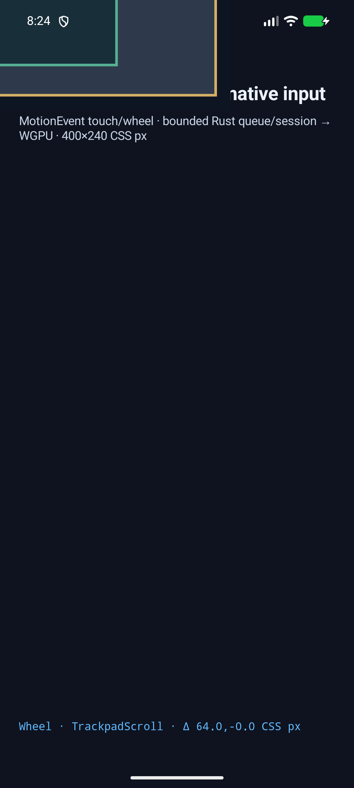

# C13.3 · Android AVD touchpad raw-point follow-up · 2026-10-16

**판정:** ADB input shell이 만든 Android ACTION_SCROLL event가 opt-in fixture harness의 translated SurfaceView에서 기존 hit-test와 native wheel queue를 통과했다. 이 결과는 AVD event와 test-only surface 배치를 확인하며 실제 외장 trackpad나 제품 화면 배치를 확인하지 않는다. C13.3 체크는 미완료다.

## 실패 원인과 수정

Android API 37 AVD에서 다음 명령은 callback에 ACTION_SCROLL, source 0x100008, pointer count 1, finger tool, raw screen point (0,0)을 전달했다.

    adb -s emulator-5554 shell input touchpad scroll --axis HSCROLL,1 --axis VSCROLL,0

기본 fixture SurfaceView origin은 (15,991)이므로 point (0,0)은 표면 밖이다. 앱은 기존 경계 규칙대로 point-outside-surface로 queue 전에 거부했다. default-rejection-android-avd.log에 이 callback과 거부가 있으며 default-surface-before.png와 default-surface-after.png의 SHA-256은 모두 f186a078d3d15f908be491730286a46452468ae6eed3419d7647d5723bb77c91이다.

Android InputShellCommand의 touchpad scroll source는 pointer-class positional axis를 채우지 않아 명령에 x/y를 붙여도 위치가 생기지 않는다. 앱은 이전 cursor 위치를 대입하지 않는다. 재현과 Android API/AOSP 비교는 [후속 계획](../../../../plan/c13-3-android-avd-touchpad-point.md)에 기록했다.

고정된 Chrome 155 fixture target (132,112) CSS px를 확인하기 위해 fixture-test APK에만 별도 intent를 추가했다. 해당 flag와 gesture fixture가 모두 활성화된 경우에만 C13.3 opt-in Java source set의 helper가 SurfaceView를 이동한다. MotionEvent 원본 좌표와 source는 그대로 둔다. default app APK에서는 helper class, intent key, origin-target marker 문자열이 빠지고 opt-in positive control에 포함된다.

## AVD 환경과 artifact

- Emulator serial: emulator-5554. 모든 ADB 명령은 이 serial에만 보냈다.
- Android 17 / API 37, ARM64, QEMU.
- Fingerprint: google/sdk_gphone16k_arm64/emu64a16k:17/CP31.260623.012/16064790:userdebug/dev-keys.
- Display: 1080×2400 px, density 420.
- C13.3 opt-in build: BUILD SUCCESSFUL. BuildConfig gesture fixture flag는 true였다.
- Opt-in APK SHA-256: ade03d16bc8e5df272560b3016c790e3a467745b2d6a0cfbad846ee8fa62328c.
- Default build: BUILD SUCCESSFUL. BuildConfig gesture fixture flag는 false였다.
- Default APK SHA-256: b872134de55d6ec0cf95301c15a1946e8c20310811e4acc1f83b6b2f06f43e1d.
- Default classes.dex/classes2.dex scan에는 `spinon_c133_touchpad_origin_target`, `SPINON_C133_TOUCHPAD_ORIGIN_TARGET`, `C133TouchpadOriginTargetFixture`, `event_source_bits=0x`, `pointer_count=`, `pointer_tool_type=`, `device_supported_source_bits=0x` 7개 marker가 모두 없었다. Opt-in APK scan에는 7개 marker가 모두 있었다.
- Build and scan logs: [default build](default-build.log) · [default DEX scan](default-artifact-scan.log) · [opt-in build](opt-in-build.log) · [opt-in DEX scan](opt-in-artifact-scan.log) · [artifact boundary comparison](artifact-boundary.txt) · [boundary discovery and correction](artifact-boundary-discovery.txt).

재현 build 명령은 다음과 같다.

    SPINON_V8_DIR=/Users/yoonhb/Documents/workspace/spinon/build/v8-source/v8 SPINON_ENABLE_C04_RUNTIME_GPU=1 SPINON_ENABLE_C13_3_GESTURE_FIXTURE_TEST=1 mise exec -- bun run build:android

Default control은 SPINON_ENABLE_C13_3_GESTURE_FIXTURE_TEST를 unset하고 같은 명령을 실행했다. AGP는 compile SDK 37.2 지원 경고를 냈지만 두 build 모두 성공했다.

## Positive AVD 실행

양성 실행은 다음 intent를 사용했다.

    adb -s emulator-5554 shell am start -W -n dev.spinon.bootstrap/.MainActivity --ez spinon_c133_gesture_fixture true --ei spinon_c133_policy_scenario_id 1 --ez spinon_c133_touchpad_origin_target true

SurfaceView size는 1050×630 px, scale은 양축 2.625 px/CSS px였다. 안정된 origin은 (-347,-294) px이고 raw screen point (0,0)은 CSS point (132.19048,112.0)으로 계산됐다. X 오차는 0.5 CSS px 이내다.

실제 AVD MotionEvent는 action 8, event source 0x100008, pointer count 1, finger tool, H axis 1.0, V axis 0.0, factor 168 physical px, normalized delta (64,0) CSS px를 기록했다. sequence 1이 admission되었고 target 7에서 process revision 2까지 진행했다. outer owner X offset은 64 CSS px, inner offset은 (86,106), root offset은 (0,0)으로 남았다. 전체 callback·queue·process·draw 기록은 [positive log](positive-android-avd.log)에 있다.

이 캡처는 테스트를 위해 SurfaceView를 이동해 일부 화면이 잘린 상태다. 하단의 Wheel · TrackpadScroll · delta 64 CSS px는 native callback 결과를 보여준다. 제품 기본 UI의 화면 캡처가 아니다.

## Negative controls

- Translation extra 없이 같은 ADB command를 실행하면 raw point (0,0)은 default SurfaceView 밖으로 판정되고 queue/process는 발생하지 않는다. [거부 log](default-rejection-android-avd.log)와 before/after screenshot으로 확인했다.
- 두 손가락 uinput helper는 앱에 SOURCE_MOUSE ACTION_DOWN/MOVE/UP, finger tool로 전달됐다. 이 event는 native ACTION_SCROLL이 아니므로 positive gate에서 제외했다. helper를 종료한 뒤 virtual device는 dumpsys input에서 사라졌다. 저장 로그의 EventHub inventory 한 줄에서 끝 공백만 제거했으며 관측 필드는 바꾸지 않았다. [uinput negative-control log](uinput-two-finger-negative-control.log).
- AVD 종료 후 Touchpad probe device가 남지 않았다. 현재 callback의 분류 근거는 MotionEvent source/action/tool이며 device-supported source bits는 진단에만 기록한다.

## 남은 검증

실제 Android 외장/내장 trackpad가 좌표 있는 sample을 제공하는지, iOS native discrete/continuous callback과 단위 변환, 실기기·hardware GPU·compositor 이후 출력은 확인하지 않았다. 화면 translation은 테스트 harness에 한정하며 앱의 정상 SurfaceView 경계 처리는 유지된다. 공개 WheelEvent/DOM scroll 지원이나 C13.3 완료를 뜻하지 않는다.
