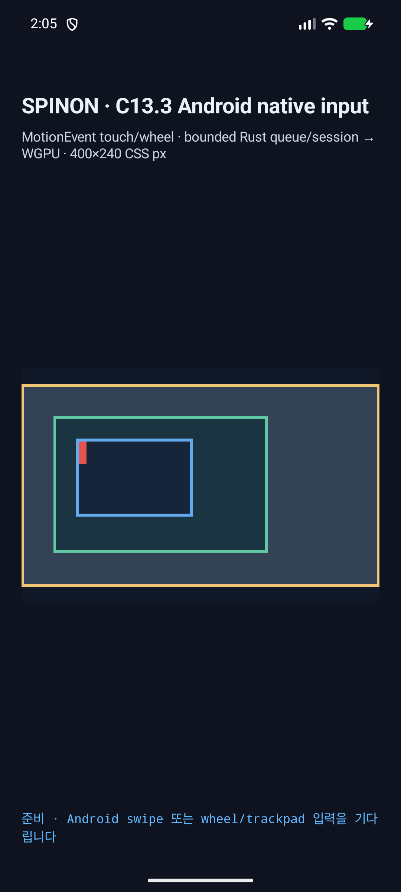

# C13.3 Android Control-wheel AVD 실행 근거 · 2026-10-16

캡처 시각: 2026-10-15T17:05:55.485Z · APK SHA-256: `e0d2f6bd86f4eafeebe437b56904beace84cc639825fb1047372fdfac66dd046` · helper SHA-256: `c0f011c3321bd9441df0519eda938efa47b3561679870a18e49f13094040348e`.

Android API 37 ARM64 AVD `emulator-5554`에서 가상 uinput pointer의 Control-left/right와 horizontal/vertical wheel을 앱 native `ACTION_SCROLL` callback까지 전달했다. 좌우 Control × 두 축 4/4 case 모두 좌 Ctrl `meta=12288`, 우 Ctrl `meta=20480`, normalized `modifiers=2`와 `reason=control-wheel`로 queue 전에 거부됐다.

각 case는 fixture를 fresh launch하고 화면 point `(132,112) CSS px`를 SurfaceView screen origin에 scale `2.625`로 더해 계산했다. 네 case에서 enqueue/process는 0건, draw revision 1, offsets `[0,0;0,0;86,106]`, SurfaceView `661,500` pixels 중 changed 0개였다. 입력 종료 뒤 virtual uinput device는 제거됐고 Android key-down/meta state는 모두 0이다.

일반 wheel positive control은 modifier 0, target 7 queue admission, revision 2와 offsets `[0,0;64,0;86,106]`을 만들었다. 전체 raw logs는 `android-control-*.log`와 `ordinary-wheel-positive-control.log`, machine record는 `android-control-wheel-runtime.json`에 있다.

이전 ADB 시도에서 `input keyevent`와 별도 `input mouse scroll` 명령은 Control meta를 공유하지 않아 callback에 modifier가 0으로 들어왔다. 이 helper는 한 Linux uinput device에서 Control key-down, wheel event, key-up을 순서대로 보내 같은 Android InputReader device의 modifier state를 사용한다. 16 KB AVD를 위해 ELF LOAD alignment 16 KB를 적용한다. 실패 시 helper는 `UI_DEV_DESTROY`와 close로 device를 정리한다.

이 결과는 API 37 ARM64 AVD의 opt-in fixture 경로만 확인한다. 실기기, 외장 trackpad, iOS callback/sign, public DOM events, compositor 이후 scanout 및 C13.3 전체 완료를 증명하지 않는다. C13.3은 미완료이고 Tailnet 로드맵 전체 완료 수는 61/197 그대로다.

opt-in APK 빌드: `SPINON_ENABLE_C04_RUNTIME_GPU=1 SPINON_ENABLE_C13_3_GESTURE_FIXTURE_TEST=1 mise exec -- bun run build:android` (고정 V8 source/build와 Android NDK 설정은 `platforms/android/README.md`를 따른다).

실행: `bun tools/css-reference/capture-c13-3-android-control-wheel-runtime.mjs --android-serial emulator-5554`. 이 도구는 API 37 ARM64 AVD `emulator-N`만 허용하며 물리 device와 `localhost` alias를 거부한다.
