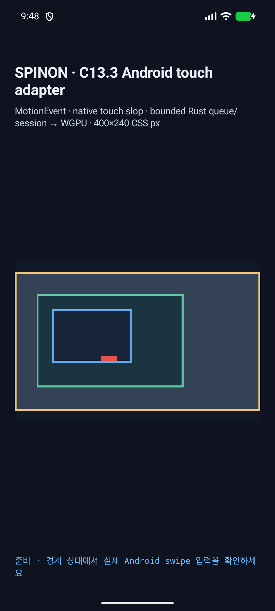
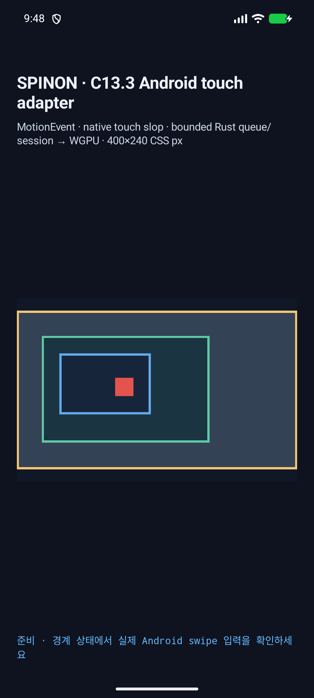

# C13.3 Android AVD 멀티터치 입력 후속

2026-10-15, Android 17/API 37 ARM64 AVD `spinon_api37_1_compat16k`에서 C13.3 second-contact 동작을 Linux evdev 입력부터 Activity `SurfaceView`의 `MotionEvent`까지 확인했다. 실기기는 사용하지 않았다. 이전에 사용하던 `MotionEvent`를 직접 만들어 `View.dispatchTouchEvent`에 넘기는 synthetic probe는 실행하지 않았다.

## 재현 결과

| 단계 | 입력 시스템 / 앱 관찰 | 기대와 결과 |
| --- | --- | --- |
| 첫 contact | `ACTION_DOWN`, 이어 `PanBegan`; target 7, inner Y offset `38.058037 CSS px`, revision 1 | 두 번째 pointer 전 pan이 이미 활성 상태였음 |
| 두 번째 contact | Android InputReader `pointerCount=2`; 앱 `event_action=5` (`ACTION_POINTER_DOWN`); `SecondPointer` cancel | 기존 inner offset과 revision 1 유지 |
| 두 번째 contact 해제 | InputReader `pointerCount=1`; 남은 첫 contact에서 move 1회 | `accepted=false` |
| 두 번째 contact가 남아 있는 동안 | 첫 contact의 후속 move 2회가 각각 `accepted=false` | 억제 상태 유지 |
| 두 번째 contact 해제 뒤, 첫 contact가 남은 동안 | 첫 contact의 후속 move 1회가 `accepted=false`; 이어 모든 contact를 해제 | 두 번째 contact가 끝났다는 이유만으로 stream이 다시 활성화되지 않음 |
| all-up | cancel 화면부터 all-up 화면까지 SurfaceView crop 차이 0 | 모든 contact가 끝나기 전까지 state가 변하지 않음 |
| fresh contact | 새 `ACTION_DOWN`/`PanBegan`; inner Y offset `76.11607 CSS px`, revision 2 | 모든 contact가 끝난 뒤 새 gesture 회복 |

세 번의 억제된 move 전부 `accepted=false`였고 root/outer offset은 0이었다. 화면 캡처는 1080×2400 PNG이며 crop `(15,1026)-(1065,1656)`에서 initial→첫 pan 1,134 pixel, 첫 pan→cancel 0, cancel→all-up 0, all-up→fresh recovery 5,103 pixel이 바뀌었다. cleanup 뒤 InputReader pointer count도 0이다. [비교값](canvas-pixel-comparison.txt) · [기계 판정 결과](scenario-results.txt) · [all-up InputReader 상태](android-input-all-up-state.txt).





## ADB 입력 실패 원인과 수정

처음에는 `adb shell input motionevent`를 검토했지만 이 명령은 `DOWN|UP|MOVE|CANCEL`만 지원하고 다중 pointer를 만들 수 없다. Linux evdev `sendevent`는 비-root `shell`에서 SELinux 정책에 막혔다. 커널 audit에는 `scontext=u:r:shell:s0`, `tcontext=u:object_r:input_device:s0`, `denied { write }`가 남았다. 이 제한은 `adb root`를 적용한 AVD에서만 해소했다.

처음 고른 `/dev/input/event11`도 잘못된 장치였다. `dumpsys input`은 이 장치를 비활성화된 virtual display에 매핑했다. 같은 AVD에서 `/dev/input/event1`은 멀티터치 slot을 제공하고 internal `displayId=0`, 1080×2400 viewport의 `DIRECT` 장치로 매핑됐다. [장치 매핑 요약](android-input-device-map.txt) · [전체 dump](android-input-device-map.log.gz) · [SELinux denial](android-avc-denial.log) · [ADB input 사용법](android-input-help.txt.gz).

고정된 evdev slot 0/1 이벤트는 Android InputReader의 실제 2→1 contact 상태와 앱이 받은 `ACTION_POINTER_DOWN`을 모두 만들었다. 따라서 이 결과는 AVD의 Linux input/EventHub/InputReader/Window dispatch 경로를 검증하지만 물리 touchscreen hardware 또는 실기기 결과는 아니다. 재현 스크립트는 물리 serial, 다른 AVD/API/ABI, root가 아닌 shell, 비활성 virtual-display 장치, 좌표 경로 변조를 입력 전에 거부한다. [실패 경로 대조](harness-negative-controls.log).

## 재현 명령

저장소 고정 V8 commit `7b50b62cb18f28617959e8452e2cd18195b38bcf`와 프로젝트 `mise.toml` Java 17을 사용한다.

```sh
SPINON_V8_DIR=/Users/yoonhb/Documents/workspace/spinon/build/v8-source/v8 \
  mise exec -- env \
  SPINON_ENABLE_C04_RUNTIME_GPU=1 \
  SPINON_ENABLE_C13_3_GESTURE_FIXTURE_TEST=1 \
  bun run build:android

adb -s emulator-5554 root
adb -s emulator-5554 install -r platforms/android/app/build/outputs/apk/debug/app-debug.apk
adb -s emulator-5554 shell am force-stop dev.spinon.bootstrap
adb -s emulator-5554 shell am start -n dev.spinon.bootstrap/.MainActivity \
  --ez spinon_c133_gesture_fixture true

# `SPINON_C133_READY input=MotionEvent`가 나온 뒤 별도 터미널에서 trace를 저장한다.
adb -s emulator-5554 logcat -v threadtime --pid="$(adb -s emulator-5554 shell pidof dev.spinon.bootstrap)"
adb -s emulator-5554 shell getevent -lt /dev/input/event1

spec/internal/evidence/c13-3-android-multitouch-simulator-2026-10-15/android-evdev-multitouch.sh \
  emulator-5554 /dev/input/event1
```

opt-in APK build transcript, APK/native library SHA-256, AVD identity, display, renderer와 serial 근거는 [run-info](run-info.txt)에 있다. 원본 Android runtime/kernel event transcript는 공백을 포함한 바이트 그대로 gzip 보관했고, [체크섬](transcript-sha256.txt)에서 압축 전후 SHA-256과 크기를 대조할 수 있다. [앱 trace](android-runtime.log.gz), [evdev trace](android-evdev.log.gz), [장치 매핑 원본](android-input-device-map.log.gz), [ADB input help](android-input-help.txt.gz)을 `gzip -dc <파일>`로 풀면 된다. 핵심 행은 [요약 trace](android-runtime-key-trace.log)에 모았다. 주입 코드는 [android-evdev-multitouch.sh](android-evdev-multitouch.sh).

첫 build 시도는 mise 환경 밖에서 Java를 찾지 못해 중단됐다. 프로젝트가 고정한 Java 17 환경을 적용한 재실행과 V8 pinned checkout 사용으로 build를 통과했다. [첫 환경 실패 로그](android-build-missing-mise-java.log).

## 범위

이 후속은 고정 opt-in C13.3 fixture와 API 37 ARM64 AVD의 Android second-contact gate만 닫는다. iOS Simulator의 별도 `UITouch` second-contact 결과는 [PR #190 evidence](../c13-3-ios-multitouch-simulator-2026-10-15/README.md)에 있다. 공개 DOM `PointerEvent`/`scroll` event, wheel/trackpad, 실기기, hardware GPU, S04.10 displayed-frame targeting, compositor 이후 scanout 및 전체 C13.3 완료를 뜻하지 않는다.

## 실행 종료와 검토 자료

이 evidence는 [PR #192](https://github.com/ohah/spinon/pull/192)에 포함했다. scoped Rspress build에서 두 화면 링크가 이미지로 렌더되지 않는 결함을 발견해 Markdown image 문법을 바로잡았다.

실행 후 `adb -s emulator-5554 unroot`로 이 AVD의 root를 해제했고, 에뮬레이터와 앱은 종료하지 않았다. 실기기 ADB serial은 사용하지 않았다. [구현/harness 실패 관점 20개](implementation-review-20.md) · [로드맵 문구 검토 20개](roadmap-review-20.md) · [PR 변경 적대 검토 30개](pr-delta-review-30.md) · [이미지 경로 수정 PR 검토](image-link-fix-pr-review-30.md).
