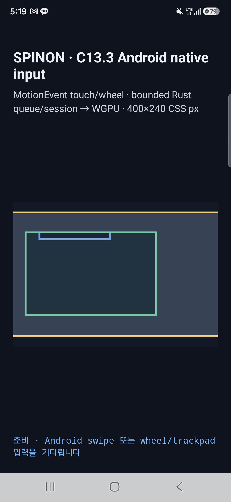

# C13.3 Android 실기기 입력·scroll 경계 확인 · 2026-10-21

## 판정

Android 실기기에서 C13.3 opt-in gesture adapter의 MotionEvent → bounded queue/session → immutable scroll snapshot → Vulkan/WGPU draw 경로를 확인했다. 합성 swipe는 nested inner 경계에서 멈춘 뒤 남은 이동량을 outer scroll owner에 전달했고, native touch slop보다 짧은 대조 입력은 scroll 상태와 표면 픽셀을 바꾸지 않았다.

## 대상과 빌드

- 기기: Samsung SM-S731N, Android 16/API 36, `1080×2340` physical px, density 450 dpi (`2.8125 px/CSS px`), ADB serial `R5KYB06SMPE`.
- 렌더러: `SPINON_C0410_RENDERER=backend=Vulkan device=Samsung Xclipse 940 format=Rgba8Unorm`.
- source: `ceb3ef5272b456c2ecd66a59b5ba9a5c6d3c0045`.
- APK SHA-256: `50c92c4890d5b3bca69c5cf69f241950fcf261f981eca9b4855dc0ccea9922c7`; 기기에 설치된 APK의 SHA-256도 같았다.
- `SPINON_ENABLE_C04_RUNTIME_GPU=1`, `SPINON_ENABLE_C13_3_GESTURE_FIXTURE_TEST=1`로 만든 debug APK다. C13.3 이외의 제품 지원이나 release APK 동작을 검증하지 않는다.
- 실행 시각: `2026-10-20T20:19:11.004Z` 양성 입력, `2026-10-20T20:19:15.307Z` below-slop 대조 입력 (KST 2026-10-21 05:19).

## 입력과 결과

- 입력은 사람이 화면을 누른 raw touch가 아니라 `adb shell input swipe`가 실기기 Android InputReader에 전달한 합성 MotionEvent다. Android 앱 callback 로그는 `event_source_bits=0x1002`, `pointer_tool_type=1` (`finger`)을 기록했다.
- 양성 경로는 scenario 1의 초기 offset `root=(0,0), outer=(0,0), inner=(86,106)`에서 surface CSS `(150,150) → (150,60)` swipe를 보냈다. 화면 좌표는 `(400,1363) → (400,1110)` physical px, 500ms였다.
- Android `ACTION_DOWN`, native slop `23px`을 넘은 `pan-began`, `ACTION_UP`이 모두 수신됐고 callback은 worker 처리를 기다리지 않았다. 29개 queue batch가 처리되고 최종 draw가 revision `28`을 게시했다. 최종 offset은 `root=(0,0), outer=(0,88.42639), inner=(86,106)`이었다. inner 세로 offset은 경계에 유지되고 나머지 이동량은 outer로 전달됐다.
- 대조 경로는 scenario 0에서 5 physical px swipe를 보냈다. 기기의 `ViewConfiguration.scaledTouchSlop=23px` 아래였고 모든 move가 `accepted=false`였다. 최종 scroll offset과 revision은 시작값 0을 유지했으며 `ACTION_UP` 뒤 queue terminal도 처리됐다.
- ADB 화면 캡처의 물리 표면 pixel 비교에서 양성 swipe는 root scrollport 안 `87,204` pixels만 바뀌고 바깥 `123,525` 비교 pixels는 0개 변경됐다. below-slop 대조는 표면 안·밖 모두 변경 0개였다. 이는 화면 캡처 표본이며 optical scanout 측정이 아니다.



## 화면 경계와 한계

SurfaceView는 `(x=-22, y=941)`에서 `1125×675px`로 생성되어 `1080px` display의 좌우를 각각 22px·23px 벗어났다. 이 fixture는 `400 CSS px` 폭을 고정하지만 기기 가용 display 폭은 `384 CSS px`다. 따라서 화면 양쪽에 fixture surface clipping이 있다. 입력은 화면 안 `(400,1363) → (400,1110)` 위치에서 수행했고, 이번 비교 대상 root scrollport는 visible display 안 `(x=23..1058, y=986..1571)`에 있었다. scroll로 달라진 pixel이 이 scrollport 밖에 없는 것은 확인했지만, 이 실행을 400 CSS px 전체 surface가 보이는 것으로 확대 해석하지 않는다.

이 결과는 C13.3 Android AVD 결과와 구분되는 단일 실기기 debug fixture 실행이다. 사람의 손가락 입력, multi-touch 동작, iOS, 다른 Android 기기, public DOM event, compositor 이후 광학 표시 시각, 일반 HTML/CSS 지원을 검증하지 않는다. C13.3은 미완료이며 공식 완료 수 `74/207`은 그대로다.

## 재현

저장소 루트에서 다음 순서로 실행한다. 첫 명령은 `platforms/android/app/build/outputs/apk/debug/app-debug.apk`를 생성한다. 설치와 실행은 반드시 지정한 실기기 serial만 사용한다.

```sh
mise exec -- env SPINON_ENABLE_C04_RUNTIME_GPU=1 SPINON_ENABLE_C13_3_GESTURE_FIXTURE_TEST=1 bun run build:android
adb -s R5KYB06SMPE install -r platforms/android/app/build/outputs/apk/debug/app-debug.apk
mise exec -- node spec/internal/evidence/c13-3-android-physical-2026-10-21/run-physical-device.mjs
```

실행 요약은 [`summary.json`](summary.json), 전체 입력·draw 로그와 시작/종료 캡처는 이 디렉터리에 보관했다. [`SHA256SUMS.txt`](SHA256SUMS.txt)는 파일별 해시다. 캡처된 텍스트에서는 줄 끝 공백과 마지막 빈 줄만 정리하며 log/event 내용은 바꾸지 않는다. 첫 캡처 시도는 signed SurfaceView origin을 양수 좌표만으로 해석한 parser 오류로 준비 단계에서 멈췄다. 다음 시도에서는 ready 로그와 draw 로그의 offset 표기 차이를 harness parser가 처리하지 못했다. 두 테스트 도구 문제를 수정하고 surface 시작점·offset 불변식 검사를 보강한 뒤 최종 실기기 실행이 통과했다. 앱 실패는 아니었다.
