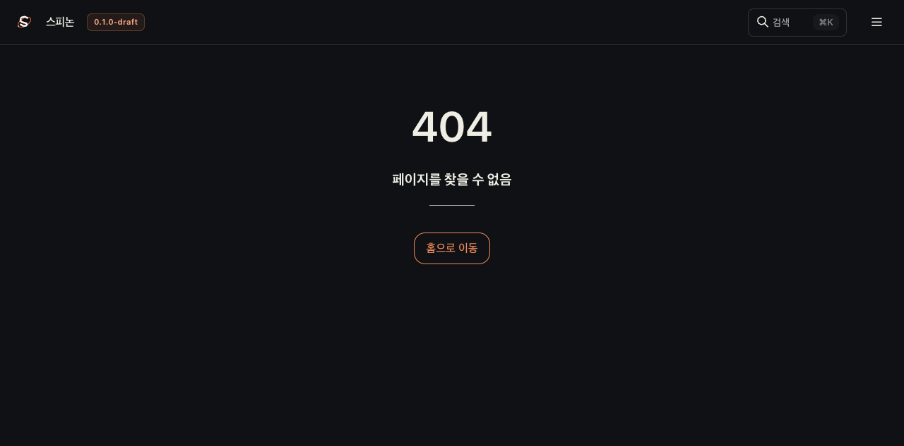
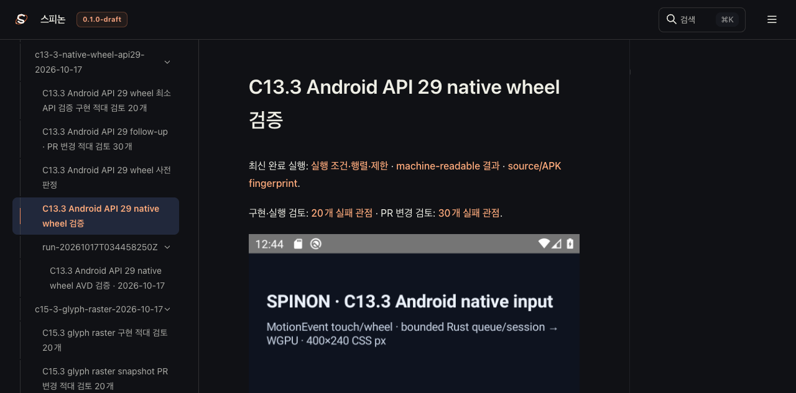

# C13.3 API 29 근거 route 링크 수정

## 재현 결과

2026-10-17 Tailnet Agent Browser에서 아래 두 경로를 직접 열었다.

| route | HTTP 응답 | Agent Browser 표시 |
|---|---:|---|
| `/spinon/spec/internal/evidence/c13-3-native-wheel-api29-2026-10-17/README.html` | 200 · 30,259 bytes | Rspress의 `페이지를 찾을 수 없음` |
| `/spinon/internal/evidence/c13-3-native-wheel-api29-2026-10-17/README.html` | 200 · 30,259 bytes | API 29 근거 문서와 AVD 화면 2장 표시 |

두 응답 본문은 같은 SHA-256 `b386b1ba14c0f6c35a746cb082e19addb76804779ca188f6522afeb7c1f655c8`다. 파일이 HTTP 200으로 제공되는지만 검사하면 브라우저에서 Rspress route가 404로 전환되는 실패를 찾지 못한다. 문서 링크는 route table에서 정상 렌더링되는 `/internal/.../*.html` 주소로 바꿨다.

`/internal/.../README.html`에서 API 29 AVD 입력 전·후 PNG가 모두 `complete=true`, natural size `1080×1920`으로 로드됐다. API 29 입력 실행 결과나 C13.3 공식 완료 상태는 변경하지 않았다.

## Agent Browser 화면

화면 해시:

- `spec-prefix-route-agent-browser.png`: `59df73cef4f3a1d4ba58d007248843480f8cc9b4836b2505c4ad7de68059d184`
- `canonical-route-agent-browser.png`: `e565dc2bc52fb888ca584c00a6a0603c689c20b8cbbe53444f1f433489be11a2`
