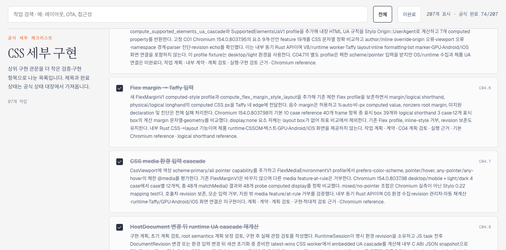
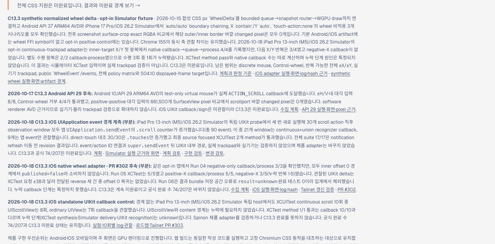
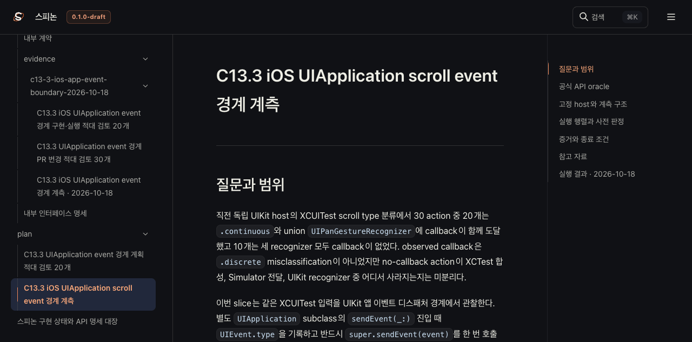
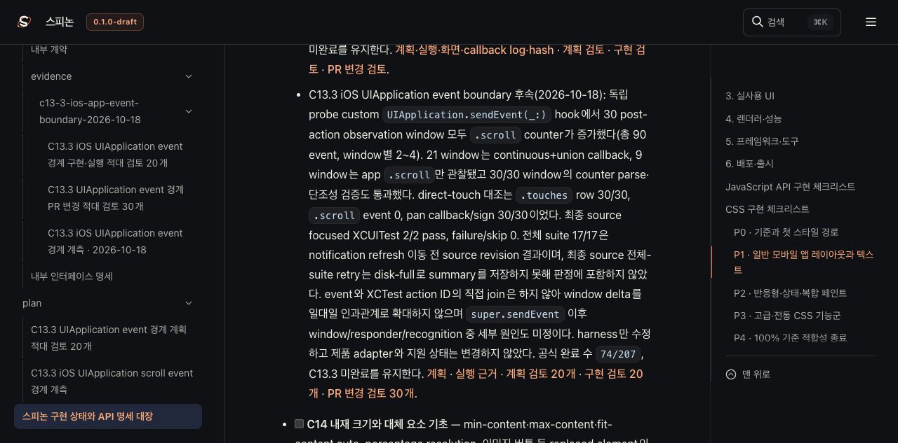
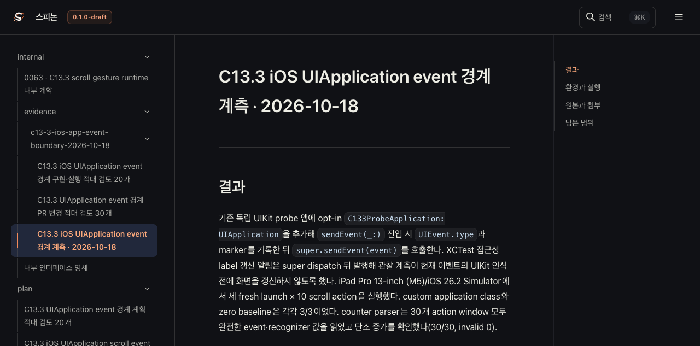

# C13.3 iOS UIApplication event boundary Tailnet 동기화 · 2026-10-18

## 갱신 범위와 공식 상태

구현 PR [#307](https://github.com/ohah/spinon/pull/307)이 Rebase and merge로 병합된 뒤, C13.3 계획·상태 대장·내부 인덱스와 iOS 앱 event-boundary 실행 근거를 Tailnet 미리보기에서 확인한다. 병합 커밋은 `faf48de4ba2ffc1d5d12bb2607419ecc220bc40b`다. C13.3은 미완료이고 공식 완료 수는 `74/207`이다. 이 동기화는 상태 대장의 완료 표식이나 제품 지원 범위를 바꾸지 않는다.

iPad Pro 13-inch (M5)/iOS 26.2 Simulator의 독립 UIKit probe에서 30 post-action observation window마다 `UIApplication.sendEvent`의 `.scroll` count가 증가했다(총 90 event). 21 window에서는 continuous+union recognizer callback도 관찰됐고 9 window에서는 앱 `.scroll`만 관찰됐다. direct-touch 대조 30/30은 `.touches` event와 pan callback/sign을 기록했다. event/action 직접 join과 `super.sendEvent` 뒤 UIKit 내부의 세부 원인은 미정이다. 최종 source focused XCUITest 2/2는 통과했으며, 이전 source revision의 full suite 17/17과 저장 공간 부족으로 판정 불가인 최종 full-suite 재시도는 분리해 기록한다. 상세 범위는 [실행 근거](../c13-3-ios-app-event-boundary-2026-10-18/README.md)에서 확인한다.

## 렌더·복사·해시 검증

Rspress `2.0.22` 선택 root에서 로드맵, 상태 대장, C13.3 내부 인덱스·계약·계획·실행 근거와 이 페이지를 렌더했다. 이는 선택한 페이지 집합의 정적 렌더 확인이다. 저장소 전체 문서 build나 전체 링크·이미지 검증으로 확대하지 않는다.

복사 전 대상 경로를 검사했다. 덮어쓰는 각 파일의 backup SHA-256을 원본과 대조하고, 복사 후 source·target 크기와 SHA-256을 비교했다. 신규 파일만 추가했고 기존 파일 삭제는 없다. 로컬과 Tailnet HTTP 응답도 파일별 status·크기·SHA-256을 비교했다.

- [선택 문서 build 결과](./render-build-result.md)
- [로드맵 파일 동기화 기록](./roadmap-sync.json)
- [사전 검사와 복사 대상 목록](./preflight-final.json)
- [기존 파일 backup 검증](./backup-verification-final.json)
- [선택 파일 복사 검증](./copy-verification-final.json)
- [로컬·Tailnet served hash 검증](./served-verification-final.json)
- [파일별 SHA-256 목록](./SHA256SUMS)
- [PR 변경 관점 검토 30개](./pr-delta-review-30.md)

## Agent Browser 확인

Agent Browser에서 로드맵 화면의 동적 공식 완료 수 `74/207`, C13.3 미완료와 event-boundary 결과, 계획·상태·실행 근거 route를 확인했다. 실행 근거 페이지의 Simulator screenshot 두 장은 각각 1536×2048 이미지로 로드됐다. 새 Tailnet 동기화 페이지 route와 링크도 최종 확인 결과에 기록한다.

- [브라우저 확인 요약](./browser-verification.json)
- [Agent Browser HTTP 요청 요약](./agent-browser-network-final.log)
- [Agent Browser 종료 확인](./browser-session-shutdown.json)

기록 파일에는 개인 경로, Tailnet 호스트 이름, process ID를 넣지 않는다. 브라우저 검증 후 해당 Agent Browser 프로세스를 종료하고 세션 비활성 상태를 확인한다.

## 남은 범위

이번 변경은 문서 미리보기의 반영·표시·파일 일치만 확인한다. Simulator 결과를 실기기나 실제 trackpad의 증거로 해석하지 않으며, C13.3 전체 기능 완료를 주장하지 않는다. GitHub Pages 배포는 하지 않았고 기존 미리보기 listener는 재시작하지 않았다.
