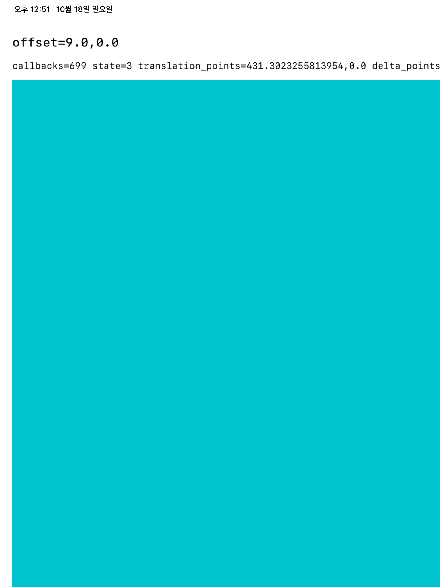
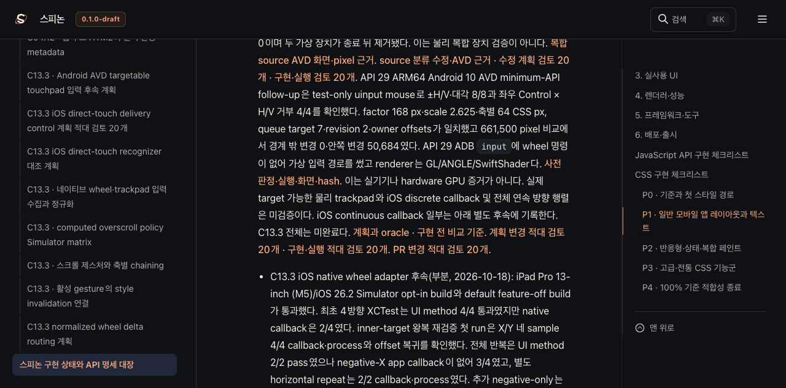

# C13.3 iOS direct-touch positive control · 2026-10-18

## 질문

기존 standalone UIKit 대조에서 `XCUICoordinate.scroll(byDeltaX:)`가 scroll view 없는 일반 UIView에도 7/10 callback을 전달했다. 이번 후속은 같은 독립 host와 `UIPanGestureRecognizer`로 XCTest direct touch를 positive control로 보내, 같은 Simulator에서 직접 touch recognizer 경로가 안정적으로 작동하는지 확인한다.

이 비교는 직접 손가락 touch와 indirect continuous scroll/trackpad를 같은 입력으로 취급하지 않는다. Apple 문서에서 `allowedScrollTypesMask`는 마우스·trackpad scroll 이벤트를 인식하도록 하고 touch 허용은 `allowedTouchTypes`로 별도 제어한다. [UIPanGestureRecognizer.allowedScrollTypesMask](https://developer.apple.com/documentation/uikit/uipangesturerecognizer/allowedscrolltypesmask) · [XCUICoordinate.press(forDuration:thenDragTo:)](https://developer.apple.com/documentation/xctest/xcuicoordinate/press%28forduration%3Athendragto%3A%29).

## 환경과 oracle

- iPad Pro 13-inch (M5), iOS 26.2 build `23C54`, Simulator UUID `9F29B0ED-C7E6-46AE-A933-14E1A87FC4DF`.
- macOS 26.5.1, Apple Silicon Simulator build.
- 독립 host bundle ID `dev.spinon.probe.oracle.host`; Spinon framework·Rust queue·renderer는 링크하지 않는다.
- Direct mode는 scroll view 없이 일반 UIView만 만들고 `allowedScrollTypesMask = []`, `allowedTouchTypes = [UITouch.TouchType.direct.rawValue]`를 사용한다. XCTest coordinate는 매 gesture에서 x=0.8→0.2 또는 x=0.2→0.8로 drag한다.
- 각 fresh app launch에서 left/right 다섯 쌍을 실행한다. 매 gesture 전후 `wheelCallbackCount`와 callback translation을 누산한 표시 offset을 읽는다.
- Continuous mode는 기존 일반 UIView scene을 별도 launch하고 `.continuous` scroll type과 `allowedTouchTypes = []`를 사용해 `coordinate.scroll(byDeltaX: ±38)`를 각각 다섯 번 요청한다.

## 결과

| 경로 | 입력 수 | UIKit callback을 낸 입력 | 방향 일치 | 관찰 |
|---|---:|---:|---:|---|
| direct touch, 3 fresh launch | 30 | 30/30 | 30/30 | 시작 callback/offset baseline 3/3 모두 0. 각 gesture translation 누산량은 약 422.3–431.3 UIKit pt였다. 이 값은 XCTest gesture 좌표 이동 관찰치이며 CSS px나 trackpad delta가 아니다. |
| indirect continuous scroll, 일반 UIView | 10 | 4/10 (positive-X 2/5, negative-X 2/5) | 해당 없음 | callback과 offset이 그대로인 입력 6개가 첨부물에 남아 있다. |

Direct-touch assertion으로 UI test method는 통과했지만, callback 개수/offset 증거는 별도 첨부물에서 판정한다. 기존 continuous-scroll 비교도 XCTest method는 통과했다. 이 실행에서 `summary.json`은 두 UI test 2/2 pass, 0 failed, 0 skipped, xcodebuild exit 0을 기록한다. 테스트 앱에는 orientation 지원과 launch screen의 향후 요구사항 경고가 있었고 기능 실패는 아니다.



같은 일반 UIView에 대한 앞선 Run 03은 7/10이었다. 이번 4/10은 누락이 재현됨을 보여주지만 비율이 달라 안정적인 누락률로 해석하지 않는다. direct touch 30/30은 간접 continuous scroll 경로의 pass를 뜻하지 않는다. 실패 계층은 계속 XCTest event synthesis, Simulator event delivery, UIKit scroll recognition 중 미확정이며, Spinon native adapter도 이 독립 host에서 시험하지 않았다.

## 실행 원본

재현은 repository의 `harness/C133WheelProbe.xcodeproj` 대신 변경된 source가 있는 현재 checkout의 동일 project를 사용했다.

```sh
xcodebuild test \
  -project spec/internal/evidence/c13-3-ios-wheel-delivery-oracle-2026-10-18/harness/C133WheelProbe.xcodeproj \
  -scheme C133WheelProbe \
  -destination 'platform=iOS Simulator,id=9F29B0ED-C7E6-46AE-A933-14E1A87FC4DF' \
  -derivedDataPath /tmp/spinon-c133-ios-wheel-delivery-oracle-run-20261018/DerivedData \
  -resultBundlePath /tmp/spinon-c13-3-ios-direct-touch-run-20261018/C133WheelProbe-direct-touch.xcresult \
  -only-testing:C133WheelProbeUITests/C133WheelProbeUITests/testDirectTouchRecognizerDeliveryControl \
  -only-testing:C133WheelProbeUITests/C133WheelProbeUITests/testContinuousScrollRecognizerWithoutScrollView \
  -parallel-testing-enabled NO CODE_SIGNING_ALLOWED=NO
```

- [result summary](./runs/summary.json) · [test tree](./runs/tests.json) · [direct-touch activities](./runs/direct-touch-activities.json) · [continuous-scroll activities](./runs/continuous-scroll-activities.json)
- [xcodebuild log](./runs/xcodebuild.log) · [exit code](./runs/xcodebuild.exit) · [xcresult attachment manifest](./runs/attachments/manifest.json) · [SHA-256 list](./runs/SHA256SUMS)
- [direct touch launch 1](./runs/attachments/94F01679-1AA8-4827-BCAA-473D82D21F27.txt) · [launch 2](./runs/attachments/2AB57670-D369-4044-BE5A-935F86EFAFA6.txt) · [launch 3](./runs/attachments/09861BD5-FC63-466E-9214-FED543A75248.txt) · [30-action aggregate](./runs/attachments/6DEBE747-92C9-4B12-98FC-6BF361DCBEA6.txt) · [all observation rows](./runs/attachments/E86993B0-D62F-47FA-BA40-D736F4BE0D67.txt)
- [continuous-scroll observation rows](./runs/attachments/899A3F19-3F40-491D-86E6-AD0575B5D528.txt) · [direct-touch Simulator screenshot](./runs/attachments/7B137B17-B73F-4A4E-AE84-22A2E1E48DD5.png)
- [plan](../../../../plan/c13-3-ios-direct-touch-delivery-control.md) · [계획 적대 검토 20개](../../../../plan/c13-3-ios-direct-touch-delivery-control-plan-review-20.md) · [실행 적대 검토 20개](./implementation-review-20.md)

두 UI test가 끝난 뒤 Xcode가 보조 `simctl diagnose`를 시작했다. 3분 이상 대기한 뒤 이 보조 작업을 중단했고, 이후 xcodebuild는 exit 0으로 종료하며 위 summary, activity tree, 첨부물을 마무리했다. 전체 시스템 진단 archive는 보존하지 않았다. 이는 UI test 결과에 영향을 주지 않으며 sysdiagnose를 수집했다고 표현하지 않는다.

## 판정

C13.3은 계속 미완료다. 이 실험은 direct touch의 독립 UIKit positive control만 추가하며 product support/API completion을 바꾸지 않는다. 공식 구현 완료 수는 `74/207`을 유지한다.

## Tailnet 미리보기와 브라우저 확인

선택한 문서 root를 RSPress `2.0.22`로 빌드한 뒤 삭제 없이 동기화했다. 첫 pass는 107개 파일(40 생성, 28 교체, 39 동일)을 대상으로 복사 후 hash 107/107, 교체 전 백업 28/28, HTTP 200 및 본문 hash 107/107을 확인했다. 새 증거 링크를 반영한 두 번째 pass는 117개 파일(10 생성, 31 교체, 76 동일), source-target hash 117/117, 교체 전 백업 31/31, HTTP 200 및 본문 hash 117/117이었다. 아래 Agent Browser 캡처를 문서에 삽입한 뒤 최종 문서 root도 다시 빌드·동기화했다. 최신 결과는 `tailnet-sync/preflight-pass-3.json`, `copy-verification-pass-3.json`, `backup-verification-pass-3.json`, `served-verification-pass-3.json`에 기록한다. 각 pass의 RSPress build log와 preflight·copy·backup·served manifest를 보존했다.

Agent Browser에서 roadmap과 STATUS route를 열어 렌더된 문서 내용을 확인했다. roadmap DOM은 `완료 74/207개`와 `207개 표시 · 공식 완료 74/207`을 표시했고, STATUS DOM에는 이 C13.3 direct-touch 기록이 포함됐다. STATUS 캡처는 관련 항목 위치로 스크롤한 화면이다. 브라우저 세션을 닫은 뒤 상태가 inactive, pid null이며 browser process-name scan 결과가 0건임을 확인했다. 세션 기록은 `tailnet-sync/agent-browser-verification.json` 및 `tailnet-sync/browser-session-shutdown.json`에 있다.



