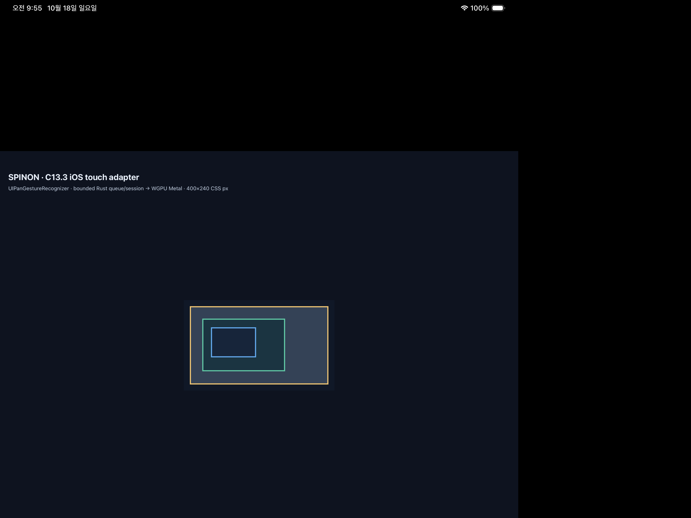

# C13.3 iOS native wheel adapter · iPadOS Simulator 부분 실행 근거

## 범위와 판정

이 후속은 C13.3 opt-in iOS fixture에서 UIKit continuous scroll callback을 native wheel sample로 바꾸어 기존 Rust bounded queue와 snapshot router에 전달하는 제한 adapter를 구현한다. 내부 계약 [0063](../../0063-c13-3-scroll-gestures.md), 계획 [native wheel 입력](../../../../plan/c13-3-native-wheel-input.md), 사전 비교 [정규화 oracle](../c13-3-native-wheel-input-precomparison-2026-10-16/normalization-oracle.json)에 연결된다. 앱 제품 API, DOM `WheelEvent`, 실기기 지원 또는 C13.3 완료를 주장하지 않는다.

iPad Pro 13-inch (M5), iOS 26.2 Simulator에서 `C133WheelProbe`의 ±X/±Y UI test method 4개는 모두 pass했다. 이는 XCTest event synthesis와 앱 lifecycle이 오류 없이 끝났다는 뜻이다. 같은 test run의 Simulator unified log에서는 continuous UIKit adapter callback이 2/4 case에서만 확인됐다.

| 방향 | native callback | queue/process | 결과 |
| --- | --- | --- | --- |
| negative Y | 있음 | 있음 | raw `+3.9068756` points → CSS `−3.9068756`; target 5의 경계에서 소비되지 않아 revision 0·offset 0 유지 |
| positive X | 있음 | 있음 | raw `−19.394547` points → CSS `+19.394547`; target 7, revision 1, inner X `+19.394547 CSS px` |
| negative X | 없음 | 없음 | XCTest method pass만 관찰 |
| positive Y | 없음 | 없음 | XCTest method pass만 관찰 |

두 callback 모두 `source=continuous-trackpad`, `unit=UIKitPoints`, `pointsPerCssPx=1.0`, `momentum_phase=None`, `modifiers=0`이었다. callback이 없는 case를 성공 입력으로 계산하거나 FFI 직접 enqueue로 대체하지 않았다. negative-Y의 처리 결과도 실제 offset 변화와 혼동하지 않는다.

## 구현

- `UIPanGestureRecognizer.allowedScrollTypesMask`를 discrete mouse와 continuous trackpad 두 recognizer로 나누고, 각 recognizer의 touch input을 비운다.
- gesture 누적 translation에서 직전 sample을 빼 callback 간 증분만 사용한다. `.began`의 nonzero sample은 보존하며 zero/duplicate terminal delta는 거부한다.
- canvas UIKit point를 CSS px로 변환하고, `delta_css = -translationDelta / pointsPerCssPx`를 적용한다. 이 부호는 현재 continuous Simulator 표본에서만 관찰했다.
- surface generation이 바뀐 첫 callback은 새 baseline으로 rebase하고 enqueue하지 않는다. invalid coordinate/scale, outside point, non-finite sample, Control-wheel, runtime not-ready/closing을 FFI 전에 거부한다.
- FFI report가 `status=0`과 `admitted=true`를 모두 만족할 때만 worker drain을 예약한다. momentum phase는 `None`으로 전달한다.
- adapter launch marker와 route allowlist는 C13.3 fixture compile flag 안에 둔다. 첫 hostile review가 발견한 feature-off allowlist 문자열 누출을 수정하고 기본 app/archive negative control을 다시 확인했다.

## 빌드·테스트와 artifact 경계

- Device: `9F29B0ED-C7E6-46AE-A933-14E1A87FC4DF`, iPad Pro 13-inch (M5), iOS Simulator 26.2, arm64.
- Opt-in build: `SPINON_ENABLE_C04_RUNTIME_GPU=1 SPINON_ENABLE_C13_3_GESTURE_FIXTURE_TEST=1 mise exec -- bun run build:ios-sim` 통과. 원본 Xcode 출력 [`xcodebuild-opt-in.log.gz`](./xcodebuild-opt-in.log.gz)을 보존했다.
- Default build: `SPINON_ENABLE_C04_RUNTIME_GPU=0 SPINON_ENABLE_C13_3_GESTURE_FIXTURE_TEST=0 mise exec -- bun run build:ios-sim` 통과. 원본 Xcode 출력 [`xcodebuild-default.log.gz`](./xcodebuild-default.log.gz)을 보존했다.
- XCUITest: 4 passed, 0 failed, 0 skipped. `xctest-four-directions.log`는 XCTest 결과이며 callback 표본은 `runtime-callbacks-sanitized.log`를 기준으로 2/4로 판정한다.
- Static source boundary: `node --test tools/css-reference/c13-3-ios-native-wheel-adapter.test.mjs` 5/5 통과.
- Opt-in app executable SHA-256: `46c19b1070ce41ff14084c5c33abf30603c2c6fc1143a213b6da72df91c49f6e`.
- Default app executable SHA-256: `3106d4e641d31f5b5f812a980d192274116c76167ef7a4e6a949cc35a6140358`; adapter launch marker가 없다.
- Default `libspinon_ffi.a` SHA-256: `26a72e2ad024fc7d1e86bb86275b77a255cc7c70562b0e6b964e84eb0eb3ea34`; `_spinon_runtime_gpu_host_enqueue_c13_3_wheel` symbol이 없다. Opt-in archive에서 해당 symbol을 확인했다.
- 상세 source/build 식별자는 [`source-revision.json`](./source-revision.json)에 둔다.

## 화면과 해석

이 캡처는 opt-in 앱의 고정 GPU fixture 장면이 그려진 것을 보여준다. 이 캡처가 나온 별도 positive-X XCTest에서는 native adapter callback이 관찰되지 않았다. 따라서 스크린샷은 runtime scene 확인용이며 scroll 처리 성공 증거가 아니다. callback과 처리 여부는 위 표와 sanitized Simulator log가 증명하는 표본에만 한정한다.

## 미완료 범위

Discrete mouse callback, iOS Control-wheel runtime rejection, pinch/magnification, 실제 trackpad/device, surface resize/background runtime negative injection, 다른 points/CSS scale, 반복 가능한 ±X/±Y 전체 행렬, screenshot pixel-diff와 compositor 이후 출력, public DOM event 및 S04.10 displayed-frame targeting을 확인하지 않았다. C13.3 체크 및 공식 완료 집계는 그대로 미완료다.
