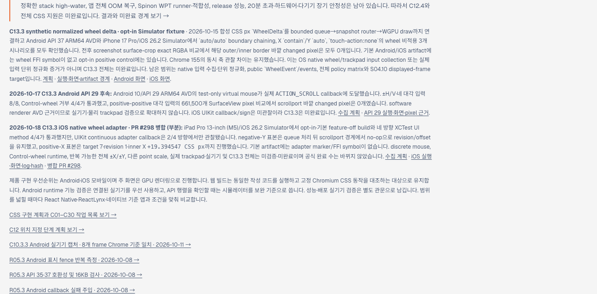
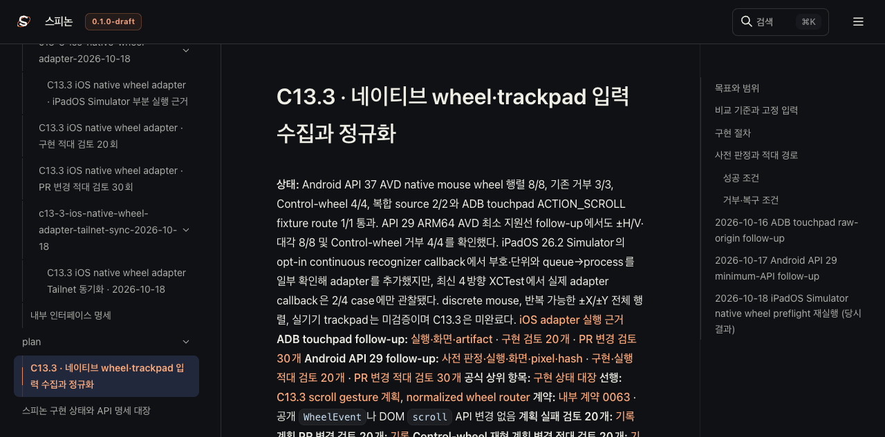

# C13.3 iOS native wheel adapter Tailnet 동기화 · 2026-10-18

## 갱신 범위와 공식 상태

구현 PR [#298](https://github.com/ohah/spinon/pull/298)이 Rebase and merge 방식으로 병합된 뒤, C13.3 계획·상태 대장·내부 인덱스와 iOS adapter 실행 근거를 Tailnet 미리보기에서 확인한다. 병합 커밋은 `3024f6c9e6fa726e4eeae44d952f56ab0a3ec6af`다. Tailnet custom roadmap에도 iOS 후속 결과와 한계를 추가했다. 이 페이지는 공식 상태 대장의 체크를 기준으로 동적 합계를 읽는다.

이번 결과는 부분 진행이다. iPad Pro 13-inch (M5)/iOS 26.2 Simulator의 최신 XCTest UI method 4/4는 통과했지만 UIKit continuous adapter callback은 2/4 방향에서만 관찰됐다. 이를 네 방향 native adapter 성공으로 확대하지 않는다. 공식 C13.3 완료 체크와 전체 완료 수는 바뀌지 않았으며 C13.3은 미완료다. Agent Browser 확인 시 화면은 공식 상태 `74/207`로 동기화됐고 C13.3 완료 체크는 그대로였다. 이 값은 캡처 시각의 동적 관찰이다. 상세 근거와 한계는 [adapter 실행·화면·log·hash](../c13-3-ios-native-wheel-adapter-2026-10-18/README.md)에 있다.

GitHub Pages 배포는 하지 않았다. 기존 Tailnet preview listener는 재시작하지 않았다. 이 변경은 저장소 문서와 사용자가 지정한 Tailnet 미리보기 사본에 한정된다.

## 렌더·복사·검증

Rspress `2.0.22`의 선택 root로 계획, 상태 대장, 내부 인덱스, 계약 0063, adapter 실행 근거, 20/30 관점 검토와 본 동기화 기록을 렌더했다. 이는 해당 선택 페이지의 정적 렌더 확인이며 저장소 전체 docs build나 전체 링크·이미지 적합성 결과가 아니다. 선택 root에서는 불러오지 않은 기존 자료 링크와 이미지가 있어 해당 링크·이미지 완전성 검사는 끄고 렌더했다.

기존 파일을 덮어쓴 경로마다 복사 전에 별도 backup root에 원본을 보관하고 backup SHA-256을 원본과 대조했다. 신규 파일을 포함해 삭제는 하지 않았다. 아래 근거에는 사전 검사·backup·복사·served hash 결과를 둔다. Tailnet과 로컬 미리보기 HTTP 응답은 Agent Browser 화면 확인 뒤 다시 요청해 status와 SHA-256을 확인했다.

- [선택 문서 build 결과](./render-build-result.md)
- [로드맵 파일 backup·copy hash](./roadmap-sync.json)
- [사전 검사와 복사 대상 목록](./preflight-final.json)
- [기존 파일 backup 검증](./backup-verification-final.json)
- [선택 파일 복사 검증](./copy-verification-final.json)
- [로컬·served HTTP hash 검증](./served-verification-final.json)
- [파일별 SHA-256 목록](./SHA256SUMS)
- [PR 변경 30 관점 검토](./pr-delta-review-30.md)

## Agent Browser 확인

Agent Browser에서 Tailnet 로드맵의 공식 완료 수 동기화 결과와 C13.3 미완료 상태, 계획 페이지의 iOS 후속 기록을 확인했다. roadmap HTML, GitHub main 상태 요청, 계획 페이지, Rspress 검색 index 요청은 모두 HTTP 200이었다. 화면 캡처는 미리보기 문서가 제공하는 상태를 보여주며 adapter callback 증거는 아니다.

- [Browser 관찰 요약](./browser-verification.json)
- [Agent Browser 요청 요약](./agent-browser-network-final.log)
- [Browser 종료 확인](./browser-session-shutdown.json)

공개 근거에는 사용자 계정 경로, Tailnet DNS 이름, process ID를 기록하지 않는다. Agent Browser를 종료하고 세션이 비활성 상태인지 확인한다. 이는 tmux 세션 또는 기존 preview listener 종료를 뜻하지 않는다.

## 판정과 남은 범위

Tailnet에서 C13.3 계획·근거 페이지를 열어 업데이트된 링크와 미완료 판정을 확인했다. 동적 official status 요청 결과는 GitHub `main`의 상태 대장과 일치해야 하며, 표시된 완료 수가 과거 로컬 값에 고정되지 않는 구성을 유지했다.

이 동기화는 iOS adapter의 미확인 방향·discrete mouse·Control-wheel·실제 trackpad·실기기·compositor 이후 pixel·전체 C13.3 범위를 검증하지 않는다. Simulator 실행과 전체 구현 상태는 계속 분리한다.
