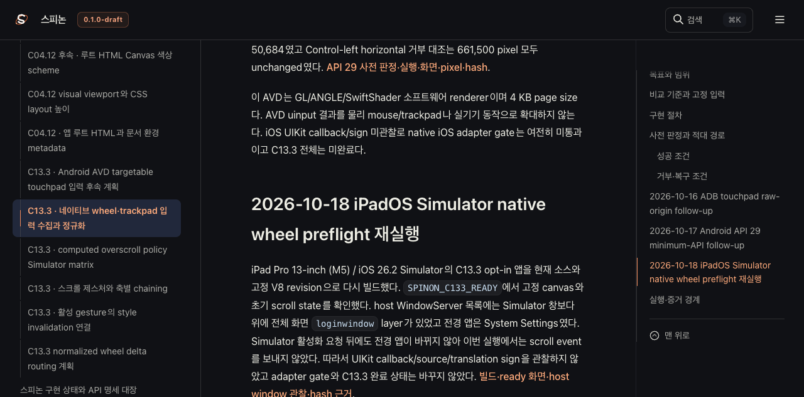
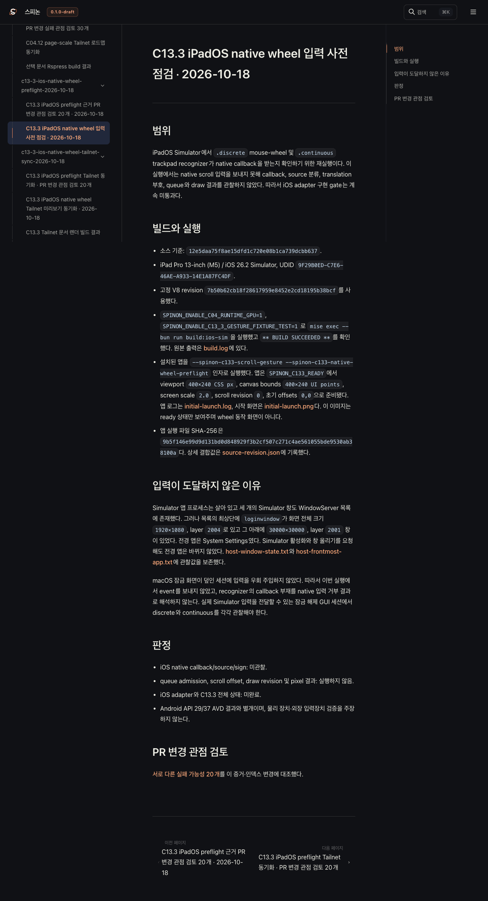
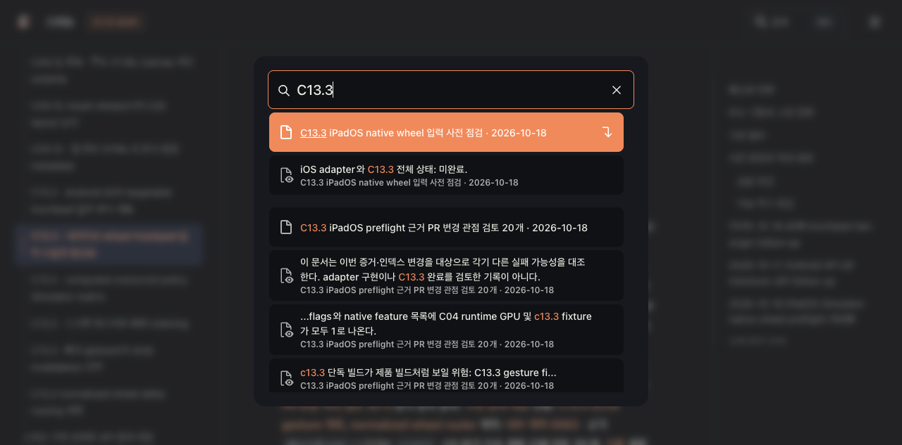

# C13.3 iPadOS native wheel Tailnet 미리보기 동기화 · 2026-10-18

## 갱신 범위

PR [#289](https://github.com/ohah/spinon/pull/289)이 병합된 뒤 C13.3 계획 페이지와 내부 인덱스를 Tailnet 미리보기에 맞췄다. 새 페이지는 iPadOS 26.2 Simulator의 앱 ready 상태와 macOS `loginwindow` 때문에 native scroll 입력을 전달하지 못한 사전 점검을 기록한다. 이번 동기화는 iOS native callback을 검증하지 않으며, iOS adapter 및 C13.3 전체 상태는 미완료다.

공식 `STATUS.md`와 public roadmap에는 새 완료 항목이 없고 그대로 두었다. 공식 완료 수는 바뀌지 않았다. GitHub Pages도 배포하지 않았다.

## 렌더와 Tailnet 동기화

Rspress `2.0.22` 선택 build는 29개 HTML route를 렌더했다. 전체 저장소 docs build는 기존 dead-link/MDX 자료 오류로 통과하지 못했다. 선택 빌드와 전체 빌드의 경계는 [렌더 결과](./render-build-result.md)에 적었다.

첫 동기화 pass는 74개 파일을 검사해 53개를 추가하고, 기존 plan/index 4개를 백업 후 교체했으며, 동일 hash 파일 17개를 건너뛰었다. 4개 백업은 모두 원본과 SHA-256이 일치했다. 삭제는 없었다. 첫 pass의 148개 local/Tailnet HTTP 응답도 전부 200 및 원본 SHA-256과 일치했다. 계획 문서의 `../spec/internal/...` raw 링크를 위해 preflight 원본 8개 파일도 `/spec/internal/evidence/...`에 별도로 복사하고 hash를 확인했다.

Tailnet 계획 화면에서 새 iPadOS preflight 절과 “C13.3 미완료” 판정을 확인했다. 렌더된 사전 점검 페이지에서는 잠금 화면이 Simulator를 가려 native 입력을 보내지 않았다는 설명이 보인다. Agent Browser는 2064×2752 Simulator ready PNG를 정상 로드했다. page·image 캡처는 아래 파일에 있다. 공개 근거에서는 개인 Tailnet DNS, 사용자 계정/checkout 경로, process ID를 가렸다. HTTP status, byte count, SHA-256 결과는 유지한다.

## Agent Browser 검색 자산 후속 수정

최종 페이지 점검 중 Agent Browser network log에서 Rspress가 요청하는 동적 `search_index.ko.7ebea52c.json` 한 개가 Tailnet에 없어서 404가 나는 것을 발견했다. 해당 파일을 선택 build output에서 복사해 local과 Tailnet에서 536,258 bytes 및 SHA-256이 일치하는 HTTP 200을 확인했다. 같은 Agent Browser 세션에서 `C13.3`을 다시 검색해 계획·preflight 결과가 표시되는 것과 해당 asset의 200 응답을 확인했다. 이전 404와 수정 후 200을 모두 [network 기록](./agent-browser-network-final.log)에 남겼다. 최종 bundle이 요청하는 locale search index도 Agent Browser에서 200이고, C13.3 native wheel/preflight와 30개 PR 검토 결과가 검색된다.

- [첫 사전 검사](./preflight-first.json), [첫 백업 검증](./backup-verification-first.json)
- [첫 복사 검증](./copy-verification-first.json), [첫 served hash 검증](./served-verification-first.json)
- [raw spec 경로 복사 검증](./raw-alias-copy-verification.json)
- [누락된 검색 인덱스 복사와 served hash](./search-index-fix-verification.json), [이전 누락/복구 요청](./agent-browser-network-before-search-index-fix.log)
- [최종 사전 검사](./preflight-final.json), [최종 백업 검증](./backup-verification-final.json)
- [최종 복사 검증](./copy-verification-final.json), [최종 served hash 검증](./served-verification-final.json)
- [Agent Browser 관찰](./browser-verification.json), [세션 종료 확인](./browser-session-shutdown.json)
- [SHA-256 목록](./SHA256SUMS)

## 검토와 제한

PR 변경 관점 검토의 [렌더된 30개 항목](./pr-delta-review-30.html)과 [Markdown 원문](./pr-delta-review-30.md)을 기록했다. [iPadOS 사전 점검의 실제 근거](../c13-3-ios-native-wheel-preflight-2026-10-18/README.md)는 앱 ready와 Simulator 가림 상태를 구분하며 wheel 실행 성공으로 표현하지 않는다.

Android AVD의 기존 결과, 이 미리보기 화면, 또는 Simulator ready 화면만으로 UIKit callback/sign, 실제 trackpad, 물리 기기, compositor 이후 pixel, WPT, 전체 CSS profile 또는 C13.3 완료를 주장하지 않는다. 기존 listener는 재시작하지 않았다. Agent Browser 세션은 확인 후 닫고 종료 상태를 기록한다.
