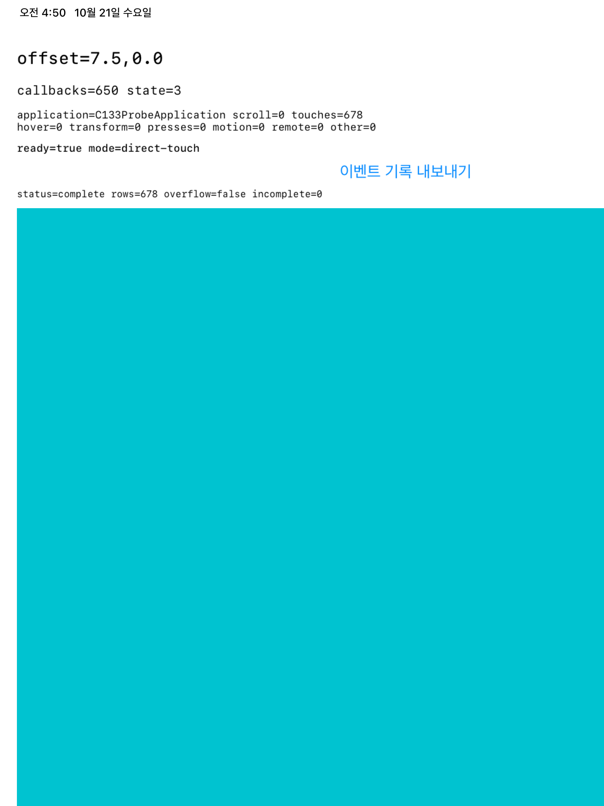
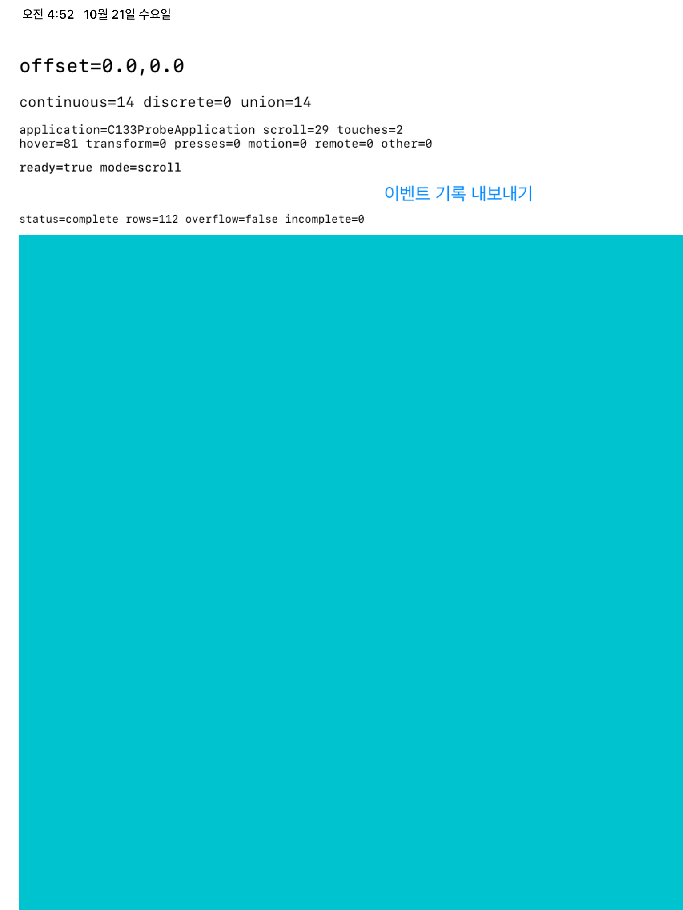

# C13.3 iOS recognizer/event pairing 계측 실행 근거

## 범위와 결과

독립 UIKit/XCUITest host에서 `UIApplication.sendEvent(_:)`가 `super.sendEvent(_:)`를 호출하기 전후로 세 recognizer의 state와 target-action callback counter를 기록했다. 제품 adapter, Rust queue, 공개 DOM event/API는 변경하지 않았다. XCUITest action과 `UIEvent` row를 직접 연결하지 않으며, 이 결과로 누락 원인을 XCTest synthesis·Simulator delivery·UIKit 내부 단계 중 하나로 특정하지 않는다.

- 대상: iPad Pro 13-inch (M5), iOS 26.2 Simulator, Xcode 26.2 (build 17C52), macOS 26.5.1.
- 최신 source/test에서 지정한 두 UI test가 통과했다: **2 passed, 0 failed, 0 skipped**. 전체 테스트 실행 시간은 약 292초다. [xcresult summary](xctest/test-results-summary.json) · [xcodebuild log](xctest/xcodebuild.log).
- Scroll type-mask mode는 3 fresh launch × 양·음 X 각 5회로 30 action을 실행했다. 30/30 action observation window에서 앱 `.scroll` counter가 증가했고 15/30 window에서 하나 이상의 recognizer callback counter가 증가했다. 이 window 집계는 event/action ID 대응이 아니다.
- Per-event scroll ledger에는 `UIEvent.type.rawValue=10` row가 90개 있었다. 그중 같은 `sendEvent` row에서 continuous+union callback delta가 함께 증가한 row는 30개, discrete delta는 0개였다. 그 밖의 60개 scroll row에서는 callback delta가 없었다. continuous/union 불변식 위반은 0개다.
- Direct-touch positive control은 별도 fresh process 3회 × 10 drag에서 `.touches`, callback, signed offset이 각각 30/30 action window로 확인됐다. 이는 indirect trackpad scroll 증거에 합산하지 않는다.
- 앱이 export한 여섯 JSON은 2,384 event row 전체에서 sequence 연속성, main-thread capture, 완전한 pre/post snapshot, monotonic receive time, callback 단조성, overflow 및 union 검사를 통과했다. Scroll mode ledger는 339 row, direct-touch mode는 2,045 row다. 세부 집계는 [analysis.json](analysis.json), 원본은 [ledgers/](ledgers/)에 있다.

## 화면 근거

캡처는 export 완료 뒤 저장했다. 화면 문구가 잘리지 않고 ready marker, callback/event counter, `status=complete`를 확인할 수 있다.





## 재현

```sh
xcodebuild test \
  -project spec/internal/evidence/c13-3-ios-wheel-delivery-oracle-2026-10-18/harness/C133WheelProbe.xcodeproj \
  -scheme C133WheelProbe \
  -destination 'platform=iOS Simulator,id=9F29B0ED-C7E6-46AE-A933-14E1A87FC4DF' \
  -parallel-testing-enabled NO \
  -only-testing:C133WheelProbeUITests/C133WheelProbeUITests/testPerEventRecognizerRowsForScrollTypeMasks \
  -only-testing:C133WheelProbeUITests/C133WheelProbeUITests/testPerEventRecognizerRowsForDirectTouchControls \
  -resultBundlePath /tmp/spinon-c133-recognizer-event-pairing-20261021-01/final.xcresult \
  CODE_SIGNING_ALLOWED=NO
```

원장 분석기는 아래와 같이 다시 실행한다.

```sh
node spec/internal/evidence/c13-3-ios-recognizer-event-pairing-2026-10-21/analyze-ledgers.mjs \
  spec/internal/evidence/c13-3-ios-recognizer-event-pairing-2026-10-21/ledgers \
  6c307b8e-1ad2-4ab6-88b7-6ee4013644e6 \
  79ca17bc-eae3-436d-a9ef-4571fd3eaf0f
```

Xcode 결과 bundle은 `/tmp/spinon-c133-recognizer-event-pairing-20261021-01/final.xcresult`에 남아 있고, 공유 근거에는 요약·log·attachment manifest·두 screenshot·여섯 JSON을 보존했다. 실행 파일 및 source hash는 [`SHA256SUMS.txt`](SHA256SUMS.txt)에 기록한다.

## 판정 한계

`sendEvent` 전후 snapshot은 그 dispatch 동안의 공개 state와 callback counter만 설명한다. 한 XCTest action이 여러 event를 만들 수 있고, 15/30 action-window callback 결과를 90 scroll event row에 개별 배분하지 않는다. 3회 실행 사이 callback 빈도도 일정하지 않았다. iOS Simulator와 XCTest가 만든 입력이며 실제 외장 trackpad, 실기기, UIKit private recognizer decision, compositor/scanout은 검증하지 않았다. 이 조사는 C13.3 제품 지원 완료나 공식 완료 수 증가를 뜻하지 않는다.

## 검토 기록

- [구현·실행 실패 관점 20개](implementation-review-20.md)
- [이번 변경 전체의 PR 실패 관점 30개](pr-delta-review-30.md)
