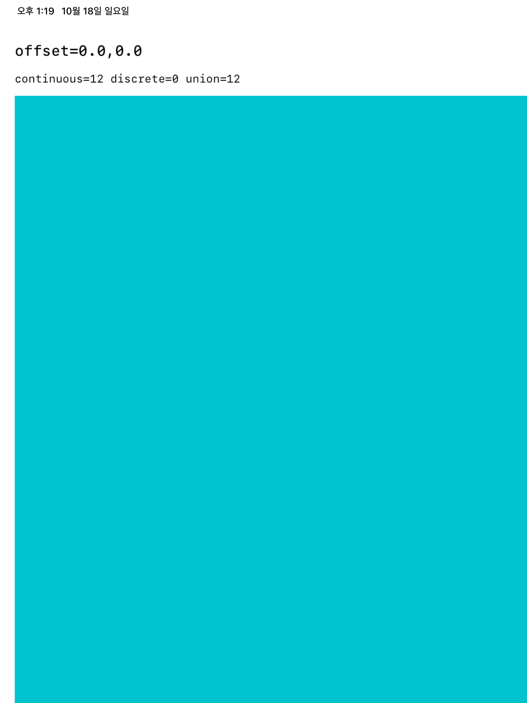
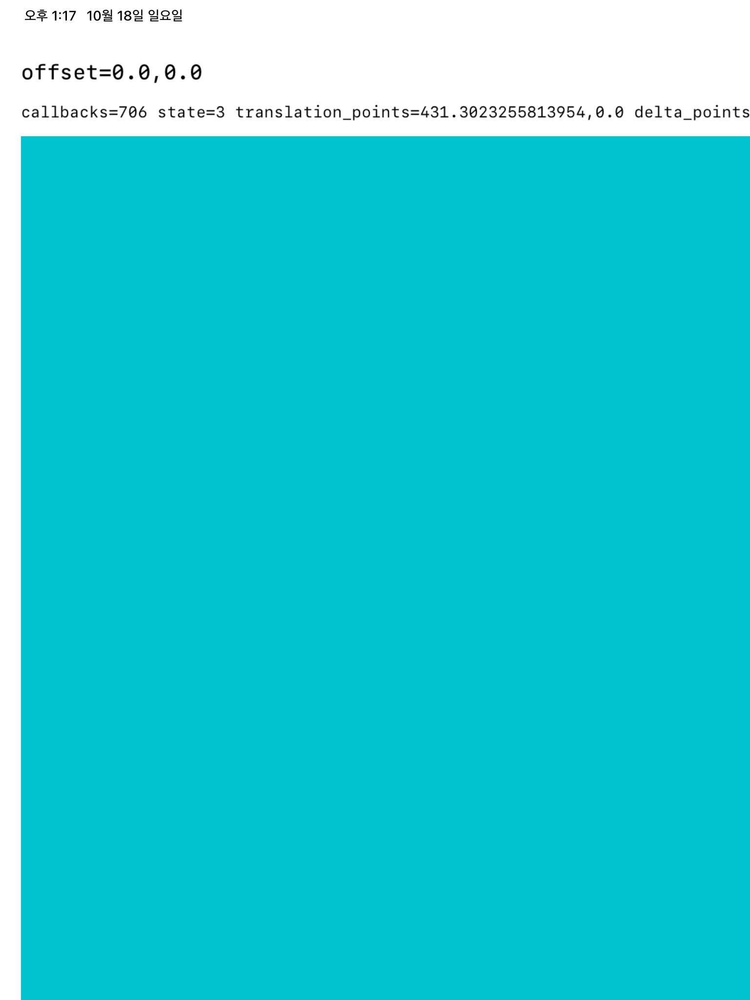
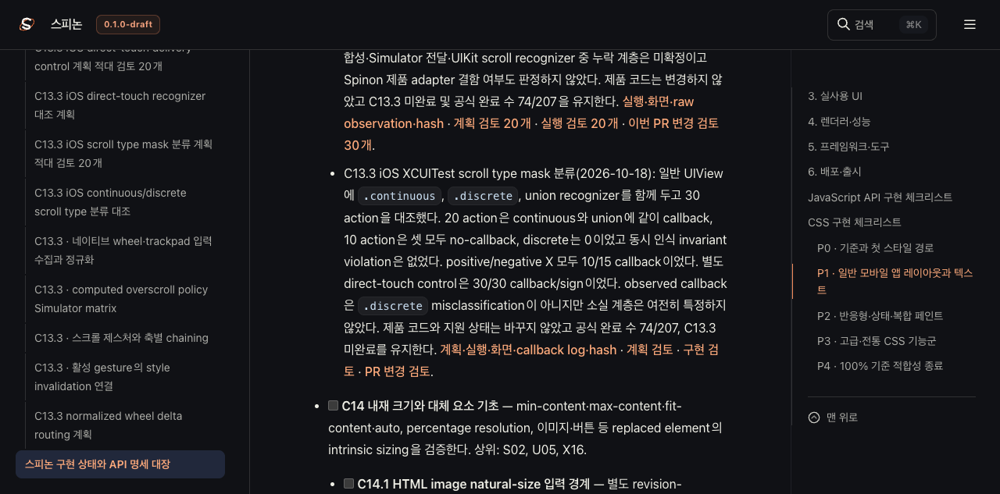

# C13.3 iOS XCUITest scroll type mask 분류 · 2026-10-18

## 결과

XCUITest `scroll(byDeltaX:)`를 같은 일반 UIView에 동시에 연결된 `.continuous`, `.discrete`, union-mask `UIPanGestureRecognizer` 세 개에 보냈다. iPad Pro 13-inch (M5)/iOS 26.2 Simulator build `23C54`에서 세 fresh launch 모두 zero baseline이었다. 30개 action 중 **20개는 continuous와 union recognizer에 callback이 함께 도달했고, 10개는 어느 recognizer에도 callback이 없었다. `.discrete` callback은 0개**였다. 방향별 분포는 positive-X 10/15 callback, negative-X 10/15 callback으로 같았다. 세 recognizer 동시 인식 invariant 위반은 0이었다.

Simulator unified log의 callback 기록은 continuous 41행, union 41행, discrete 0행이다. 이는 callback event 행 수이며 30개의 XCUITest action 수와 다르다. action별 관찰 표와 callback log가 서로 맞는다. 이번 실행의 no-callback 10개는 discrete mask 거부로 설명되지 않지만, XCTest synthesis·Simulator delivery·UIKit scroll recognition 중 어느 단계에서 빠졌는지는 아직 특정하지 않는다.

같은 xcodebuild run에서 direct-touch positive control도 별도 실행됐다. 앱 3회 fresh launch × 10 gesture 모두 callback과 translation 부호가 맞았다(30/30, 30/30). 이는 direct touch가 다른 input source인 점을 유지한 독립 recognizer control이며 indirect scroll 결과와 합산하지 않는다.





## 환경과 실행

- 독립 host `dev.spinon.probe.oracle.host`; Spinon framework, runtime queue, product adapter, UIScrollView 없음.
- iPad Pro 13-inch (M5), iOS 26.2 build `23C54` Simulator, UUID `9F29B0ED-C7E6-46AE-A933-14E1A87FC4DF`; macOS 26.5.1, Xcode 26.2 build `17C52`.
- XCUITest scroll type 분류와 direct-touch control, 2개 UI test method가 pass, 실패 0, skip 0, xcodebuild exit 0이었다. 두 method 모두 orientation/launch-screen Info.plist 향후 요구 warning이 있었고 기능 실패는 아니다.
- 재현 명령:

```sh
xcodebuild test \
  -project spec/internal/evidence/c13-3-ios-wheel-delivery-oracle-2026-10-18/harness/C133WheelProbe.xcodeproj \
  -scheme C133WheelProbe \
  -destination 'platform=iOS Simulator,id=9F29B0ED-C7E6-46AE-A933-14E1A87FC4DF' \
  -derivedDataPath /tmp/spinon-c13-3-ios-scroll-type-mask-run-20261018/DerivedData \
  -resultBundlePath /tmp/spinon-c13-3-ios-scroll-type-mask-run-20261018/C133WheelProbe-scroll-type-mask.xcresult \
  -only-testing:C133WheelProbeUITests/C133WheelProbeUITests/testScrollTypeMaskDeliveryClassification \
  -only-testing:C133WheelProbeUITests/C133WheelProbeUITests/testDirectTouchRecognizerDeliveryControl \
  -parallel-testing-enabled NO CODE_SIGNING_ALLOWED=NO
```

## 원본과 범위

- [xcodebuild exit와 log](./runs/xcodebuild.exit) · [summary](./runs/summary.json) · [test tree](./runs/tests.json) · [scroll-type activities](./runs/scroll-type-activities.json) · [direct-touch activities](./runs/direct-touch-activities.json) · [SHA-256 목록](./runs/SHA256SUMS)
- [30-action observation](./runs/attachments/scroll-type-observations.txt) · [launch별 rows 1](./runs/attachments/scroll-type-launch-1.txt), [2](./runs/attachments/scroll-type-launch-2.txt), [3](./runs/attachments/scroll-type-launch-3.txt) · [aggregate](./runs/attachments/scroll-type-summary.txt)
- [process/thread 식별자를 제거한 Simulator callback 행](./runs/attachments/scroll-type-callbacks.txt) · [log 추출 집계](./runs/callback-log-summary.json) · [xcresult attachment manifest](./runs/attachments/xcresult-export-manifest.json)
- [direct-touch 30개 observations](./runs/attachments/direct-touch-observations.txt) · [aggregate](./runs/attachments/direct-touch-summary.txt)
- [C13.3 계획](../../../../plan/c13-3-ios-scroll-type-mask-classification.md) · [계획 실패 검토](../../../../plan/c13-3-ios-scroll-type-mask-classification-plan-review-20.md) · [구현·실행 검토](./implementation-review-20.md) · [PR 변경 검토](./pr-delta-review-30.md)
- Apple [`UIPanGestureRecognizer.allowedScrollTypesMask`](https://developer.apple.com/documentation/uikit/uipangesturerecognizer/allowedscrolltypesmask) · [`UIScrollType`](https://developer.apple.com/documentation/uikit/uiscrolltype).

## Tailnet 미리보기

Tailnet 문서 미리보기에서 Agent Browser로 roadmap의 공식 완료 수 `74/207`과 C13.3 미완료 상태, STATUS의 새 분류 기록과 근거 링크를 확인했다. 아래는 그 세션에서 캡처한 문서 화면이다. 미리보기 서버는 재시작하지 않았고, 브라우저 세션과 실행 프로세스는 확인 후 종료했다.




최초 evidence page 확인에서 원본 plan 링크 2개가 repository 경로에서는 맞지만 RSPress의 `spec/` root 제거 뒤 `/spinon/` 밖으로 해석되는 것을 발견했다. Tailnet 미리보기에서만 생성된 HTML 링크를 실제 `.html` route로 바꿨고, repository Markdown은 수정하지 않았다. 적용 내역은 [rendered route 보정](./tailnet-sync/rendered-link-rewrite-pass-3.json)에 남긴다. 최종 동기화는 렌더된 페이지와 문서가 링크하는 원본 plan·evidence를 함께 대조한다. 파일별 사전 검사, 교체 백업, 복사 hash, HTTP 응답 hash와 Agent Browser 검증·종료 기록은 같은 `tailnet-sync/` 폴더에 남긴다.

xcodebuild test가 끝난 뒤 보조 `simctl diagnose`가 3분 이상 대기해 해당 child를 interrupt했다. 이후 xcodebuild는 exit 0으로 종료했고 result bundle과 위 attachments가 완성됐다. 전체 diagnostic archive는 수집되지 않았다. Simulator unified log를 필터링할 때 local user lookup warning이 있었지만 callback marker 행은 추출됐다. 공유 xcodebuild/activity log와 callback derivative에서 local process/thread identifiers는 제거했다.

## 판정

이번 입력의 observed callback은 `.continuous`로 분류됐고 `.discrete` misclassification은 관찰되지 않았다. 10/30 action에서 callback이 없던 정확한 원인은 미확정이다. 제품 adapter 변경 근거로 사용하지 않았고, 실제 trackpad·discrete mouse·실기기 및 C13.3 product support는 검증하지 않았다. 공식 완료 수 `74/207`을 유지하며 C13.3은 미완료다.
