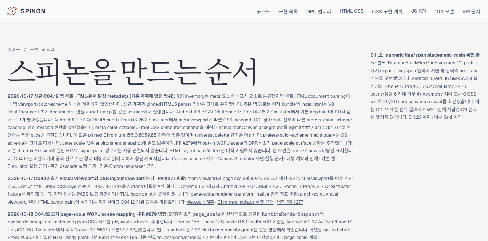
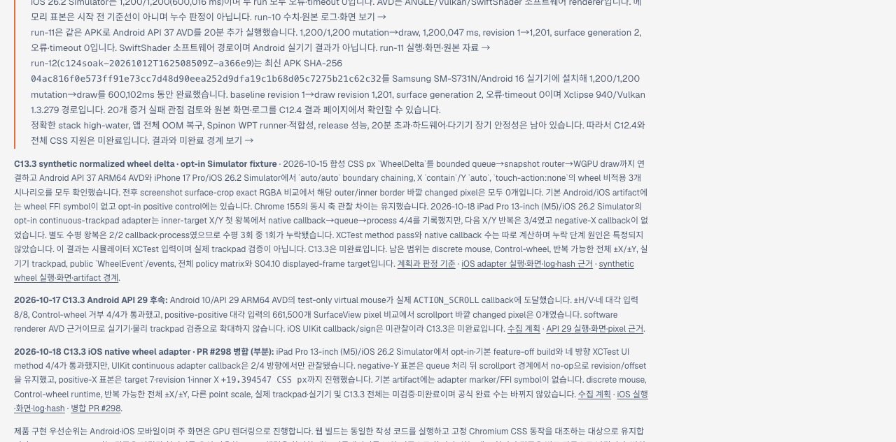
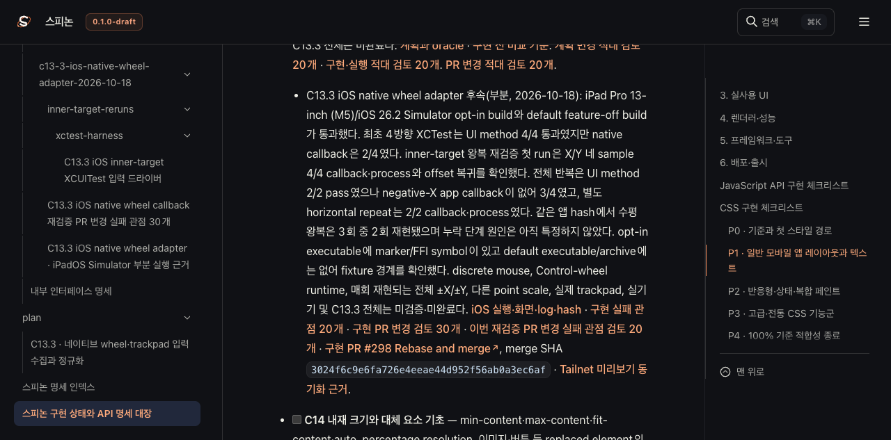
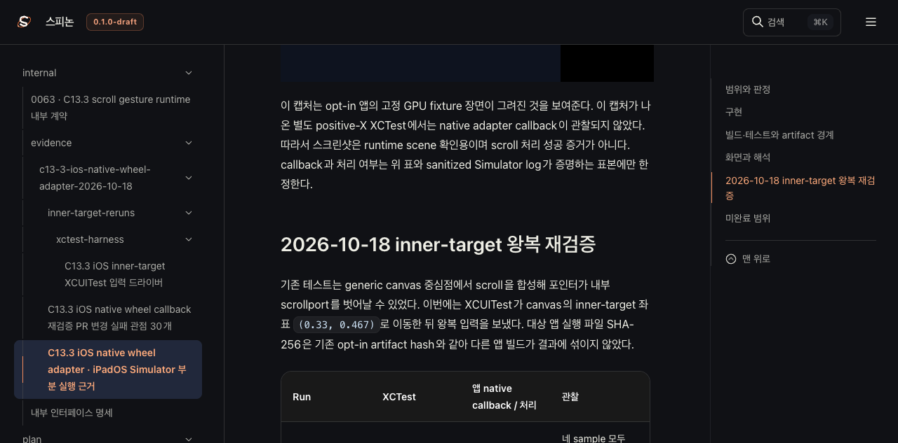
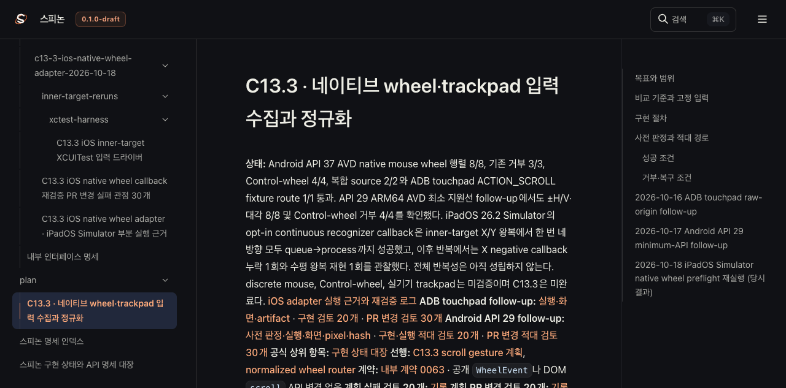

# C13.3 iOS wheel 재검증 Tailnet 로드맵 동기화 · 2026-10-18

## 갱신 범위

PR [#300](https://github.com/ohah/spinon/pull/300)이 Rebase and merge로 병합된 뒤 공식 계획, 상태 대장과 정적 `roadmap.html`을 Tailnet 미리보기와 맞췄다. C13.3 결과는 iPad Pro 13-inch (M5)/iOS 26.2 Simulator의 opt-in continuous-trackpad XCUITest 재검증이다. 공식 체크 상태는 그대로 미완료다.

상태 대장과 로드맵 화면은 공식 완료 `74/207`을 표시했다. 상위 항목은 78개, 세부 ID는 127개, ID 없는 하위 체크는 2개다. 이번 변경은 완료 항목을 추가하지 않았다.

## 선택 렌더와 파일 전달

Rspress `2.0.22`로 8개 Markdown route를 선택 root에서 빌드했다. `roadmap.html`은 `spec/public/roadmap.html`의 static file로 함께 출력됐다. 이 선택 빌드는 필요한 C13.3 페이지를 생성한 부분 렌더이며 전체 문서·링크·이미지 적합성 검사로 취급하지 않는다. 실제 실행과 남은 범위는 [iOS Simulator 실행 근거](https://github.com/ohah/spinon/blob/main/spec/internal/evidence/c13-3-ios-native-wheel-adapter-2026-10-18/README.md)에 있다.

전체 `mise exec -- bun run docs:build`는 540개 문서 페이지의 기존 dead-link 오류로 실패했다. 변경된 iOS evidence README는 raw artifact와 plan 링크를 GitHub 경로로 바꾼 뒤 해당 페이지의 dead-link 그룹이 사라졌다. 선택 build는 dead-link/image checks를 끈 채 8개 route만 만들었으므로 전체 build 통과라고 보고하지 않는다. [전체 build 경계 요약](https://github.com/ohah/spinon/blob/main/spec/internal/evidence/c13-3-ios-wheel-callback-recheck-tailnet-sync-2026-10-18/full-docs-build-boundary.json)과 [선택 build 요약](https://github.com/ohah/spinon/blob/main/spec/internal/evidence/c13-3-ios-wheel-callback-recheck-tailnet-sync-2026-10-18/selected-build-summary.json)을 보관한다.

Preview root에는 build 산출물과 필요한 Markdown/source evidence 75개를 copy-only로 반영했다. 32개를 추가했고, 기존 12개는 전용 backup root에 원본 SHA-256을 확인한 뒤 교체했으며 31개 동일 hash 파일은 건너뛰었다. 삭제는 없었다. 로컬과 Tailnet에서 각 대상 파일을 모두 GET해 총 150개 응답이 HTTP 200 및 기대 SHA-256과 일치했다. Listener port 8768은 실행 전후 그대로 유지했고 재시작하지 않았다.

- [사전 대상 inventory와 hash](https://github.com/ohah/spinon/blob/main/spec/internal/evidence/c13-3-ios-wheel-callback-recheck-tailnet-sync-2026-10-18/preflight.json)
- [교체 전 backup hash 검증](https://github.com/ohah/spinon/blob/main/spec/internal/evidence/c13-3-ios-wheel-callback-recheck-tailnet-sync-2026-10-18/backup-verification.json)
- [copy 결과와 hash](https://github.com/ohah/spinon/blob/main/spec/internal/evidence/c13-3-ios-wheel-callback-recheck-tailnet-sync-2026-10-18/copy-verification.json)
- [local/Tailnet HTTP 및 served hash](https://github.com/ohah/spinon/blob/main/spec/internal/evidence/c13-3-ios-wheel-callback-recheck-tailnet-sync-2026-10-18/served-verification.json)
- [Agent Browser 화면 관찰](https://github.com/ohah/spinon/blob/main/spec/internal/evidence/c13-3-ios-wheel-callback-recheck-tailnet-sync-2026-10-18/browser-verification.json)
- [Rspress selected build log](https://github.com/ohah/spinon/blob/main/spec/internal/evidence/c13-3-ios-wheel-callback-recheck-tailnet-sync-2026-10-18/selected-build.log)
- [적대적 검토 30항목](./pr-delta-review-30.md)
- [SHA-256 목록](https://github.com/ohah/spinon/blob/main/spec/internal/evidence/c13-3-ios-wheel-callback-recheck-tailnet-sync-2026-10-18/SHA256SUMS)

## Agent Browser 관찰과 제한

Agent Browser에서 `/spinon/roadmap.html`, `/spinon/STATUS.html`, C13.3 plan/evidence route를 확인했다. 로드맵은 `74/207`을 표시하고 C13.3를 미완료로 남겼다. evidence 페이지의 새 PNG는 `2752×2064`로 로드됐다. 이 문서 화면은 Tailnet 문서 반영 근거이며 앱 입력이나 callback의 추가 실행 근거가 아니다. PR #300의 본문 screenshot도 Agent Browser에서 원본 image `2752×2064`로 표시되는 것을 확인했다.

GitHub Pages를 배포하지 않았고 물리 기기를 사용하지 않았다. 터미널 브라우저를 실행하지 않았으며 tmux 세션을 건드리지 않았다. PR #301 본문 screenshot의 실제 로드와 표시를 Agent Browser에서 확인한 뒤 세션을 종료했다. 종료 뒤 세션은 비활성, 활성 세션 수는 0, `agent-browser` 프로세스 검출은 없었다. [세션 종료 확인](https://github.com/ohah/spinon/blob/main/spec/internal/evidence/c13-3-ios-wheel-callback-recheck-tailnet-sync-2026-10-18/browser-session-shutdown.json).
