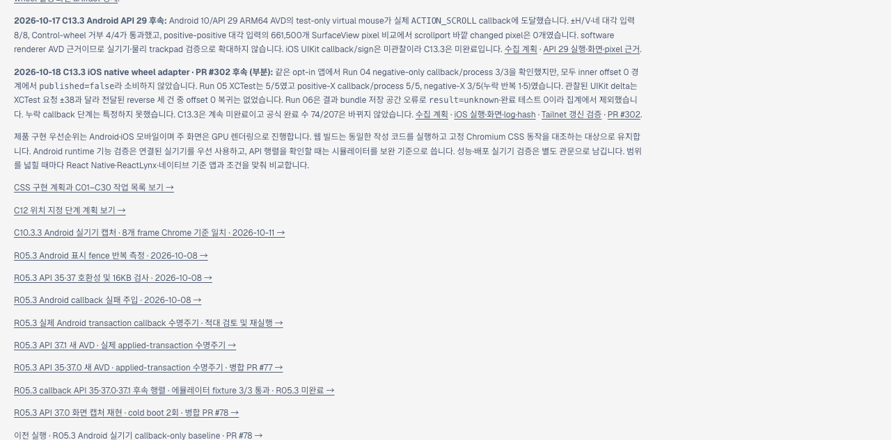
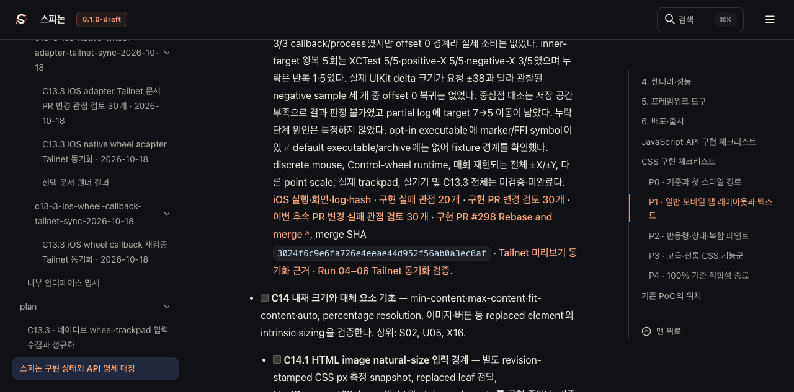
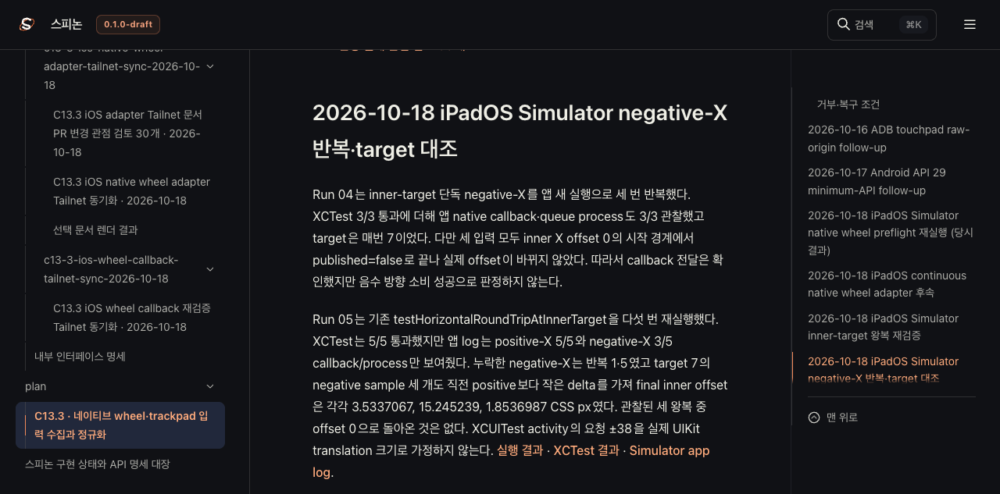

# C13.3 iOS wheel callback 재검증 Tailnet 동기화 · 2026-10-18

PR [#302](https://github.com/ohah/spinon/pull/302)의 Rebase and merge 결과를 공식 상태 문서와 Tailnet 미리보기에 반영한다. 병합 commit은 `ec84242d8261a64489c3ed621ede69d61c38e492`다. 이번 문서 작업은 C13.3 체크나 구현 계약을 바꾸지 않는다.

## 갱신 내용과 판정

공개 로드맵, `spec/STATUS.md`, iOS native wheel 계획·실행 근거에 Run 04–06 후속 결과를 연결했다. Run 04 negative-only 입력은 callback/process 3/3이지만 offset 0 경계라 `published=false`이고 실제 소비는 없다. Run 05는 XCTest 5/5, positive-X callback/process 5/5, negative-X 3/5이며 누락은 반복 1·5다. 관찰한 UIKit delta는 요청한 ±38과 다르고, 전달된 reverse 입력 후 offset 0 복귀는 없었다. Run 06은 결과 bundle 저장 공간 오류로 테스트 0건·`result=unknown`이라 통과 집계에서 제외했다. 빠진 callback의 단계를 특정하지 않았다.

로드맵의 공식 완료 수는 `74/207`이며 C13.3은 미완료다. Run 상세, raw JSON·log, fixture 경계는 [iOS Simulator 실행·화면·log·hash](../c13-3-ios-native-wheel-adapter-2026-10-18/README.md)에 남아 있다. 화면에 보이는 이 Tailnet 캡처는 문서 동기화 근거이지 앱 callback 실행 근거가 아니다.

## 렌더와 파일 전달

프로젝트 고정 RSPress `2.0.22`로 선택 문서만 렌더한다. 선택 root에서는 기존 자료 링크·이미지 전체를 가져오지 않으므로 dead-link/image 검사는 끄며, 이 결과를 전체 문서 빌드나 전체 링크 적합성으로 확대하지 않는다. GitHub Pages 배포는 하지 않는다.

Tailnet preview에 덮어쓰는 각 파일은 복사 전에 전용 backup으로 보관하고 원본 SHA-256을 확인한다. 복사 후 source·target 크기와 SHA-256을 대조한다. 새 파일도 추가하며 삭제는 하지 않고, 기존 preview listener는 재시작하지 않는다. 첫 전달은 128개 경로·6,592,264 bytes였고 44개 생성·18개 교체·66개 동일, 교체 전 backup 18개 검증, source/target hash 일치와 HTTP 200/served hash 일치 128/128을 기록했다. 최종 pass의 상세 경로·바이트 수와 결과는 아래 manifest에서 확인한다.

- [선택 문서 렌더 결과](./render-build-result.md)
- [RSPress build log](./render-build.log)
- [로드맵 source와 backup hash](./roadmap-sync.json)
- [첫 pass 사전 대상 목록](./preflight-pass-1.json) · [backup 검증](./backup-verification-pass-1.json) · [복사 검증](./copy-verification-pass-1.json) · [served HTTP/hash 검증](./served-verification-pass-1.json)
- [최종 pass 사전 대상 목록](./preflight-pass-2.json) · [backup 검증](./backup-verification-pass-2.json) · [복사 검증](./copy-verification-pass-2.json) · [served HTTP/hash 검증](./served-verification-pass-2.json)
- [Agent Browser 페이지 관찰](./browser-verification.json) · [Browser 프로세스 종료 확인](./browser-session-shutdown.json)
- [PR 변경 30개 실패 관점 검토](./pr-delta-review-30.md)
- [증거 파일 SHA-256 목록](./SHA256SUMS)

공개 기록에서는 Tailnet 호스트 이름, 사용자 계정 경로, 로컬 process ID를 숨긴다. tmux 세션과 preview listener는 유지한다. Agent Browser 세션과 그 실행 프로세스는 검증을 마친 뒤 종료한다.

## 미완료 범위

이번 동기화는 iOS discrete mouse, Control-wheel runtime rejection, 반복 가능한 전체 ±X/±Y callback, 실제 trackpad·실기기, 다른 point scale, 누락 callback의 원인, compositor 이후 픽셀 또는 public `WheelEvent`를 검증하지 않는다. S04.10 displayed-frame targeting도 남아 있다. C13.3 전체는 계속 미완료다.
