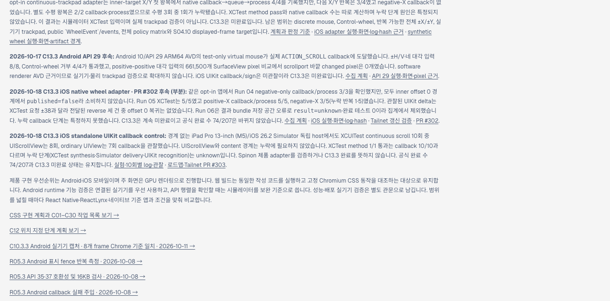

# C13.3 iOS standalone UIKit wheel callback 대조 · 2026-10-18

## 목적

Run 05의 negative-X callback 누락이 Spinon adapter에서만 생기는지, 같은 XCTest 입력이 UIKit recognizer를 사용하는 별도 호스트에서도 누락되는지 확인했다. 앱은 UIKit `UIPanGestureRecognizer`와 `UIScrollView` 또는 일반 `UIView`만 사용한다. Spinon 프레임워크·Rust queue·렌더러는 링크하거나 호출하지 않았다.

이 자료는 C13.3의 네이티브 입력 기능 검증이 아니며 iOS Simulator XCTest 입력 경로를 대조한다. 누락 원인이 XCTest event synthesis, Simulator event delivery, UIKit recognizer 중 어느 단계인지 구별하지 못한다. Spinon 앱 adapter의 결함 유무도 판정하지 않는다.

## 환경과 입력

- Simulator: iPad Pro 13-inch (M5), iOS 26.2, build `23C54`, UUID `9F29B0ED-C7E6-46AE-A933-14E1A87FC4DF`.
- Xcode 빌드 환경: macOS 26.5.1, arm64 Simulator.
- 독립 호스트 bundle ID: `dev.spinon.probe.oracle.host`; UI test bundle ID는 `dev.spinon.probe.oracle.tests`다.
- recognizer: `UIPanGestureRecognizer`, `allowedScrollTypesMask = .continuous`, `allowedTouchTypes = []`, `cancelsTouchesInView = false`, `delaysTouchesBegan = false`.
- 각 측정 run은 XCTest의 `coordinate.scroll(byDeltaX: ±38, deltaY: 0)`를 양·음 순서로 5회씩 요청했다. 요청 delta는 UIKit에서 관찰한 translation과 같다고 가정하지 않는다.
- 각 XCTest method는 assertion 실패 없이 끝날 수 있으므로 `1/1 passed`는 UI automation 실행 결과일 뿐 열 개 native callback을 뜻하지 않는다. Run 02·03은 모든 입력별 오프셋과 callback counter를 XCTest string attachment로 저장한다.

## 관찰 결과

| Run | 호스트 장면 | 콜백 관찰 | 판정 |
|---|---|---:|---|
| 01 | `UIScrollView`, content width 1,600pt, 시작 x=300pt | 경계에 도달함 | 최대 offset에 닿아 방향·callback 비교에서 제외 |
| 02 | `UIScrollView`, content width 20,000pt, 시작 x=10,000pt | 8/10 입력; 양의 X 3/5, 음의 X 5/5 | 콜백 없는 양의 입력은 반복 2·4이며 offset도 그대로였다. 관찰 offset 8,919~10,791pt로 양쪽 경계와 멀었다. |
| 03 | 스크롤 뷰 없는 일반 `UIView`에 recognizer 직접 부착 | 7/10 입력; 양의 X 4/5, 음의 X 3/5 | 콜백 없는 입력은 반복 3 음의 X, 반복 4 양의 X, 반복 5 음의 X였다. 해당 입력 직후 callback counter와 callback 기반 표시 offset이 변하지 않았다. |

Run 02·03의 XCTest method는 각각 1/1 pass, 0 failures다. Run 02에서는 모든 입력이 경계 밖에서 offset을 바꾸거나 callback 없이 그대로였고, Run 03에서는 UIScrollView 소비 경로 자체가 없는데도 콜백 누락이 다시 관찰됐다. 두 결과는 기존 XCTest 입력 경로의 누락을 Spinon 앱 밖에서 재현한다.

## Tailnet roadmap 화면과 파일 전달

Agent Browser에서 최신 Tailnet roadmap을 열어 C13.3 standalone UIKit 대조 결과와 공식 완료 수 `74/207`을 확인했다. 아래 캡처는 앱 동작 화면이 아니라 갱신된 roadmap 문서다.



pass-1은 선택 RSPress 출력과 원본 근거 파일 95개를 대상으로 했다. 첫 복사 시 디스크 공간 오류로 `STATUS.html`·`STATUS.md` 두 파일이 남았으나, 덮어쓰기 전 기존 해시와 백업을 확인하고 두 파일만 재개 복사했다. pass-1 결과는 복사 95/95, 교체 전 백업 18/18, HTTP 200 및 응답 SHA-256 일치 95/95다. 삭제한 문서 파일은 없으며, 실패 뒤 남은 0바이트 임시 파일 하나만 확인 후 제거했다. [사전 대상 목록](./copy-preflight-pass-1.json) · [복사 검증](./tailnet-sync/copy-verification-pass-1.json) · [백업 검증](./tailnet-sync/backup-verification-pass-1.json) · [HTTP·응답 해시 검증](./tailnet-sync/served-verification-pass-1.json).

## 재실행 명령

Run 02는 다음 selector를 사용했다.

```sh
xcodebuild test \
  -project spec/internal/evidence/c13-3-ios-wheel-delivery-oracle-2026-10-18/harness/C133WheelProbe.xcodeproj \
  -scheme C133WheelProbe \
  -destination 'platform=iOS Simulator,id=9F29B0ED-C7E6-46AE-A933-14E1A87FC4DF' \
  -derivedDataPath /tmp/spinon-c133-ios-wheel-delivery-oracle-run-20261018/DerivedData \
  -resultBundlePath /tmp/spinon-c133-ios-wheel-delivery-oracle-run-20261018/C133WheelProbe-run02.xcresult \
  -only-testing:C133WheelProbeUITests/C133WheelProbeUITests/testContinuousScrollRecognizerDeliveryOracle \
  -parallel-testing-enabled NO CODE_SIGNING_ALLOWED=NO
```

Run 03은 같은 명령에서 result bundle을 `C133WheelProbe-run03.xcresult`로, selector를 `testContinuousScrollRecognizerWithoutScrollView`로 바꿨다. Run 01의 경계 조건과 변경 전 harness는 `runs/01/xcodebuild.log` 및 Git 이력에서 확인한다.

## 해석과 남은 범위

- Run 02는 Run 01의 scroll boundary confound를 제거했다. 오프셋은 content 가장자리에 도달하지 않았는데도 callback이 없는 요청이 두 번 있었다.
- Run 03은 `UIScrollView` 내부 pan recognizer·scroll consumption 경쟁이 필수 원인은 아님을 보여준다. ordinary `UIView`에 같은 continuous recognizer를 직접 붙인 경우에도 callback이 빠졌다.
- 따라서 현재 확실히 좁힌 범위는 `XCTest .scroll(byDeltaX:)` → Simulator → UIKit recognizer 경로 안이다. 세 단계 중 정확한 누락 위치는 계속 unknown이다.
- Spinon의 `MTKView`, C13.3 callback→queue→process, normalized delta, 화면 소비는 이 독립 호스트에서 시험하지 않았다. Spinon adapter 결함이 없다는 증거가 아니며, 제품 코드를 바꿀 근거도 아니다.
- 다음 진단은 XCTest 대체 입력 또는 Simulator host-side event trace를 사용해 event 생성, 앱 도달, recognizer callback을 각각 계측해야 한다. discrete mouse, 실제 trackpad, 실기기 결과로 확대하지 않는다.
- C13.3는 계속 미완료다. 공식 완료 수 74/207은 변하지 않는다.

## 원본 근거

- Run 01: [xcodebuild log](./runs/01/xcodebuild.log) · [xcresult summary](./runs/01/summary.json) · [test tree](./runs/01/tests.json) · [activity tree](./runs/01/activities.json).
- Run 02: [xcodebuild log](./runs/02/xcodebuild.log) · [xcresult summary](./runs/02/summary.json) · [10개 관찰 첨부물](./runs/02/attachments/FDC0DF0F-B23A-4894-BFDA-FFF8F84E07F3.txt) · [attachment manifest](./runs/02/attachments/manifest.json).
- Run 03: [xcodebuild log](./runs/03/xcodebuild.log) · [xcresult summary](./runs/03/summary.json) · [10개 관찰 첨부물](./runs/03/attachments/79E9A7D6-2B9A-4ED4-A572-F678D5A6F1B3.txt) · [attachment manifest](./runs/03/attachments/manifest.json).
- [독립 UIKit 호스트](./harness/Sources/C133WheelProbeApp.swift)
- [XCUITest 입력과 관찰 코드](./harness/Tests/C133WheelProbeUITests.swift)
- [선택 RSPress route 렌더 결과](./render-build-result.md) · [route manifest](./route-manifest.json) · [build log](./render-build.log)
- [실험 설계 관점 검토 20개](./probe-design-review-20.md)
- [구현·실행 실패 관점 검토 20개](./implementation-review-20.md)
- [이번 PR 변경 실패 관점 검토 30개](./pr-delta-review-30.md)

Run 01–03은 같은 iPadOS 26.2 Simulator에서 실행했다. 테스트 코드는 실제 외장 trackpad나 물리 iOS 기기를 사용하지 않았다.
