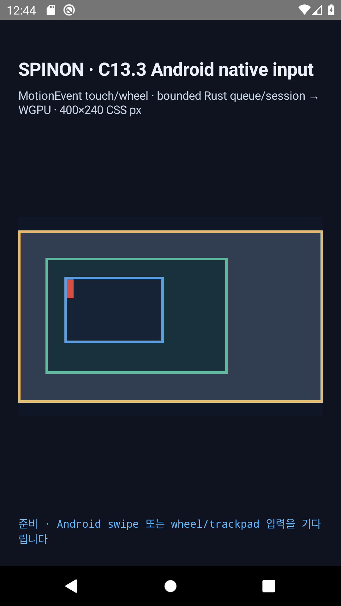
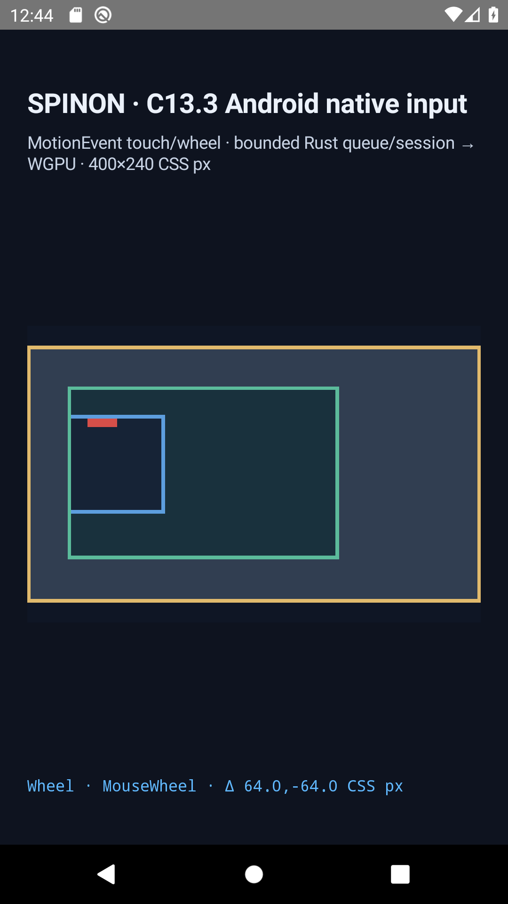

# C13.3 Android API 29 native wheel AVD 검증 · 2026-10-17

실행 시각 2026-10-17T03:44:58.250Z · API 29 / Android 10 · AVD `spinon_r05_api29_fallback` · APK SHA-256 `94fa826e43c616486ab8b2e9a30bf01e714a3ff821801951136f919ba4491ff1` · 소스 기준 `824b28dd90b00f67d93de7504ecab84969e0d3bc`.

## 사전 기준과 입력 경로

[사전 판정](../precomparison.md)에 고정한 400×240 CSS px fixture, 방향별 owner offset, queue 및 pixel 경계를 사용했다. API 29 ADB `input`에는 `mouse scroll`이 없어 API 29 ABI로 컴파일한 test-only uinput mouse가 Linux relative wheel axes를 보냈다. 실제 OS `ACTION_SCROLL` callback을 거쳤고 FFI direct enqueue는 사용하지 않았다.

±H/V와 대각 방향 8/8 통과: 각 입력은 fresh launch, callback source/tool/axes/factor/scale/point/delta, queue sequence 1·target 7, revision 2, owner offsets와 presented draw를 확인했다.
SurfaceView는 1050×630 px / 2.625 px per CSS px였고, 실제 GL/ANGLE/SwiftShader renderer log는 machine-readable JSON에 보존했다.

좌우 Control × H/V 거부 4/4 통과: queue/process 부재, revision 1, 초기 offsets를 보존했다. Control 좌수평 pixel positive-control 대조는 SurfaceView `661500`개에서 changed 0개였다.

Positive-positive 대각 surface 비교: 바깥 changed 0개, 안쪽 changed 50684개, 비교 661500개. 입력 전후 화면은 [입력 전](./android-diagonal-positive-positive-before.png), [입력 후](./android-diagonal-positive-positive-after.png)다.

## 근거와 한계

원본 callback/process/draw는 `android-*.log`, machine-readable 입력·offset·hash는 `android-api29-wheel-matrix.json`, classifier 회귀는 `classifier-test.log`에 있다. 실행 helper는 각 성공·거부 입력 뒤 `UI_DEV_DESTROY`를 호출했고 device 목록에서 helper 이름이 사라지는 것을 검사했다.
적대적 검토: [구현·실행 검토 20개](../implementation-review-20.md) · [PR 변경 검토 30개](../pr-delta-review-30.md).

이 결과는 Android 10/API 29 Google APIs ARM64 AVD와 소프트웨어 renderer의 opt-in fixture 검증이다. 실기기, hardware GPU, 외장 mouse/trackpad, API 28 이하, iOS native callback/sign/adapter, public DOM events, compositor 이후 presentation 및 C13.3 전체 지원은 미검증이다. 공식 완료 checkbox는 변경하지 않았다.

재현: opt-in Android APK를 빌드한 뒤 `node tools/css-reference/capture-c13-3-android-api29-wheel-runtime.mjs --android-serial emulator-5556`을 실행한다. 전용 AVD는 `spinon_r05_api29_fallback`이며 물리 기기 serial은 스크립트가 거부한다.
