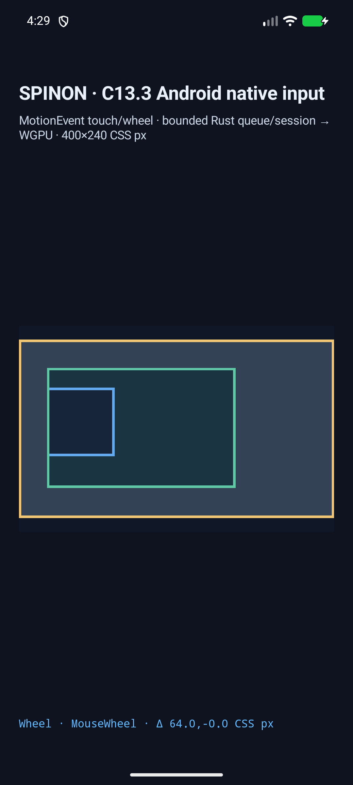
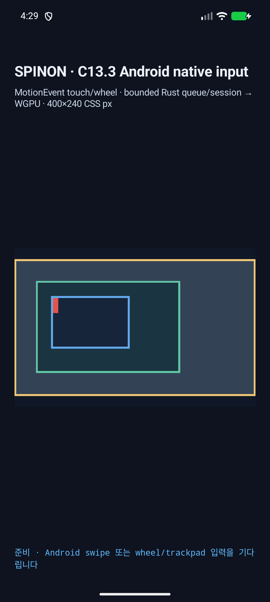

# C13.3 Android AVD 복합 wheel source 분류 · 2026-10-16

캡처 시각: 2026-10-15T19:29:25.384Z · APK SHA-256: `0ea4955a417c1bc50d6e8d849a18b76c797126500ae2dfa67d623523e918169e` · uinput helper SHA-256: `7d2d54ee4e2fc936738591b002fa9deef9f228f2809ea4450192f9ad6034d901`.

Android API 37 ARM64 AVD `emulator-5554`에서 하나의 test-only uinput 장치가 Android InputReader에 `TOUCHPAD`와 `CURSOR` 클래스로 등록되는 것을 확인했다. 이 장치는 `SOURCE_TOUCHPAD (0x100008)`와 `SOURCE_MOUSE (0x2002)`를 함께 지원한다.

positive control에서 실제 `ACTION_SCROLL` event는 `event_source_bits=0x2002`, pointer tool `mouse`, 지원 source 합집합 `0x10200a`로 도착했고 `MouseWheel`로 분류됐다. CSS point `132.09375,111.43936`, target 7, normalized `(64,0) CSS px`, queue sequence 1과 draw revision 2까지 확인했다. 따라서 device source union의 touchpad bit가 mouse event를 TrackpadScroll로 오분류하지 않는다.

같은 장치의 화면 밖 positive-looking scroll은 `MouseWheel`로 분류된 뒤 SurfaceView 밖 좌표에서 거부됐다. queue/process는 0건이고 revision/offset과 화면이 유지됐다. helper 종료 뒤 두 case 모두 InputReader에서 가상 장치가 사라졌다.

positive control surface 비교는 root scrollport 바깥 134,064 pixels에서 changed 0개, 안쪽 changed 50774개였다. 거부 control은 바깥/안쪽 changed 0개다. SurfaceView crop은 캡처 간 위치 변화에 맞춰 정렬했다.







InputReader/getevent 장치 진단, 원본 callback·draw log, pixel manifest와 모든 source hash는 이 디렉터리에 저장했다.
사람이 읽는 `.log`와 program-header text 파일은 줄 끝 공백만 정리한다. JSON에는 InputReader/getevent 원문 문자열과 compiler program-header 원문·SHA-256을 보존한다.

재현:

```sh
SPINON_V8_DIR=/path/to/pinned/v8 SPINON_ENABLE_C04_RUNTIME_GPU=1 SPINON_ENABLE_C13_3_GESTURE_FIXTURE_TEST=1 mise exec -- bun run build:android
bun tools/css-reference/capture-c13-3-native-wheel-composite-android.mjs --android-serial emulator-5554
```

실기기와 terminal-browser는 사용하지 않았다. 이 결과는 가상 AVD input-path 검증이며 composite peripheral 하드웨어, iOS discrete/continuous callback, 공개 WheelEvent/scroll API, S04.10 displayed-frame target이나 C13.3 전체 완료를 증명하지 않는다.
