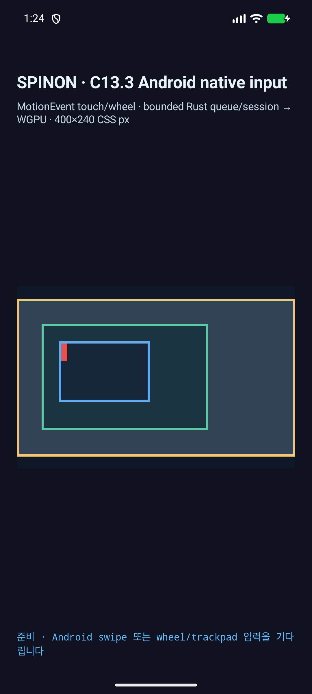
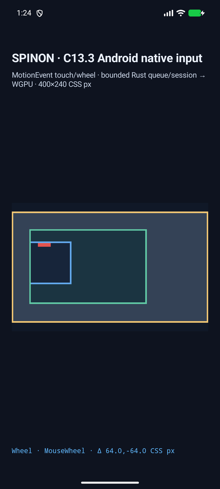

# C13.3 Android native wheel AVD 실행 근거 · 2026-10-16

캡처 시각: 2026-10-15T16:24:10.157Z · APK SHA-256: `4e968d96c0300b1b6a0c966e48d9f5e38dbe5b532def29f8dc130aa2bade3886` · 소스 기준: `120c933a08037e7b7ea11fc4e89ca9d9c97d6f89`.

API 37 ARM64 AVD `emulator-5554`에서 mouse `ACTION_SCROLL`의 H/V 네 방향과 네 대각 조합을 실제 앱 callback → bounded queue → render draw까지 실행했다. 각 방향은 별도 앱 실행으로 fixture 시작 오프셋을 고정했다.

ViewConfiguration factor 168 px, surface scale 2.625 px/CSS px에서 각 native axis 1은 64 CSS px다. 성공 8/8은 입력 axis, normalized delta, sequence 1 admission, target 7, revision 2, owner offsets와 presented draw를 검사했다.

목표 point `(132,112)` CSS px는 정수 screen pixel로 주입한다. 실제 callback point는 `(132.19048,112)` CSS px였고, 2.625 px/CSS px에서 screen pixel 반올림 허용치 0.191476 CSS px 이내였다. `ready`와 input callback의 SurfaceView screen origin도 일치했다.

거부 경로 3/3: SurfaceView 밖 좌표, 좌표가 없는 ADB touchpad sample, 영 축 입력은 각각 기대 reason으로 거부됐고 revision 1 / 시작 offsets `root:0,0;outer:0,0;inner:86,106`를 유지했다.

스크린샷 `android-diagonal-positive-positive-before.png`와 `android-diagonal-positive-positive-after.png`의 SurfaceView 안쪽 134,064개 픽셀 중 scrollport border 바깥은 변경 0개, 안쪽 변경은 50,684개였다. 비교 범위는 고정 fixture의 root scrollport `left=16, top=16, right=384, bottom=224 CSS px` 바깥 영역이다.

원본 callback, queue, draw 로그는 각 `android-*.log`, 전체 입력·offset 표는 `android-avd-matrix.json`에 있다.

기본/opt-in APK의 `BuildConfig` 값, DEX/native SHA-256, Rust FFI symbol 경계는 [Android artifact 기록](android-artifact-boundary.md)에 있다.

PR [#198](https://github.com/ohah/spinon/pull/198) 본문의 after 화면은 Agent Browser에서 1080×2400으로 렌더링됐다. [브라우저 검증 요약](pr-body-image-verification.json)과 [PR 화면 캡처](pr-198-agent-browser.png)를 보존했다.

로드맵을 반영한 private Tailnet 제공 경로의 파일 해시·화면 검증은 [동기화 보고서](tailnet-preview-sync.md), [제공 검증 JSON](tailnet-served-verification.json), [로드맵 Agent Browser 화면](tailnet-roadmap-agent-browser.png)에 있다.

이 방향 행렬 실행 당시에는 ADB virtual keyboard가 mouse event에 Control meta를 전달하지 않아 Control-wheel runtime을 검사하지 못했다. 후속 [Control-wheel AVD 실행](../c13-3-android-control-wheel-runtime-2026-10-16/README.md)은 같은 API 37 ARM64 AVD에서 좌우 Ctrl × H/V 거부 경로를 별도로 확인했다. 이 근거들은 물리 장치, target 가능한 외장 trackpad, hardware GPU, iOS, public DOM events, compositor 이후 scanout 또는 C13.3 전체 완료를 증명하지 않는다.

재현: `bun tools/css-reference/capture-c13-3-native-wheel-input-android.mjs --android-serial emulator-5554` (먼저 opt-in Android debug APK를 빌드한다).
