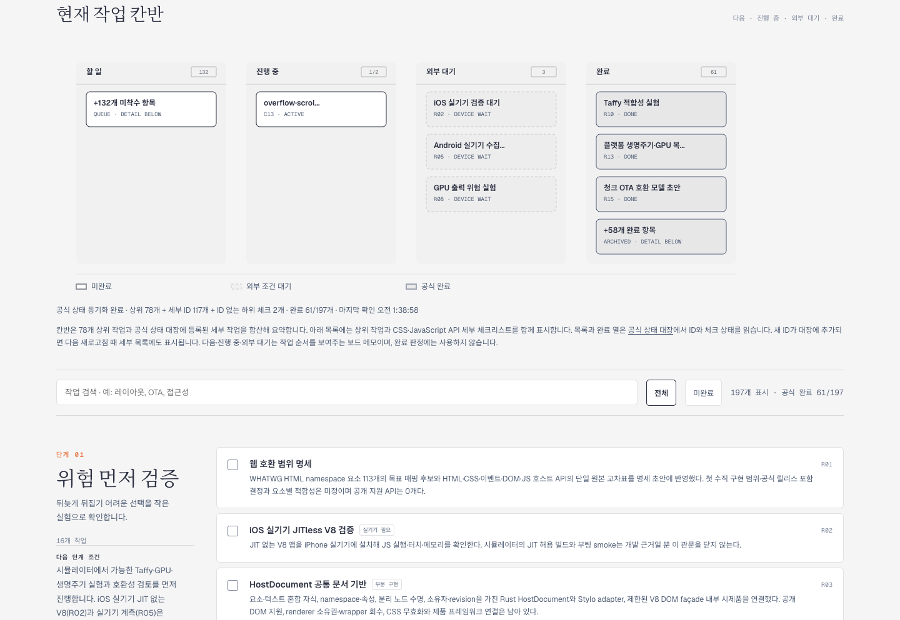

# Tailnet roadmap sync · 2026-10-16

로드맵과 C13.3 Android native wheel 실행 자료를 private Tailnet 미리보기에 최종 반영했다. 문서는 PR #198 브랜치 feat/c13-3-native-wheel-input-sim-20261016, source revision 4e90ab9eb31be4239fe8739c8af356426a934314에서 생성했다.

Rspress 2.0.22의 C13.3 범위 제한 build가 성공했다. 공식 완료 수는 61/197로 유지하고 Android partial progress와 iOS·trackpad 미검증 조건을 표시한다. 실행 페이지에는 8/8 입력 방향, 거부 제어 3/3, Android before/after 화면과 artifact 경계 자료를 연결했다. 별도 PR 변경 검토 페이지도 제공한다.

Agent Browser session spinon-tailnet-roadmap에서 로드맵의 61/197, Android 진행 내용과 실행 링크, 실행 페이지의 8/8·3/3·1080×2400 화면 두 장, PR 변경 검토의 해결 상태를 확인했다. 최종 sync manifest의 82개 파일을 Tailnet에서 각각 HTTP 200과 SHA-256 일치로 확인했다. manifest SHA-256은 1fa0129d52c0c5ba9658828e97f9846788fd79a21ef85bbf0894e4a8760b4b98이다. 제공 검증은 [JSON 기록](./tailnet-served-verification.json), 전체 manifest는 [파일 목록](./tailnet-sync-manifest.json), 화면은 아래 캡처에 보존했다.

- [Tailnet 로드맵](https://macstudio.tailed42f2.ts.net/spinon/roadmap.html)
- [Android native wheel 실행 요약](https://macstudio.tailed42f2.ts.net/spinon/spec/internal/evidence/c13-3-native-wheel-input-2026-10-16/README.html)
- [PR 변경 관점 검토 30개](https://macstudio.tailed42f2.ts.net/spinon/spec/internal/evidence/c13-3-native-wheel-input-pr-delta-review-30-2026-10-16.html)
- Rspress 범위 제한 build이며 전체 사이트 build/dead-link 검사를 주장하지 않는다. GitHub Pages 배포 또는 preview 서버 재시작은 하지 않았다.

