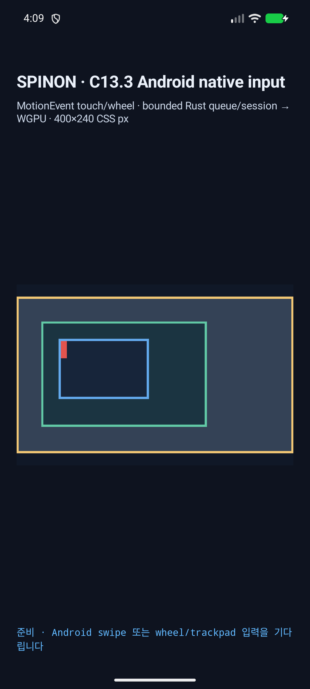
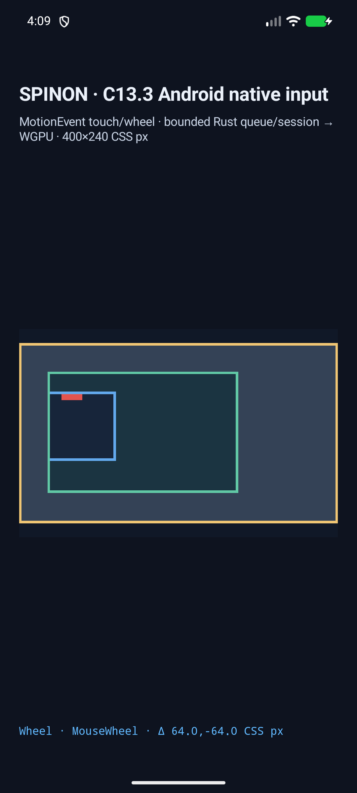

# C13.3 Android native wheel AVD 실행 근거 · 2026-10-16

캡처 시각: 2026-10-15T19:10:04.952Z · APK SHA-256: `0ea4955a417c1bc50d6e8d849a18b76c797126500ae2dfa67d623523e918169e` · 소스 기준: `f1c3d17ad1e7485d5f4566d6996026364d8f1999`.

API 37 ARM64 AVD `emulator-5554`에서 mouse `ACTION_SCROLL`의 H/V 네 방향과 네 대각 조합을 실제 앱 callback → bounded queue → render draw까지 실행했다. 각 방향은 별도 앱 실행으로 fixture 시작 오프셋을 고정했다.

ViewConfiguration factor 168 px, surface scale 2.625 px/CSS px에서 각 native axis 1은 64 CSS px다. 성공 8/8은 입력 axis, normalized delta, sequence 1 admission, target 7, revision 2, owner offsets와 presented draw를 검사했다.

거부 경로 3/3: SurfaceView 밖 좌표, 좌표가 없는 ADB touchpad sample, 영 축 입력은 각각 기대 reason으로 거부됐고 revision 1 / 시작 offsets `root:0,0;outer:0,0;inner:86,106`를 유지했다.

Android 분류는 event source와 pointer tool type을 사용하며 `InputDevice.getSources()`는 진단용으로만 기록한다. JVM classifier harness는 mouse+finger, mouse+mouse, unknown tool/source 및 복합 장치의 legacy source-union negative control을 검사한다. AVD 입력별 `event_source_bits`, `pointer_tool`, `device_supported_source_bits`는 각 로그에 보존한다.

스크린샷 `android-diagonal-positive-positive-before.png`와 `android-diagonal-positive-positive-after.png`의 SurfaceView 안쪽 134,064개 픽셀 중 scrollport border 바깥은 변경 0개, 안쪽 변경은 50,684개였다. 비교 범위는 고정 fixture의 root scrollport `left=16, top=16, right=384, bottom=224 CSS px` 바깥 영역이다.

원본 callback, queue, draw 로그는 각 `android-*.log`, 전체 입력·offset 표는 `android-avd-matrix.json`에 있다.

기본/opt-in APK의 `BuildConfig` 값, DEX/native SHA-256, Rust FFI symbol 경계는 [기준 실행의 Android artifact 기록](../c13-3-native-wheel-input-2026-10-16/android-artifact-boundary.md)에 있다.

이 run은 Android API 37 AVD에서 mouse 방향/기존 거부 행렬을 다시 확인한 결과다. 복합 source uinput 검증은 [별도 실행 근거](../c13-3-native-wheel-composite-avd-2026-10-16/README.md)에 기록했다. 이 run은 물리 장치, hardware GPU, targetable trackpad, iOS, public DOM events, compositor 이후 scanout 또는 C13.3 전체 완료를 증명하지 않는다.

재현: `bun tools/css-reference/capture-c13-3-native-wheel-input-android.mjs --android-serial emulator-5554` (먼저 opt-in Android debug APK를 빌드한다).
