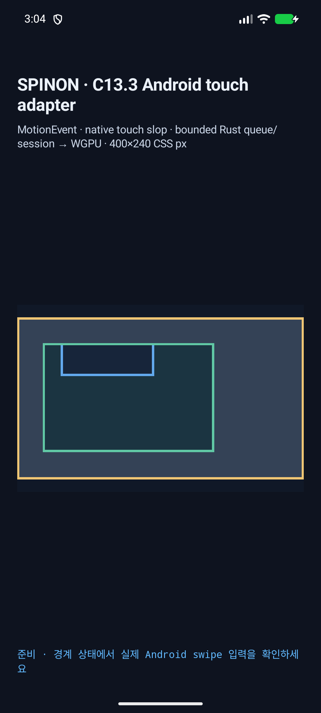
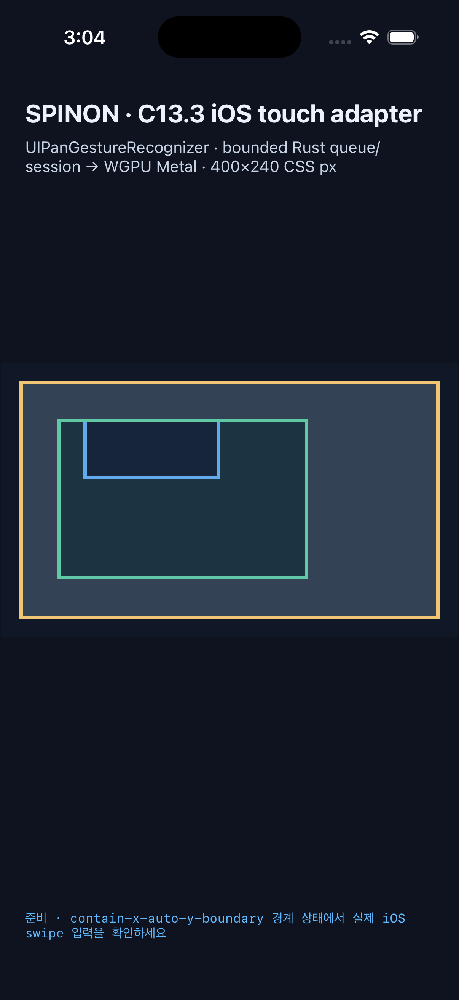

# C13.3 computed overscroll policy simulator matrix

2026-10-15에 opt-in C13.3 gesture fixture를 Android와 iOS simulator에서 실행한 근거다. 이 결과는 계산된 `overscroll-behavior` 입력이 scroll-owner snapshot과 실제 native swipe를 거쳐 축별 offset에 반영되는지 확인하며, C13.3 전체 완료를 주장하지 않는다.

## 실행 환경

- Android: API 37 ARM64 AVD `spinon_api37_1_compat16k`, `adb` serial `emulator-5554`, emulator surface 1050×630 physical px, CSS scale 2.625. ANGLE/Vulkan의 SwiftShader software renderer를 사용했다.
- iOS: iPhone 17 Pro, iOS 26.2 Simulator, UDID `ACA7BF91-E2D5-4CF7-909A-08D1AD95FF3D`, surface texture 1200×720 px, CSS scale 3.
- 실기기는 연결하거나 사용하지 않았다. OS compositor 이후 scanout도 관찰하지 않았다.
- 두 앱 모두 `c13-3-gesture-fixture-test` opt-in으로 빌드했다. Android는 `spinon_c133_gesture_fixture=true`와 `spinon_c133_policy_scenario_id=0|1|2` extra를, iOS는 `--spinon-c133-scroll-gesture`와 `--spinon-c133-policy-scenario-id=0|1|2` argument를 사용한다.
- scenario 0은 `auto-zero`, 1은 `auto-boundary`, 2는 `contain-x-auto-y-boundary`다. 알 수 없는 ID, 중복 iOS ID, fixture route 없는 scenario 선택은 거부한다.

## 14회 simulator 행렬

각 scenario는 fresh app session에서 실행했다. 경계 scenario는 host router로 inner offset `(86,106)`을 준비한 뒤 실제 ADB `MotionEvent` 또는 iOS `UIPanGestureRecognizer` 입력을 주었다. `SPINON_C133_READY`는 해당 seed와 같은 revision/offset을 가진 첫 successful draw를 검사한 뒤에만 출력된다.

| 플랫폼 | 입력 | 계산 policy | root offset | outer offset | inner offset |
| --- | --- | --- | --- | --- | --- |
| Android | auto-zero | auto/auto | (0,0) | (0,0) | (0,0) |
| Android | auto-horizontal | auto/auto | (0,0) | (60.375,0) | (86,106) |
| Android | auto-vertical | auto/auto | (0,0) | (0,60.265) | (86,106) |
| Android | auto-diagonal | auto/auto | (0,0) | (58.686,58.686) | (86,106) |
| Android | contain-horizontal | contain/auto | (0,0) | (0,0) | (86,106) |
| Android | contain-vertical | contain/auto | (0,0) | (0,59.814) | (86,106) |
| Android | contain-diagonal | contain/auto | (0,0) | (0,60.567) | (86,106) |
| iOS | auto-zero | auto/auto | (0,0) | (0,0) | (0,0) |
| iOS | auto-horizontal | auto/auto | (0,0) | (50,0) | (86,106) |
| iOS | auto-vertical | auto/auto | (0,0) | (0,50) | (86,106) |
| iOS | auto-diagonal | auto/auto | (0,0) | (50,50) | (86,106) |
| iOS | contain-horizontal | contain/auto | (0,0) | (0,0) | (86,106) |
| iOS | contain-vertical | contain/auto | (0,0) | (0,50) | (86,106) |
| iOS | contain-diagonal | contain/auto | (0,0) | (0,50) | (86,106) |

All 14 cases reported the expected computed policy and initial draw. In all cases changed pixels outside the gold root border were 0. The contain-horizontal before/after images were pixel-identical on both platforms (RGB max-channel threshold >8). Blue inner content remains clipped by the green outer box, which remains within the gold root. Exact color bounds and per-run pixel counts are in [pixel-analysis.json](pixel-analysis.json).

### Android



### iOS



## 현재 소스 재빌드 확인

scenario/queue state를 별도 Rust 하위 모듈로 옮긴 뒤, 현재 소스에서 Android와 iOS opt-in 앱을 각각 다시 빌드했다. 이 두 재빌드 run은 전체 행렬 재실행이 아니라 contain-horizontal 실제 입력 smoke다.

```sh
mise exec -- env \
SPINON_V8_DIR=/Users/yoonhb/Documents/workspace/spinon/build/v8-source/v8 \
SPINON_ENABLE_C04_RUNTIME_GPU=1 \
SPINON_ENABLE_C13_3_GESTURE_FIXTURE_TEST=1 \
bun run build:android

mise exec -- env \
SPINON_V8_DIR=/Users/yoonhb/Documents/workspace/spinon/build/v8-source/v8 \
SPINON_ENABLE_C04_RUNTIME_GPU=1 \
SPINON_ENABLE_C13_3_GESTURE_FIXTURE_TEST=1 \
bun run build:ios-sim
```

두 앱은 첫 successful draw에서 revision 1, owner offsets `(0,0; 0,0; 86,106)`을 확인했다. 실제 가로 swipe 뒤에도 root/outer/inner offset은 유지되고 gesture result는 `changes=0`이었다. RGB max-channel threshold `>8` 기준 before/after 변경 pixel은 Android 0개, iOS 0개였다. root 경계 밖 변경 pixel도 양쪽 0개다.

| 플랫폼 | 입력 | 누적 CSS delta | 최종 offsets | 변경 pixel |
| --- | --- | --- | --- | --- |
| Android AVD | 실제 MotionEvent horizontal swipe | `-45.518,0` | root `(0,0)`, outer `(0,0)`, inner `(86,106)` | 0 |
| iOS Simulator | 실제 UIPanGestureRecognizer horizontal swipe | `-30,0` | root `(0,0)`, outer `(0,0)`, inner `(86,106)` | 0 |

로그와 before/after 화면: [Android](android-rebuild-contain-horizontal.log) · [Android before](android-rebuild-contain-horizontal-before.png) · [Android after](android-rebuild-contain-horizontal-after.png) · [iOS](ios-rebuild-contain-horizontal.log) · [iOS before](ios-rebuild-contain-horizontal-before.png) · [iOS after](ios-rebuild-contain-horizontal-after.png).

## 기본/opt-in artifact 경계

Android `aarch64-linux-android`와 iOS Simulator `aarch64-apple-ios-sim` release static archives를 `--no-default-features`로 빌드했다. 기본 archive에서는 C13.3 scenario FFI symbol과 scenario 문자열 marker가 모두 없고, fixture-test positive control에서는 둘 다 있다. iOS Rust LLVM 22 bitcode는 Xcode `nm`이 읽지 못해 Rust toolchain `llvm-nm`으로 검사했다. 크기와 SHA-256은 [feature-boundary.txt](feature-boundary.txt)에 기록했다. 이는 static archive의 분리 근거이며 최종 앱 release bundle 크기를 뜻하지 않는다.

## 코드 검증

- `mise exec -- cargo test --locked --workspace --quiet` — 861 passed, 0 failed, 4 ignored.
- `mise exec -- cargo clippy --locked --workspace --all-targets -- -D warnings` — 통과.
- `mise exec -- cargo test --locked -p spinon-ffi --features c13-3-gesture-fixture-test --quiet` — 44 passed, 0 failed, 2 ignored.
- `mise exec -- cargo check --locked -p spinon-ffi --features c13-3-gesture-fixture-test` — 통과.
- Android opt-in app build — `BUILD SUCCESSFUL`.
- iOS Simulator opt-in app build — `BUILD SUCCEEDED`.

전체 행렬 캡처는 scenario/queue state 모듈 분리 전의 동작 코드에서 가져왔다. 그 분리는 코드 이동과 가시성 변경이며, 분리 이후에는 두 플랫폼 앱을 최신 소스로 다시 빌드해 위 contain-horizontal 입력과 pixel 결과를 재확인했다. 전체 코드, runtime, PR 리뷰와 merge 상태는 [계획](../../../../plan/c13-3-policy-simulator-matrix.md), [상태 대장](../../../STATUS.md)과 연결된 review 문서에서 추적한다.
