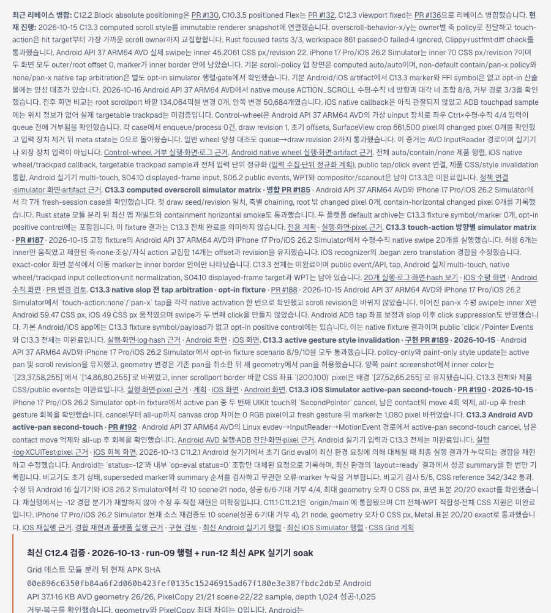
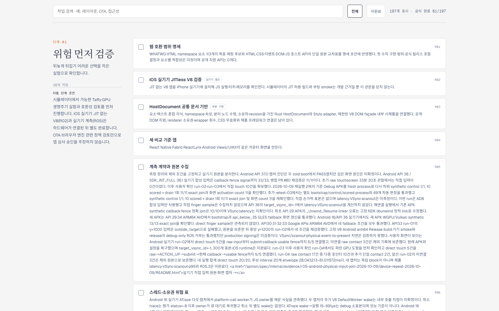

# C13.3 Control-wheel 로드맵 갱신 근거 · 2026-10-16

## 변경

PR [#199](https://github.com/ohah/spinon/pull/199) 병합 뒤에도 정적 로드맵에는 Control-wheel이 미검증이라고 남아 있었다. `spec/public/roadmap.html`의 해당 문장을 Android API 37 ARM64 AVD 가상 uinput 검증 4/4로 갱신하고 실행 근거 링크를 추가했다.

공식 완료 수는 **61/197**로 유지한다. C13.3은 여전히 미완료다. 이 AVD 검증은 실기기나 외장 입력 장치, iOS callback, 공개 DOM event, compositor 이후 화면을 확인하지 않는다.

## Agent Browser 확인

- 로드맵의 공식 counter가 `공식 완료 61/197`을 표시했다.
- 900×1000 viewport에서 갱신 문장과 실행 근거 링크를 확인했다. 링크 대상은 Android Control-wheel 실행 페이지다.
- 390×844 viewport에서 document/body 폭은 390 CSS px였고 가로 overflow가 없었다.
- 실행 페이지를 열어 before/after 화면 두 장이 모두 정상 로드되고 각 원본 크기가 1080×2400임을 확인했다.

PR 변경의 적대적 검토 30개는 [검토 기록](./pr-delta-review-30.md)에 있다.
