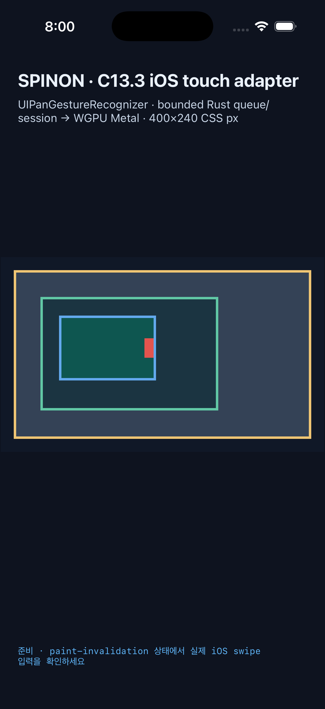
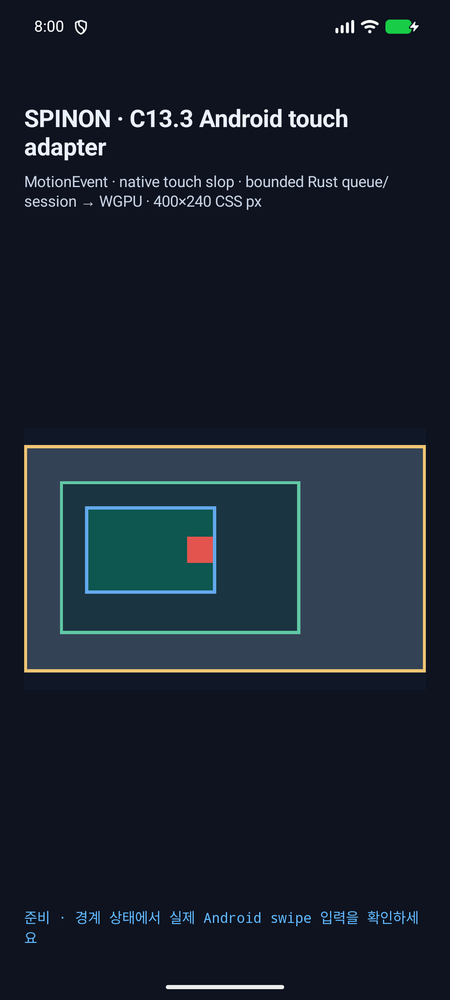

# C13.3 style invalidation · Android/iOS Simulator · 2026-10-15

> Superseded by final run `20261015T110614287Z-2f1c9e8e`; retained as the successful full run that exposed duplicate JNI/Java style-update logging.

## Captured source and devices

- Capture: `2026-10-15T10:59:16.048Z`; matrix: [matrix.json](matrix.json), SHA-256 `8047ec1340a665491049d4379458a1c84a9f69290e430606c5d77f2751aa7017`.
- Source HEAD: `288d1dd467754a8d320b98e03b2e859ec86370cd`; tracked diff plus non-evidence untracked source hash: `0006c0235b18f3c177a80f599e5a344a044da600289a3b208549825503620ccf`.
- Fixed V8 revision: `7b50b62cb18f28617959e8452e2cd18195b38bcf`.
- iOS: iPhone 17 Pro, iOS 26.2 Simulator, UDID `ACA7BF91-E2D5-4CF7-909A-08D1AD95FF3D`, Metal app capture.
- Android: API 37 ARM64 emulator `emulator-5554`, model `sdk_gphone16k_arm64`, 1080×2400 at density 420.
- These are simulator/emulator observations. No physical device, hardware GPU, compositor-after-display, or scanout claim is made.

## Build and scenarios

The capture rebuilt both apps from this worktree with `SPINON_ENABLE_C04_RUNTIME_GPU=1` and `SPINON_ENABLE_C13_3_GESTURE_FIXTURE_TEST=1`. Build transcripts are [iOS](ios-build.log) and [Android](android-build.log); both report success.

| Platform | Scenario | Revisions and geometry | Gesture result |
| --- | --- | --- | --- |
| iOS | 8 · style policy | document 55→56, tree 11→12, style 0→1, scroll state 2→2; geometry unchanged; inner offset/range `(86,106)` | Existing pan moved under policy epoch 1; the next gesture was rejected by `touch-action:none`. |
| Android | 8 · style policy | document 55→56, tree 11→12, style 0→1, scroll state 2→2; geometry unchanged; inner offset/range `(86,106)` | Existing pan moved under policy epoch 1; the next gesture was rejected by `touch-action:none`. |
| iOS | 9 · geometry | document 55→56, tree 11→12, style 0→1, scroll state 2→3; geometry changed; inner offset/range `(66,106)` | The active gesture ended with `GeometryChanged`; a new gesture started on the updated geometry. |
| Android | 9 · geometry | document 55→56, tree 11→12, style 0→1, scroll state 2→3; geometry changed; inner offset/range `(66,106)` | The active gesture ended with `GeometryChanged`; a new gesture started on the updated geometry. |
| iOS | 10 · paint | document 55→56, tree 11→12, style 0→1, scroll state 1→1; geometry unchanged | The active pan continued across the paint update. |
| Android | 10 · paint | document 55→56, tree 11→12, style 0→1, scroll state 1→1; geometry unchanged | The active pan continued across the paint update. |

Each row has a raw platform log and post-scenario screenshot in this directory. The matrix records fresh process IDs, scenario validation, screenshot names, and exact pixel samples.

## Paint and border pixel checks

The pre-update inner content sample at CSS `(85,90)` was `[23,37,58,255]`. After the paint mutation it was `[14,86,80,255]` on both screenshots. At CSS `(200,100)`, outside the inner scrollport border, both platforms remained `[27,52,65,255]`, the expected page background.

| Platform | Screenshot size | Before inner | After inner | Outside inner scrollport |
| --- | --- | --- | --- | --- |
| iOS | 1206×2622 | `[23,37,58,255]` | `[14,86,80,255]` | `[27,52,65,255]` |
| Android | 1080×2400 | `[23,37,58,255]` | `[14,86,80,255]` | `[27,52,65,255]` |

## Log normalization

Android logcat emitted the same style update twice and truncated the trailing eval diagnostics at different points. The validator identifies the update using the stable report fields before `eval=`, preserves the longer raw line, and reports one duplicate for each Android scenario. Input reports are also deduplicated by stable payload. Raw scenario logs remain attached so the normalization can be reviewed.

## Verification

- Both simulator apps rebuilt successfully from the recorded source tree.
- Scenarios 8, 9, and 10 passed on both platforms: 6/6.
- `tools/css-reference/capture-c13-3-style-invalidation-simulators.test.mjs`: 8/8 passed.
- `node --check tools/css-reference/capture-c13-3-style-invalidation-simulators.mjs` and `git diff --check`: passed before capture.
- [SHA256SUMS.txt](SHA256SUMS.txt) binds the matrix, build logs, scenario logs, YAML commands, and screenshots.

This evidence covers only the C13.3 opt-in style invalidation fixture. It does not establish Chrome parity, public DOM events/CSSOM, default-artifact inclusion, real-device behavior, hardware GPU output, displayed-frame input, or completion of C13.3.
