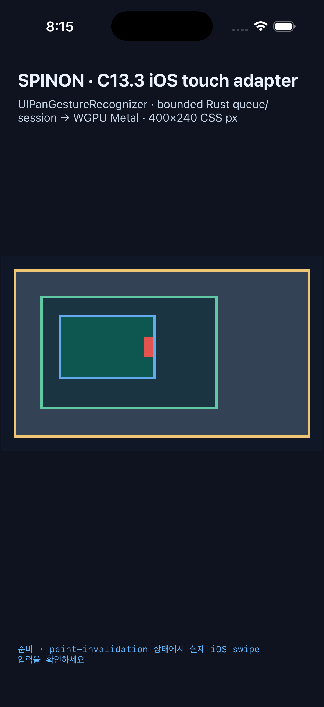
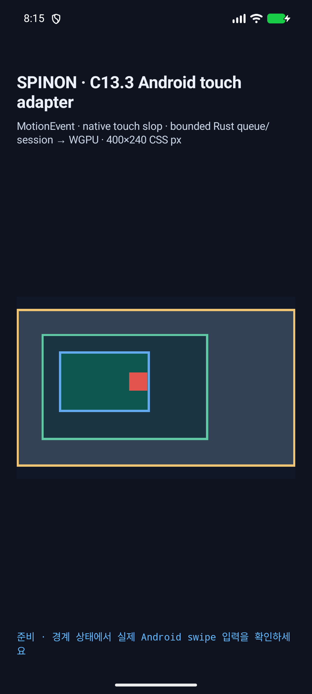

# C13.3 style invalidation · Android/iOS Simulator · 2026-10-15

## 입력 소스와 장치

- 캡처 시각: `2026-10-15T11:14:47.884Z` (KST 20:14:47.884).
- Matrix: [matrix.json](matrix.json), SHA-256 `44f09d66d25caefec19579a1a69f0b9f65f44d78d2825c9f996f4b0bee1baa15`.
- Source HEAD: `288d1dd467754a8d320b98e03b2e859ec86370cd`; 캡처 당시 tracked diff와 내부 evidence 제외 untracked source hash: `78396d8321ab8e3e288a0add48c7a3ea0f94aa1f6a1395441a0687e64bb46ae2`.
- 이 hash는 capture-time tree를 식별한다. 이후에는 artifact 검사 결과를 계획·상태·계약 문서에 반영했으며 런타임 source는 바꾸지 않았다.
- V8 revision: `7b50b62cb18f28617959e8452e2cd18195b38bcf`.
- iOS: iPhone 17 Pro, iOS 26.2 Simulator, UDID `ACA7BF91-E2D5-4CF7-909A-08D1AD95FF3D`.
- Android: API 37 ARM64 emulator `emulator-5554`, model `sdk_gphone16k_arm64`, 1080×2400, density 420.
- 두 앱은 `SPINON_ENABLE_C04_RUNTIME_GPU=1`, `SPINON_ENABLE_C13_3_GESTURE_FIXTURE_TEST=1`로 다시 빌드했다. build log는 [iOS](ios-build.log), [Android](android-build.log)다.

## 시나리오 결과

| 플랫폼 | 시나리오 | Revision·기하 결과 | 활성 gesture |
| --- | --- | --- | --- |
| iOS | 8 · style policy | document 55→56, tree 11→12, style 0→1, scroll 2→2, geometry 유지 | 현재 pan 지속, 새 policy epoch 1 사용, 다음 gesture는 `touch-action:none`으로 거부 |
| Android | 8 · style policy | document 55→56, tree 11→12, style 0→1, scroll 2→2, geometry 유지 | 현재 pan 지속, 새 policy epoch 1 사용, 다음 gesture는 `touch-action:none`으로 거부 |
| iOS | 9 · geometry | document 55→56, tree 11→12, style 0→1, scroll 2→3, range 변경 | 현재 gesture는 `GeometryChanged`; 새 gesture는 바뀐 geometry에서 시작 |
| Android | 9 · geometry | document 55→56, tree 11→12, style 0→1, scroll 2→3, range 변경 | 현재 gesture는 `GeometryChanged`; 새 gesture는 바뀐 geometry에서 시작 |
| iOS | 10 · paint | document 55→56, tree 11→12, style 0→1, scroll 1→1, geometry 유지 | paint 갱신 중에도 현재 pan 지속 |
| Android | 10 · paint | document 55→56, tree 11→12, style 0→1, scroll 1→1, geometry 유지 | paint 갱신 중에도 현재 pan 지속 |

각 결과에는 raw platform log와 실행 후 screenshot이 있고, matrix에는 process ID, 입력 batch 수, terminal 수, 중복 보고 수, screenshot 이름과 pixel 표본이 있다. 여섯 시나리오의 style-update 보고는 각각 1건이며 중복 보고는 0건이다.

## Paint와 border pixel 검사

CSS `(85,90)`의 inner content는 두 플랫폼 모두 `[23,37,58,255]`에서 `[14,86,80,255]`로 변했다. inner scrollport border 바깥 CSS `(200,100)`은 `[27,52,65,255]` 그대로였다.

| 플랫폼 | Screenshot 크기 | 이전 inner | 이후 inner | scrollport 바깥 |
| --- | --- | --- | --- | --- |
| iOS | 1206×2622 | `[23,37,58,255]` | `[14,86,80,255]` | `[27,52,65,255]` |
| Android | 1080×2400 | `[23,37,58,255]` | `[14,86,80,255]` | `[27,52,65,255]` |

## 재현·검증

- 캡처: `mise exec -- node tools/css-reference/capture-c13-3-style-invalidation-simulators.mjs --ios-udid ACA7BF91-E2D5-4CF7-909A-08D1AD95FF3D --android-serial emulator-5554`.
- [캡처 검증기](../../../../tools/css-reference/capture-c13-3-style-invalidation-simulators.mjs)는 log cardinality, revision/gesture 결과, exact pixel과 scrollport 밖 색 누출을 검사한다. 관련 JS suite는 8개 assertion을 포함한다.
- Rust workspace: 866 통과, 4 ignored, 0 실패. `spinon-ffi`의 `c13-3-gesture-fixture-test` feature suite: 45 통과, 2 ignored, 0 실패.
- `cargo clippy --locked --workspace --all-targets -- -D warnings`, `cargo fmt --all -- --check`, `git diff --check` 통과.
- CSS 사전 비교·캡처·fixture module boundary suite: 14 통과, 0 실패.
- [SHA256SUMS.txt](SHA256SUMS.txt)는 이 run의 matrix, build log, 시나리오 log, YAML 명령 기록과 screenshot을 묶는다.

결과는 고정 opt-in fixture의 시뮬레이터 관찰이다. Chrome parity, public DOM event/CSSOM, 실기기, hardware GPU, compositor/display scanout 이후 pixel, 기본 artifact 포함 또는 C13.3 전체 완료를 뜻하지 않는다. 기본 artifact 제외와 opt-in 양성 대조는 별도 [산출물 경계 기록](../artifact-boundary/README.md)에 있다.
