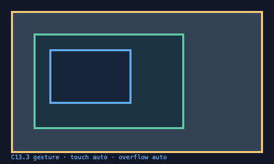

# C13.3 활성 gesture style invalidation 구현 전 비교

## 판정

고정 Chrome 155 Agent Browser fixture에서 안쪽 scroll owner의 Y 최댓값에서 직접 touch를 시작하고 두 개의 ordered `touchmove`를 보냈다. 대조군은 `overscroll-behavior-y:auto`를 유지했다. 비교군은 첫 move 뒤 같은 활성 gesture 중 `auto`에서 `contain`으로 바꾸고 두 번째 move를 보냈다. computed value는 `contain`으로 변경됐지만 Chrome은 같은 gesture의 남은 movement도 outer에 전달했다. 두 조건 모두 첫 move에서 outer Y=`15`, 최종 outer Y=`55`였다.

이는 Chrome의 observed browser behavior다. C13.3 내부 계약은 다음 revision-stamped delta sample부터 최신 `overscroll-behavior`를 사용하도록 정했으므로 둘은 다르다. 구현은 이 내부 fixture 계약을 따르고, Chrome 동작과 같다고 표시하지 않는다. 공개 CSS 적합성 또는 사용자에게 노출된 CSS 계약으로 확대하지 않는다.

## 실행과 산출물

- Chrome for Testing `155.0.8059.40`, WebKit revision `cfaadc5a132d78e1828635aa8405a499f3e14864`, Agent Browser `0.31.1`.
- Agent Browser가 연 고정 C13.3 fixture tab에서 CDP touch emulation (`400×240` CSS px, DPR 1, 최대 2 contact)을 썼다.
- capture: `mise exec -- bun tools/css-reference/capture-c13-3-style-invalidation-precomparison.mjs`.
- 재현 trace와 SHA-256: [Chrome oracle JSON](../../../../tests/fixtures/css/references/c13-3-style-invalidation-precomparison-v1.json).
- capture 결과를 읽는 회귀 확인: `mise exec -- bun test tools/css-reference/c13-3-style-invalidation-precomparison.test.mjs`.
- 시작 화면: .

## 관찰값

| 단계 | auto 대조 | active style mutation |
| --- | ---: | ---: |
| 시작 inner offset | `(0,106)` | `(0,106)` |
| 첫 move 뒤 outer Y | `15` | `15` |
| 두 번째 move 뒤 computed overscroll Y | `auto` | `contain` |
| 최종 outer Y | `55` | `55` |
| 최종 inner Y | `106` | `106` |

## 한계

이 capture는 Chrome oracle다. Spinon FFI/runtime, native app, Android/iOS Simulator를 검증하지 않았다. Chrome이 같은 gesture 중 overscroll policy 업데이트를 반영하지 않은 결과를 내부 C13.3 계약의 기대값으로 복사하지 않는다. geometry-changing style mutation의 gesture cancel은 별도 내부 불변 조건이며 이 browser fixture가 증명하지 않는다.
