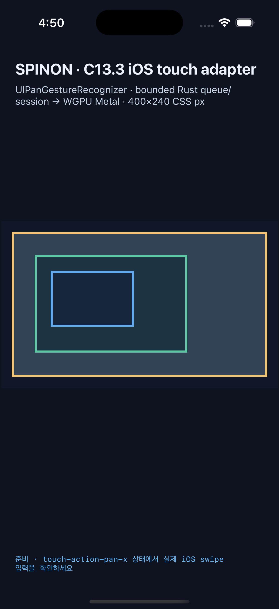
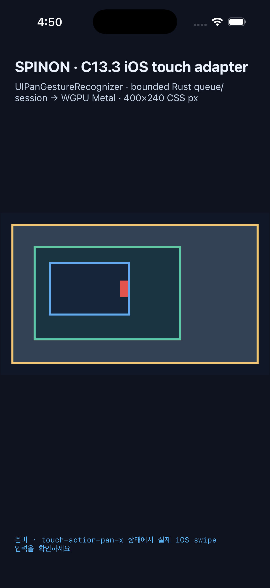
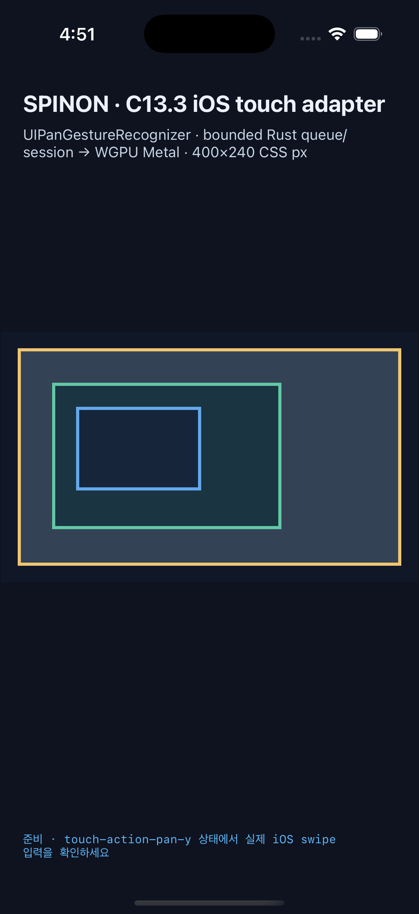
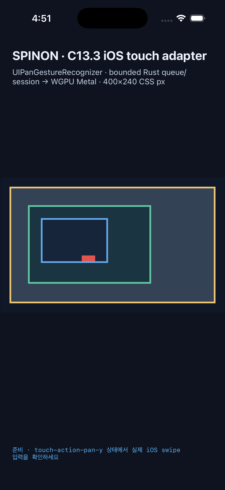
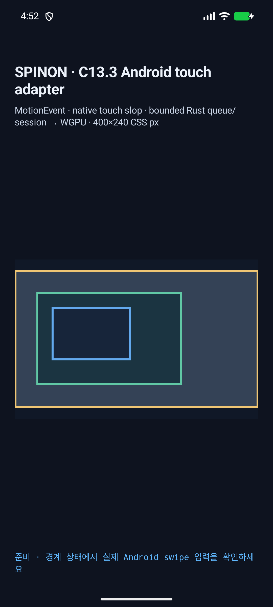
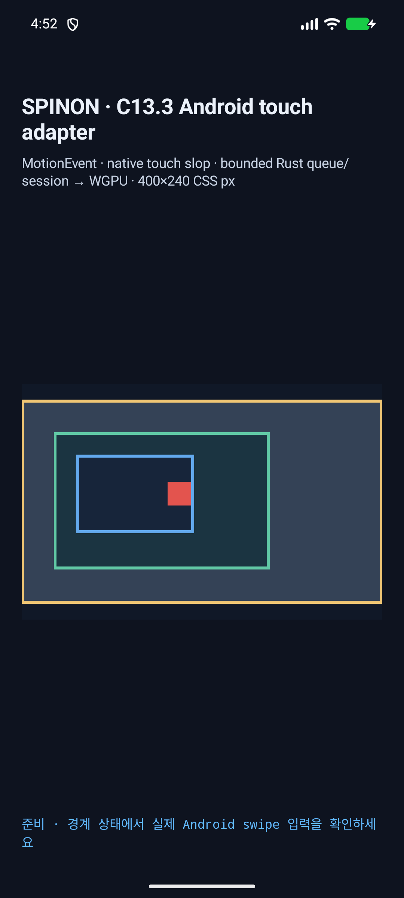
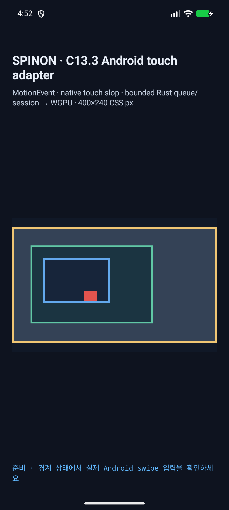

# C13.3 touch-action 방향별 시뮬레이터 행렬

## 판정

고정 400×240 CSS px C13.3 fixture에서 Android API 37 ARM64 AVD와 iPhone 17 Pro/iOS 26.2 Simulator 각각 수평·수직 swipe 10개를 실행했다. 20개 중 허용 방향 6개는 inner owner만 움직였고, 제한 축·`none`·조상/자식 교집합이 빈 14개는 scroll revision과 모든 offset을 유지했다. C13.3 전체나 공개 CSS 지원 완료를 뜻하지 않는다.

| 플랫폼 | `pan-x` 수평 | `pan-x` 수직 | `pan-y` 수평 | `pan-y` 수직 | 자식 `pan-x` 수평 | 자식 `pan-x` 수직 | 나머지 4개 `none` swipe |
| --- | --- | --- | --- | --- | --- | --- | --- |
| iOS 26.2 Simulator | inner x `37.3333`, rev 27 | 거부, rev 0 | 거부, rev 0 | inner y `41.3333`, rev 28 | inner x `37.3333`, rev 27 | 거부, rev 0 | 모두 거부, rev 0 |
| Android API 37 ARM64 AVD | inner x `49.8836`, rev 14 | 거부, rev 0 | 거부, rev 0 | inner y `48.8780`, rev 16 | inner x `44.3519`, rev 15 | 거부, rev 0 | 모두 거부, rev 0 |

허용 6개 모두 root와 outer offset은 `(0,0)`이다. 거부 14개는 inner/root/outer offset과 `ScrollStateRevision`이 모두 0을 유지했다. 각 raw case log에는 실제 CSS policy, native input, 처리 결과와 terminal sequence가 있다.

## 시뮬레이터 화면과 경계

수평·수직으로 이동하는 빨간 marker를 따로 두어 허용된 축의 scroll을 화면에서도 확인한다. 두 marker 모두 swipe 전에는 보이지 않고, swipe 뒤에는 blue inner border 안에서만 나타난다. Pillow 11.3.0 exact RGB scan에서 각 화면의 moved marker bbox가 inner border bbox 안에 있었고, outer/root marker pixel은 0이었다. 수평·수직 화면의 변경된 system status/home-indicator pixel은 이 판정에 포함하지 않았다.

### iOS 26.2 Simulator · 수평

Before: 

After: 

### iOS 26.2 Simulator · 수직

Before: 

After: 

### Android API 37 ARM64 AVD · 수평

Before: 

After: 

### Android API 37 ARM64 AVD · 수직

Before: 

After: 

<a href="./pixel-analysis.json">Pillow pixel analysis</a>는 exact blue border `#63a9ed`, red scroll marker `#e3544e`, 화면 크기와 각 pixel bbox를 기록한다. 분석기 코드는 `tools/css-reference/analyze-c13-3-touch-action-simulator-matrix-pixels.py`에서 확인할 수 있다.

## 재현 환경과 실행

- iOS: 임시 iPhone 17 Pro Simulator, iOS 26.2, UDID `5BCC297F-A234-4B9D-88D4-14485AD92D06`, scale 3.0.
- Android: `emulator-5554`, `sdk_gphone16k_arm64`, API 37, `ro.kernel.qemu=1`, 1080×2400, density 420, fixture surface scale 2.625. 연결된 실기기는 사용하지 않았다.
- iOS 입력은 Maestro 2.5.1 500ms swipe, Android 입력은 `adb shell input touchscreen swipe` 500ms다.
- 재현: `mise exec -- node tools/css-reference/capture-c13-3-touch-action-simulator-matrix.mjs --ios-udid 5BCC297F-A234-4B9D-88D4-14485AD92D06 --android-serial emulator-5554`
- 픽셀 확인: `python3 tools/css-reference/analyze-c13-3-touch-action-simulator-matrix-pixels.py` (Pillow 11.3.0).
- <a href="./ios-build.log">iOS opt-in build log</a>, <a href="./android-build.log">Android opt-in build log</a>, <a href="./matrix.json">통합 matrix</a>, <a href="./pixel-analysis.json">pixel analysis</a>.
- Capture time `2026-10-15T07:50:20.039Z`; base commit `1d1e54144ba49ee3893447c6b0c61c9285b24ff6`; capture-time tracked worktree diff SHA-256 `e47cc31e63462d9e6cfd8083805df746d768f7d11640588b44553308d8558e78`.
- iOS app tree SHA-256 `1a2d929fbe8a91516e8f187b2736ecc2ad065fcb918366dafef6758dc52edde1`; Android APK SHA-256 `40ae77fe1ae370e1244b10a06ee8cbbf303a9b8bcdea6d1ada57103909e39990`. Matrix SHA-256 `f317cb30162c267f35032a45496f47722ebd585bf8b377dbe1d2f21d90a7478f`.

## 발견한 결함과 수정

UIKit `UIPanGestureRecognizer.state == .began`에서 translation `(0,0)`을 전달했다. 그 시점에 축을 결정하면 `pan-y` swipe가 수평으로 오판될 수 있었다. 첫 nonzero translation을 일반 Move로 넣는 경로도 `PanStarted` snapshot을 플랫폼에 게시하지 않고 다음 sample에서 외부 revision 취소를 일으켰다. iOS adapter는 zero translation 시작에서 pan 입력을 대기하고, 첫 nonzero `.changed`를 `PanBegan`으로 queue에 넣는다. Rust session은 zero `PanBegan`을 상태·revision 변경 없이 받아들이며 실제 nonzero sample에서 축을 고정한다. Android의 slop 이후 nonzero `PanBegan` 경로는 유지했다.

`cargo test --locked -p spinon-render scroll_gesture_session`은 수정 후 19/19 통과했다. 최종 앱 빌드와 통합 20-swipe 행렬, exact-color marker 분석도 통과했다.

## Fixture artifact 경계

<a href="./fixture-artifact-boundary.txt">기본/opt-in artifact 대조</a>는 default `spinon-ffi` 아카이브에서 C13.3 FFI 함수와 고유 fixture JS 표식이 없고 opt-in 아카이브에는 모두 있는지 확인한다. 기본 아카이브 SHA-256은 `f8d4765667356353840ef2b5e577f4210155642d5511d0a68efe4869ec4d8c8c`, opt-in 아카이브는 `d0a62a8217b79af2bbc67054dba60df9c0d813e64050145455f079d325b375ea`다.

## 문서 생성 경계

저장소 전체 `mise exec -- bun run docs:build`는 이 변경과 무관한 기존 문서의 dead link/dead image와 Shiki 언어 태그 오류로 실패한다. 실패 진단에 이 행렬 README나 구현 검토 파일은 남지 않도록 PNG를 실제 이미지로 삽입하고 raw evidence 파일은 정적 링크로 연결했다. Tailscale 확인에 필요한 STATUS, C13.3 계획·계약, 행렬 README와 구현 검토 페이지는 Rspress `2.0.22`의 격리 입력으로 생성했다. 해당 임시 preview build는 기존 저장소 링크 전역 검사를 끈 렌더 확인이며 저장소 전체 문서 빌드 통과로 해석하지 않는다.

## 회귀 검증

- `cargo test --locked --workspace` — 864 passed, 0 failed, 4 ignored (<a href="./workspace-test.log">log</a>).
- `cargo clippy --locked --workspace --all-targets -- -D warnings` — 통과 (<a href="./workspace-clippy.log">log</a>).
- `cargo clippy --locked -p spinon-ffi --all-targets --features c13-3-gesture-fixture-test -- -D warnings` — 통과 (<a href="./ffi-opt-in-clippy.log">log</a>).
- `cargo test --locked -p spinon-render scroll_gesture_session` — 19/19 통과 (<a href="./render-session-focused-test.log">log</a>).
- `cargo test --locked -p spinon-ffi --features c13-3-gesture-fixture-test c13_3` — 2/2 통과 (<a href="./ffi-opt-in-test.log">log</a>).
- `mise exec -- bun run test:css-reference` — 447/447 통과 (<a href="./css-reference-test.log">log</a>).
- `mise exec -- bun run test:js` — 2/2 통과 (<a href="./js-test.log">log</a>). `cargo fmt --all -- --check`, 새 capture/fixture JavaScript와 Python 문법 검사, pixel analyzer 실행(<a href="./pixel-analysis-check.log">log</a>)과 `git diff --check`도 통과했다(<a href="./final-source-checks.log">source checks</a>).

[구현 실패 관점 검토 20개](implementation-review-20.md) · [PR #187](https://github.com/ohah/spinon/pull/187) · [PR 변경 관점 검토 20개](pr-delta-review-20.md). `gh pr checks`는 현재 보고된 항목이 없으며, main은 선형 이력을 요구한다. GitHub 검사 결과와 merge 상태는 simulator/local 검증과 구분한다.

## 남은 범위

이 결과는 opt-in fixed-fixture의 단일 pointer native swipe만 다룬다. iOS 실제 multi-touch, pan 전 tap/click activation, wheel/trackpad, style/layout invalidation, root/body 특수 전파, S04.10 displayed-frame hit targeting, S05.2 public events, WPT, compositor 이후 scanout, 실기기와 hardware GPU는 검증하지 않았다. 상위 C13.3은 계속 미완료다.
