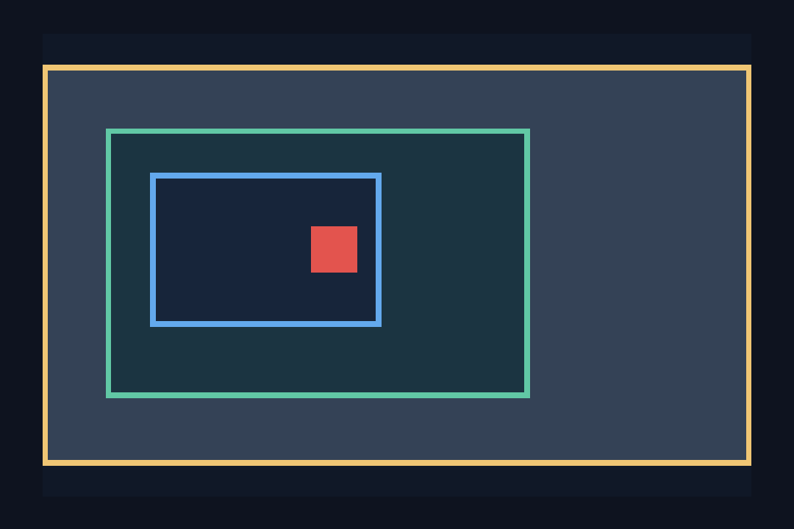
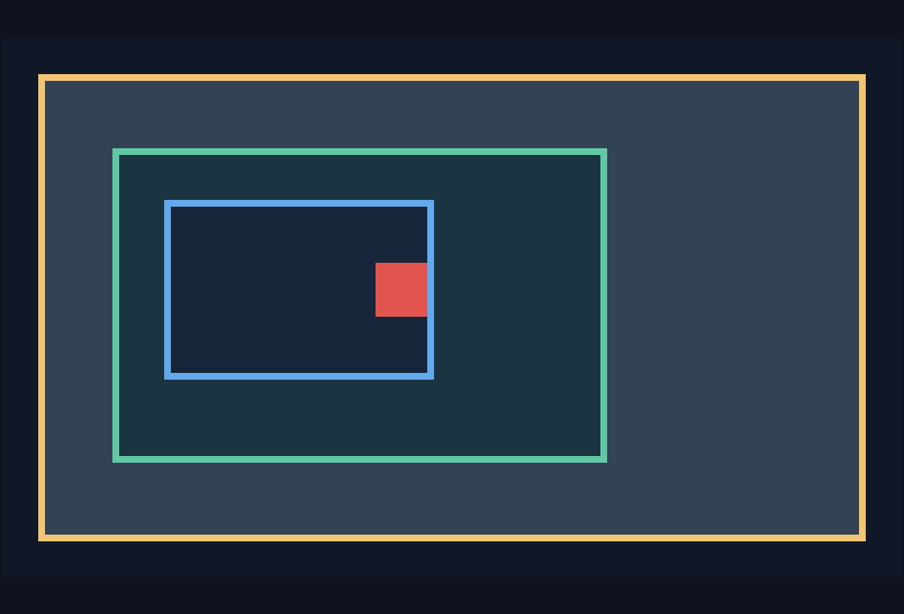

# C13.3 `touch-action` native tap arbitration · 2026-10-15

## 범위와 판정 기준

검증 범위는 `c13-3-gesture-fixture-test` opt-in 앱의 고정 400×240 CSS px 장면과 scenario 3 `touch-action:none`, scenario 4 `touch-action:pan-x`다. tap 좌표는 `(148,132)` CSS px다. pan-x에서는 같은 좌표에서 tap한 뒤 왼쪽 수평 swipe를 native slop보다 크게 실행한다.

- 두 scenario의 tap은 플랫폼 native activation을 정확히 한 번 만들고 `ScrollStateRevision` 및 root/outer/inner offsets를 바꾸지 않아야 한다.
- pan-x의 후속 swipe는 native slop 뒤 inner X offset을 움직이고 Y, outer, root offset은 유지해야 한다. swipe 뒤 추가 tap activation은 없어야 한다.
- Android `View.OnClickListener`와 iOS `UITapGestureRecognizer` recognition만 세며 public DOM `click`, Pointer Events, WPT 적합성은 주장하지 않는다.
- fixture flag가 없는 기본 artifact에는 C13.3 FFI symbol과 fixture payload가 없어야 하며 opt-in artifact에서는 양성 대조가 있어야 한다.

## 실행 환경과 결과

| 대상 | 장치와 빌드 | `none` tap | `pan-x` tap 및 후속 swipe |
| --- | --- | --- | --- |
| Android | Android 17 / API 37, ARM64 AVD `spinon_api37_1_compat16k`, `emulator-5554`, 1080×2400, density 420 | activation 1, revision 0, 모든 offset 0 | activation 1 유지, slop 21 physical px 이후 revision 26, inner X `59.468376` CSS px, Y/outer/root 0 |
| iOS | iPhone 17 Pro Simulator / iOS 26.2, UDID `ACA7BF91-E2D5-4CF7-909A-08D1AD95FF3D`, scale 3 | activation 1, revision 0, 모든 offset 0; pan recognizer 비활성 | activation 1 유지, UIKit pan `.began`, revision 29, inner X `49` CSS px, Y/outer/root 0 |

Android log에서 pan 이후 `up_candidate=false activation_count=1`을 확인했고 `unexpected_click=true`는 0건이다. iOS의 pan-x tap은 pan recognizer가 실패한 상태에서 한 번 인식됐다. 이어진 swipe는 pan recognizer가 시작됐으며 tap recognizer 추가 인식은 없었다. 두 플랫폼 모두 screen coordinate와 CSS 좌표 변환을 runtime log로 대조했다.

### 화면

아래 이미지는 full-screen 캡처에서 C13.3 scrollport 주변만 잘라 PR 본문에서 동작을 바로 볼 수 있게 한 preview다. 원본 전체 화면도 함께 보존했다.





- [Android full-screen 캡처](android-pan-x-after-swipe.png) · [Android `none` tap 후](android-none-after-tap.png)
- [iOS full-screen 캡처](ios-pan-x-after-swipe.png) · [iOS `none` tap 후](ios-none-after-tap.png)

## 앱 및 artifact 근거

- 실행 manifest: [run.json](run.json). source tree 기준 commit은 `a65b5bf3136b9240df716ebd010e24e602cd9850`이며 manifest에 플랫폼별 binary hash, simulator 정보와 CSS/native 좌표가 기록돼 있다.
- opt-in Android APK SHA-256: `d4e0332e0a3a94d73d79f808eb5c6c084b496c097a61a055a0edf9cfab9d63de`. 추출한 ARM64 library SHA-256: `d00629afe154292d1982ae03cf1caf571132e9222d75b1893fe83e34b7413c37`.
- opt-in iOS app tree SHA-256: `525482676337bb7cf9e6116304eb64d1fd1ab7f7c15eb6b3eb8595dc5f591825`.
- fixture-off Android APK SHA-256: `1937ef9b0c2ba147f4635f9036f918635865057a94a200382f8521b1e00a003f`; 추출한 ARM64 library에서 C13.3 gesture exports와 `%c13_3_gesture_fixture=ready` payload를 찾지 못했다. [기본 빌드](android-default-final-build.log) · [artifact 검사](android-default-artifact-boundary-final.log).
- fixture-off iOS app tree SHA-256: `bdbf7da2beda087083a88e74e2f5e42deaa930c7445aac0765bc23e5fbfeae09`; executable SHA-256: `0d8d277e3af8dc8f40c546d5ac003909715555be3520064a67d9570a1dcc9829`. C13.3 gesture exports와 fixture payload가 없고 default-disabled diagnostic만 있다. [기본 빌드](ios-default-final-build.log) · [artifact 검사](ios-default-artifact-boundary-final.log).
- opt-in positive control: Android [artifact 검사](android-opt-in-artifact-boundary-final.log)와 iOS [artifact 검사](ios-opt-in-artifact-boundary-final.log)에서 four C ABI exports와 fixture payload를 확인했다.

## 수정 중 드러난 실패와 보정

첫 Android 좌표 주입은 UIAutomator가 반환한 clipped `SurfaceView` accessibility bounds를 전체 view의 왼쪽 경계로 사용해 실제 tap보다 약 16.6 CSS px 어긋났다. 캡처 도구는 view/texture 크기와 symmetric clipping으로 full origin을 복원하고, 주입 좌표·runtime screen point·surface local point를 서로 대조하도록 바꿨다. 최종 로그는 `(148,132)` CSS px와 실제 native 좌표의 일치를 확인한다.

좌표 보정 뒤 Android에서 native pan을 시작한 swipe가 clickable `SurfaceView`의 두 번째 `OnClickListener`를 호출하는 실제 결함을 재현했다. native slop을 처음 넘은 move에서 pressed 상태와 long-press callback을 취소하고 나머지 touch stream을 click 경로에 전달하지 않도록 고쳤다. 최종 pan-x run은 tap activation을 1회만 기록한다.

## 재현과 한계

이 변경 문서와 evidence page는 임시 Rspress root에서 렌더링했다. 저장소 전체 `mise exec -- bun run docs:build`는 현재 이 작업과 무관한 기존 C11/S04 문서의 dead link/image 오류로 실패했다. 전체 문서 오류를 이 작업에 섞지 않았고, 변경 문서와 필요한 이미지로 격리한 Rspress 2.0.22 렌더링을 통과시켰다. [전체 build log](docs-build.log) · [첫 isolated render log](docs-build-targeted.log) · [최종 isolated render log](docs-build-targeted-pr.log).

```sh
SPINON_ENABLE_C04_RUNTIME_GPU=1 \
SPINON_ENABLE_C13_3_GESTURE_FIXTURE_TEST=1 \
  mise exec -- bun run build:android

SPINON_ENABLE_C04_RUNTIME_GPU=1 \
SPINON_ENABLE_C13_3_GESTURE_FIXTURE_TEST=1 \
  mise exec -- bun run build:ios-sim

mise exec -- bun tools/css-reference/capture-c13-3-touch-action-tap-arbitration.mjs \
  --ios-udid ACA7BF91-E2D5-4CF7-909A-08D1AD95FF3D \
  --android-serial emulator-5554
```

고정 simulator와 opt-in fixture만 검증했다. 실기기, hardware GPU, compositor 이후 scanout, iOS multi-touch, public DOM event, 제품 전체 CSS/policy 행렬은 이 결과로 판정하지 않는다. C13.3 전체는 미완료다.

검토 기록: [구현 실패 관점 20개](implementation-review-20.md) · [PR 변경 적대적 검토 30개](pr-delta-review-30.md) · [구현 전 계획 검토 20개](../c13-3-touch-action-tap-arbitration-plan-review-20-2026-10-15.md).
